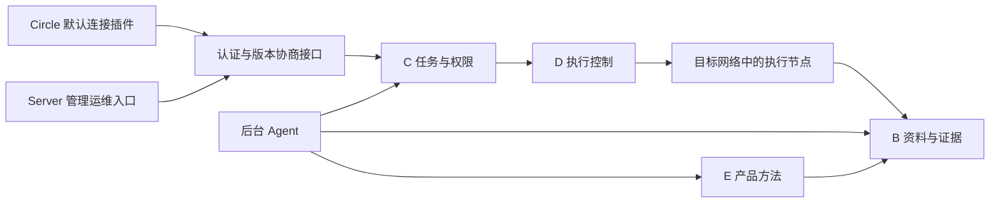

# B/C/D/E 怎样在 Circle Server 中一起工作

> **历史文档**（2026-10-21 标注）：本文是 2026-10-11 为已退役服务器写的融合提案，已被 [Hub r4 简报](hub-r4-brief.md)和[通用模型](design/generic-model.md)取代，只作记录保留。

2026-10-11。状态：**融合提案，未实施、未排期**。沿用已确认的客户端/server 分工、知识库边界和 PostgreSQL 持久任务决定。[开源基础检查](open-source-readiness.md)已通过，用户已确认 MIT 和归档公开权利；仓库仍为私有，尚未执行可见性变更。

## 用户最终得到什么

用户在 Circle 默认插件库启用 server 连接插件，填写地址并登录。之后仍在熟悉的会话里提出工作，例如“检查这条业务为什么间歇失败”。平台保留目标产品、版本、业务路径、调查步骤和证据；Circle 关闭或网络断开后，受理的工作继续保存在 server，重连可以找回。

任务需要读资料时调用 B；安排步骤、等待人回应或决定交付时由 C 记录；连接设备、运行工具和采集现场时由 D 执行；选择产品方法、解释结果和判断下一步时使用 E。四者进入同一个后台协作，起步按模块划分，暂不为每个对象建设一个独立服务或独立仓库。

普通用户的入口仍是 Circle。server 有常驻后台、执行节点及自己的管理运维入口；管理端可复用经核验的 Circle 桌面基础，后台可运行在没有图形桌面的主机。关闭管理窗口不停止后台。不另建 Web 管理站点；HTTP 接口和产品 Web 的现场显示仍需要保留。

## 什么状态放在哪里

| 对象 | 正式模块负责什么 | 已有参考 | 融合时必须补齐什么 |
|---|---|---|---|
| B：知识、证据与制品 | 产品资料修订、检索范围、原件、现场证据、输出制品及引用 | [knowledge](../references/platform/snapshot/packages/knowledge/src/index.ts)、[registry](../references/platform/snapshot/packages/platform/src/registry.ts) | 参考主要是内存记录；正式存储、原件访问权限、派生结果范围、保留和导出需补齐 |
| C：任务、权限与协作 | 受理、输入修订、阶段推进、人工回应、授权委托及交付检查 | [PostgreSQL 任务服务](../references/platform/snapshot/packages/platform-pg/src/service.ts)、[tasks](../references/platform/snapshot/packages/platform/src/tasks.ts) | 可信身份接入、任务恢复、事件补读、人员/服务权限和版本化数据库迁移 |
| D：实际执行与资源 | 操作记录、执行节点、资源租约、SSH/浏览器会话、观察与接管 | [控制面](../references/platform/snapshot/packages/execution/src/control-plane.ts)、[执行参考](../references/platform/by-object/D.md) | 操作与租约持久化、worker 身份与隔离、真实 SSH driver、结果不明时的核对、远程现场显示 |
| E：专业方法与规则 | 适用产品/版本、确定规则、模型分析、方法验证与发布 | [问答/评审/编译参考](../references/platform/by-object/E.md) | 正式能力包、适用范围、模型方法身份、独立样本、专业方法的修改/使用/发布权限 |

身份与策略由 C 统一管理；B 查询原件、D 实际执行、E 方法使用和发布仍各自执行权限检查。租约只协调资源占用，不能授予操作权限。运维能维护服务，不自动获得所有资料、设备口令或生产操作权。

A 是交互和 Agent 运行职责。服务端后台 Agent 可以复用选定 Circle 内核，但会话历史不能代替 C 的任务，Circle JobRegistry 不能代替 D 的操作账本，个人 SQLite 不能代替企业持久任务。

F 是共用契约，G 是验证。MCP、HTTP、CLI、skill 和插件用于连接或暴露能力，不拥有另一份 B/C/D/E 状态。

起步建议一个 PostgreSQL 承担元数据、任务和操作记录，各模块只通过明确接口修改自己的记录。B 的原件通过独立存储接口保存，先确定原字节、摘要、权限和恢复要求，再选择本地或对象存储；检索索引可以重建，不承担事实记录。C 的运行继续使用已确认的 [PG 任务表基线](../references/platform/snapshot/docs/decisions/0022-durable-runtime-selection.md)。

## 对象之间怎样传递工作

同一条工作需要关联项目、产品与版本、输入修订、`taskId`、`operationId`、执行节点、目标、方法版本及证据。记录的 ID 不混用；用户会话可以显示多个任务，任务也可以跨多个执行会话继续。

起步在后台内部使用受控模块接口，并由持久事件让重启后能够继续。C 接受任务及待发送事件在同一事务中落地；D 接受操作后记录自己的操作身份；worker 回报由 D 核对身份、租约和版本，再保存实际执行状态。B 登记原始输出，E 的判断引用这些记录，C 按交付要求决定是否完成。通知丢失时依靠重读和核对，不能把事件回调当作强制检查。

每个调用使用服务端从认证会话产生的身份及作用范围。请求里的账号、角色、项目或审批人只能作为待校验输入，不能自报身份。幂等范围包含项目、人员、动作与请求内容；跨项目重复键、同键不同内容及并发回应要有独立失败样本。

数据库内重复推进可以通过事务与唯一约束保护。对设备的副作用没有通用“恰好一次”保证：SSH/Web 请求超时后，D 先查原操作和现场；无法确认时保持结果不明，限制冲突写入，不能为了让任务变绿而再次发送。

## 先打通怎样的一条用户流程

第一条故事采用合成产品和固定资料，验证“用户要求检查某配置是否符合对应版本说明”。它把四对象串起来，不需要先连接真实设备：

1. Circle 插件登录，展示获准项目；用户提交自然语言任务及已有目标信息。信息不足时，后台询问必要输入，C 保存回应及修订。
2. C 持久受理任务，返回可重查的任务 ID。同一请求重发不会形成第二份工作。
3. 后台 Agent 通过 B 取得被授权的固定资料修订，经 E 选择适用检查；D 的合成执行节点产生配置观察，B 保留原输出。
4. 确定字段比较交给脚本。需要语义解释的内容由 LLM 判断或明确等待后续评测；模型结论与脚本结果分别记录，缺证据可以弃权。
5. 用户在 Circle 看到当前步骤、实际输入输出、证据和未知项。若确需人工决定，由 C 绑定本次输入、目标和动作保存；输入变化使旧决定失效。
6. C 核对当前交付项后交付。关闭 Circle、重启后台再重连，用户仍能查询原任务及原证据。

第一批开发检查使用脚本模型，不把脚本模拟语义判断宣称为 LLM 准确率。真实模型评测与真实产品检查分别建立样本、预算、环境及验收记录。

## 旧实现怎样采用

冻结原件继续保留，正式模块在新目录开发。采用清单记录源文件、来源提交、采用的行为、修改、全部调用方和新验收；不从生产入口直接 import 归档目录。将来建议的目录如下，本轮不创建这些应用目录或依赖：

| 建议位置 | 用途 |
|---|---|
| `apps/server` | 常驻后台、认证 API、后台 Agent 接入 |
| `apps/worker` | 执行节点及目标连接 |
| `apps/admin` | server 专用管理入口；桌面基线核验后确定 |
| `packages/contracts` | 协议、状态身份和版本兼容的单一原件 |
| `packages/knowledge` | B 的正式模块 |
| `packages/tasks` | C 的正式模块 |
| `packages/execution` | D 的正式模块 |
| `packages/methods` | E 的正式模块与产品能力包接口 |
| `tests/acceptance` | 跨模块、客户端与 worker 的独立验收 |

Circle 的默认连接插件留在 Circle 仓库。协议契约在 server 的 F 中维护；插件记录所采用的版本和摘要，生成或薄适配，不手工维护第二套 schema。新公共包及具体生成方式待首条故事核验，不另建 connector 或 core 仓库。

当前已经发现四个不能直接照搬的地方：

- [server-stub HTTP](../references/platform/snapshot/packages/server-stub/src/http-server.ts)用于协议实验，没有正式身份认证，请求体也没有生产级限制。不能改个名字就成为公开 server API。
- [PG 参考服务](../references/platform/snapshot/packages/platform-pg/src/service.ts)的调用参数包含项目、人员和审批人，它不是认证入口。正式调用必须由可信身份绑定；尤其核对幂等记录的跨项目范围以及审批人不能冒用。
- [ScriptedAssessor 第 92–99 行](../references/platform/snapshot/packages/assessor/src/index.ts#L92)在只有引用、没有可比值时会返回 supports。这个分支不能用于通用事实判断；正式能力必须限定规则范围，并对未确定内容使用 LLM 判断或保留未知。
- [llm-assessor bridge](../references/platform/snapshot/packages/llm-assessor/src/budget.ts#L86)依赖本机 Python 桥接。它留作评测来源，正式 provider 接入需要 TS 实现、预算、秘密通道及输入输出记录。历史 V04 语义评测未达标，不能用旧评测说明新方法已经可靠。

D 的控制面与 B 的知识记录还使用内存 Map；参考中的重启场景不自动证明新的分布式 worker 和持久存储已可恢复。前端 preview 的角色与插件启停也不是服务端授权。

## 分阶段交付

每个阶段以用户可观察的行为验收。下表是建议顺序，不承诺时间，也不把旧 P1/P2/P3 的测试数字带入新 server。

| 阶段 | 用户得到什么 | 完成前必须看到的证据 |
|---|---|---|
| S0 开源与采用准备 | 公开范围、许可和来源清楚，知道项目当前能做什么 | 许可/权利确认；最终提交及可达历史复查；第三方范围；参考采用清单；安全报告渠道 |
| S1 首条四对象流程 | Circle 连上 server，提交合成任务，后台继续并返回可打开的证据 | 真实认证接口；四模块共同参与；重复提交、跨项目拒绝、原件权限、事件补读、后台/客户端重启恢复；脚本模型范围明确 |
| S2 SSH 与执行节点 | 在获准网络位置连接目标，看到同一终端现场，观察或接管各自授权 | worker 身份；跳转链与目标身份；PTY 原字节/分页；租约失效、权限撤回、连接中断；远端停止及效果由独立观察核对 |
| S3 产品 Web 与人工协作 | 看 agent 操作的同一浏览器；需要时接管并继续 | 页面流与执行会话身份一致；凭据不进提示词；查看/控制分权；短期访问；断线、登录失效、MFA、接管冲突及进程恢复 |
| S4 复杂网络调查与产品方法 | 沿业务路径定位问题，说明已证实原因和下一步 | 固定故障与独立观察点；物理到应用层的场景矩阵；产品/版本适用范围；反例、证据冲突与模型准确度分别评测 |
| S5 运维和兼容发行 | 管理人员、资料、能力包与执行节点，升级后保留在途工作 | 分权、备份恢复、排空 worker、审计；新旧 Circle/server/worker 组合；在途审批、流程版本、迁移与回滚；制品摘要与实测兼容清单 |

基础管理能力从 S1 起随功能加入，不能直到 S5 才补授权。S5 补完整运维和发行流程。

S2 只考虑 SSH，不重新加入 console/串口。优先调查只读路径；需要变更时使用已冻结的具体作用范围。目标身份或主机密钥变化必须在执行端阻止失效动作，不能只在界面提示。

S3 的浏览器由 D 持有。Circle 内嵌显示或外部 Chrome 都连接同一获准会话；不把原始 CDP/SSH 调试端口公开给用户。用户自己的另一个登录页面不能冒充 agent 现场。

S4 按故障扩展，不一次实现“全部网络能力”。从观察点与业务路径开始，逐批覆盖链路状态、VLAN/邻居、路由与回程、DNS、TCP、TLS/SNI、HTTP、代理及产品转发。每项说明采集来源、时段、目标和可排除的原因；没有流量或产品证据时保留未知。FAMX/负载均衡用于首批验证，产品接口不限定于这一条产品线。

## GitHub 与敏捷开发怎样推进

跨仓库规划只保留归档中的历史记录；公开快照不携带私有项目面板或 Issue 关联。server 的融合规划项保持待规划、未排期，实施故事逐项拆分；Circle 的默认插件任务在 Circle。许可证和公开范围未完成前，不向公开 Circle Issue 写入私有材料。

首个 Sprint 候选是 S1 的合成故事。进入 Sprint 前，固定输入、独立预期、模块调用者、权限拒绝场景和完成条件，再估算与选取工作量。任务受理、证据保存、执行节点、产品方法、插件接入相互依赖；不能只按四个对象各做一个完成率。

每条故事经过设计、实现、独立验证、评审和组合验收。代码合并、功能验收与发布分开记录。新 server 的功能验收以当前提交和实际作用为准；旧参考通过不转移为新模块通过。所有新自维护代码使用 TypeScript。

Circle 与 server 独立版本发布；插件随 Circle 交付。实际兼容清单固定 Circle、插件修订、server/API、worker、方法包、数据库及构建摘要。共同 Circle 代码从固定来源通过同步 PR 更新；通用修复用干净公开分支回流，私有历史或业务材料不进入 Circle PR。

这轮只发布检查和规划，没有建立生产目录、安装依赖、实现 API/插件、启动验证服务或部署。
