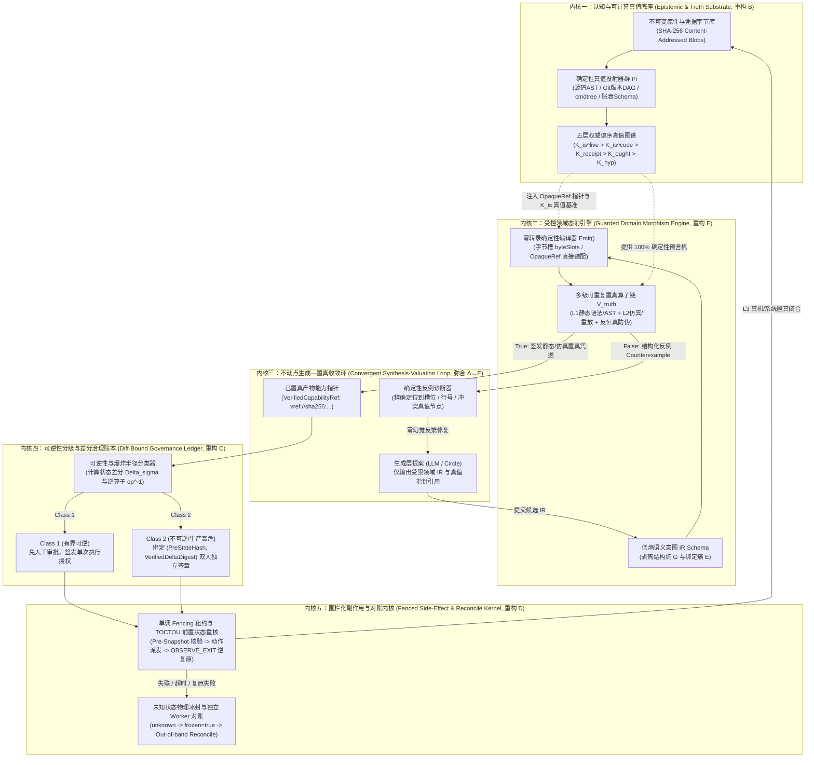

# 置真对接架构：对既有平台设计的批判与企业级 Agent 理论重构

本文对 Circle 平台演进过程中形成的既有设计规范（`B/C/D/E` 四对象五要素矩阵、`hub-execution-transition/1` 纯确定性状态机、`harness-primitives` 四原语与五固定钩子、`approvals-and-enforcement` 变更集单一审批教条，以及早期 `knowledge-v1` 的概率评估模型与闭合世界 Excel 编译理论）进行系统性的自我批判与反驳，并在此基础上确立平台真正的底层理论与核心架构。

本文不讨论行业通识（通用多智能体编排、提示词工程、向量检索切片、常规 RBAC 权限或 MCP 协议包装），只论述我们在四代工程演进与真实生产事故中淬炼出的独创理论与架构定式。

---

## 一、第一性原理：不可逆代价下的「生成—转换—置真」三元矛盾

消费级 Coding Agent 建立在**低成本试错假设（Low-Cost Trial-and-Error）**之上：模型直接修改文件、运行本地命令，出错后擦除重来。但在严肃的企业级生产场景中——无论是向共享硬件测试床下发配置并编译交付件、财务系统核算报表与记账凭证、核心网络设备变更生产策略，还是在数十个客户维护分支上定位缺陷并合入补丁——这一假设完全破产。

企业级 Agent 落地的核心物理约束只有一条：**下游目标系统对幻觉零容忍，且任何错误一旦穿透到生产系统或正式交付物，其代价是巨大的、级联放大的、甚至不可收回（不可逆）的。** 财务写错一个数、产品配置下发错一条指令、源码补丁合错一个版本分支、测试交付件漏写一行清场命令，本质上是同一个物理问题。

在这一约束下，企业级 Agent 平台的真正核心矛盾绝不是“如何连接更多工具”或“如何登记更多资产”，而是如何解决以下**三元结构的耦合与博弈**：

1. **概率性生成端（Stochastic Generation, $\mathcal{S}_{\text{gen}}$）**：大语言模型负责处理非结构化的人类意图、开放域业务需求与跨模态上下文，其输出在数学上必然是概率性的（$\sim P_\theta(y \mid x)$），且其自回归 Token 通道本质上是一个**有损信道（Noisy Channel）**。
2. **现有代码与系统的可重复性置真端（Repeatable System Ground-Truth, $\mathcal{O}_{\text{sys}}$）**：企业现有的源码 AST、Git 版本提交图、设备命令树（`cmdtree`）、数据库 Schema、财务勾稽恒等式、沙箱编译器与真实物理设备，构成了 **100% 确定、可重复验证的真值预言机（Ground-Truth Oracles）**。
3. **中间的转换、零转录对接与认知存储层（Intermediate Transformation, Zero-Transcription Docking & Epistemic Storage, $\mathcal{I}_{\text{trans}} \bowtie \mathcal{K}_{\text{store}}$）**：如何将 LLM 的概率性生成严格限制在受控的中间表示（IR）内，通过零转录指针将系统真值直接装配为目标产物，用可重复置真算子拦截一切幻觉与假阳性，并将验证过的真值与转换关系沉淀为可计算的认知状态。

**平台（Platform）的全部价值，就在于充当第 1 端与第 2 端之间的「第 3 层确定性转换、对接与置真内核」。** 如果一个平台管住了外围的账号、列表、文件哈希和审批流，却没有在架构内核中解决中间转换、系统置真与知识存储的闭环，那么这个平台的框架就是错的。

---

## 二、对既有平台设计规范与早期理论的六大根本性反驳

对照上述第一性原理，审视本仓库既有设计文档（[对象标准与数据流](object-standard.md)、[执行流迁入产品线包](execution-flow-packs.md)、[harness 原语规范](harness-primitives.md)、[审批与执行链](approvals-and-enforcement.md)、[层级与元素](levels-and-elements.md)）及归档的早期设计，现有框架存在六个结构性谬误：

### 反驳一：对「四对象（B/C/D/E）× 五要素」静态行政分类学的反驳——把“资产登记局”当成了“置真编译器”

- **既有设计的主张**：[对象标准与数据流](object-standard.md) 将平台强行切分为 `B 资料 / C 工作 / D 执行 / E 方法` 四个对称对象，规定每个对象都由相同的五样东西（记录、资产、审批策略、证据、扩展点）组成，以映射到 UI 上统一的“五格登记簿”（[层级与元素](levels-and-elements.md)），并規定所有工作按 `1. A提交 → 2. C受理 → ... → 9. A取回` 的 10 步单向流水线运转。
- **架构批判**：
  1. **最核心的“中间转换与置真层”在四对象矩阵中失踪**：`B/C/D/E × 五要素` 是一套典型的 **IT 资产合规登记分类学（Compliance Registry Taxonomy）**，它关心的是“文件怎么算 SHA、登记时谁来批、表格怎么分页”。而在真正决定成败的转换链条——**「LLM 生成领域 IR $\to$ 确定性编译器装配真值指针 $\to$ 多级置真算子判定真伪并生成结构化反例」**——在 `B/C/D/E` 中根本没有一等公民的位置，被迫碎片化地散落在客户端本地脚本（`Skill/scripts/`）、服务端纯函数（`tools/*.ts`）和刚性钩子（`hooks/*.ts`）之间。
  2. **UI 倒逼架构的本末倒置**：[层级与元素](levels-and-elements.md) 试图用固定的“五层页面、四种图、十二个动作词”来框定全部研发与工程活动。工程师在日常工作中面对的是跨版本源码排障、复杂配置推演、测试用例编译与结果归因，而不是每天在四个登记簿里点“登记、上传、推送、新版本、停用”。

### 反驳二：对「开环交活 + 纯确定性状态机 (`hub-execution-transition/1`)」的反驳——切断了“生成假设”与“系统置真反例”的反馈闭环

- **既有设计的主张**：[对象标准与数据流](object-standard.md) 与 [执行流迁入产品线包](execution-flow-packs.md) 假设用户在客户端会话（A）把活一次性交出去（`FlowSubmission`），之后服务端完全由无模型、无网络的确定性状态转换函数 `transition(frame) -> {state, actions}` 推进；一旦核验或执行失败，只能退回 `waiting-input` 等人改输入，或直接落成 `failed`。
- **架构批判**：
  1. **错误的“生成与执行一刀切”假设**：这种开环设计只有在“交进来的工作簿已经在客户端 100% 编译正确”时才成立。这直接导致：**最艰难的“生成 $\to$ 转换 $\to$ 静态置真 $\to$ 反例修复”过程其实根本没有跑在 `circle-hub` 平台上，而是退化成了客户端工作区里的本地脚本循环**；昂贵的服务端只充当了最后交卷时的“远端批处理投递队列”。
  2. **无法承载需要“探测—假设—验证—收敛”的真实产品线任务**：在源码缺陷定位、现网复杂排障、跨版本配置迁移或财务差异核对中，不存在一条事先写死步骤顺序的静态 JSON 状态机。真实工作是一个**受控的不动点迭代（Fixed-Point Iteration）**：模型提出中间假设或局部 IR $\to$ 平台转换器结合系统真值执行编译或只读探针 $\to$ 置真算子返回精确到 AST 节点、命令参数或账表单元格的**确定性反例（Counterexample）** $\to$ 模型修正 IR 直至满足健全性谓词 $\text{Sound}(x, \sigma) = \text{True}$。将生成关在客户端 A、将执行关在服务端死状态机 D/E，从根子上扼杀了平台的闭环收敛能力。

### 反驳三：对「知识库 B = 原件字节网盘 + `semantic=not-asserted` 摘抄 + `Jev` 概率打分」的反驳——自废了现有代码与系统的 100% 置真武功

- **既有设计的主张**：[对象标准与数据流](object-standard.md#四b-的原件与证据规则) 规定异步抽取的声明一律标 `origin=script, semantic=not-asserted`（“只证明字面内容与结构”）；早期的 `knowledge-v1` 则将一切知识建模为待评估的 `Claim`，引入小模型 `Jev` 对相关性与支持度输出概率分布（`Choice/Score/Noul`）。
- **架构批判**：
  1. **把工程系统的“确定性形式真值”降维成了文科文献学的“概率性摘抄”**：产品手册、会议纪要和历史工单确实存在滞后与歧义（属于规范声明 $\mathcal{K}_{\text{ought}}$），但企业工程体系中最核心的资产——**产品源码 AST 与函数调用图、Git 版本提交有向无环图（Commit DAG）、设备命令语法树（`cmdtree.xml`）、配置解析结构体、财务科目勾稽公式与数据库 Schema**——本身就是 **100% 确定、可计算的真值（$\mathcal{K}_{\text{is}}$）**！
  2. **用概率模型去猜确定性真值是架构失职**：“某个 Bug 修复 Commit 是否包含在某客户分支版本中”、“某个 CLI 命令在源码里对应哪个 C 结构体字段與校验宏”、“某张财务报表跨表勾稽差额是多少”，这些问题有且仅有唯一的确定性答案。在这些问题上搞 `semantic=not-asserted` 或 `Jev` 概率打分，是放着 100% 的可重复置真能力不用，退回到了不可靠的文档 RAG。
  3. **B 层的真正定位重构**：知识库绝不应只是存放原件字节的网盘或带概率分数的文本片段库，而必须是**将现有代码、版本树、命令树与业务 Schema 编译为“可计算真值预言机（Computable Truth Oracles）”的认知底座**。

### 反驳四：对「Harness 原语规范 (`harness-primitives.md`) 与五个固定钩子」的反驳——对上迁就消费级玩具原语，对下将单一场景硬编码为内核契约

- **既有设计的主张**：[harness 原语规范](harness-primitives.md) 将平台方法层（E）定义为治理 Claude Code、Codex、Cursor 等消费级工具的磁盘原语（`SKILL.md`、`CLAUDE.md`、`Agent`、`Command`），同时在内核中将 `Hook` 固定死为五个挂点：`verify.deviceCommand`、`verify.hostCommand`、`verify.workbook`、`beforeDispatch`、`afterResult`。
- **架构批判**：
  1. **对上失守：把消费级提示词文件当成企业级方法原语**：消费级 Harness 的 `SKILL.md` 和 `CLAUDE.md` 本质上是没有形式化契约的自然语言提示词。我们在四代工程中反复验证过：仅靠 Markdown 提示词要求模型“不要写错命令、不要抄错数字、不要漏写清场”，在长链路任务中必然失效。平台真正应该治理的一等公民原语不是各家五花八门的 `SKILL.md` 目录，而是**「领域中间表示 Schema + 零转录确定性编译器 + 可重复置真算子链」**。
  2. **对下僵化：五个固定 Hook 挂点是“Excel 设备测试”的越位硬编码**：一边宣称“Hub 核心不含任何产品逻辑”，一边在平台最核心的 Hook 契约里写死 `verify.workbook`、`verify.deviceCommand` 及其 `{client, contract:{testEnvEnabled:[…]}}` 入参结构——这是把“Excel 驱动网络设备测试”这一具体领域的校验逻辑，错误地焊死成了全平台的全局底座。一旦扩展到源码缺陷修复、版本血缘核验、财务核算或通用配置变更，这五个挂点立刻变成削足适履的障碍。

### 反驳五：对「审批只在变更集、运行时绝无审批 (`approvals-and-enforcement.md`)」教条的反驳——混淆了“逻辑真伪”与“副作用不可逆爆炸半径”

- **既有设计的主张**：[审批与执行链](approvals-and-enforcement.md) 立下绝对教条：“只有一个审批概念：变更集……运行时没有审批，只有执行链……生产设备要两人规则时，在资源上声明 `executionIsChange: true`”。
- **架构批判**：
  1. **概念混淆：人确实不能审批“真伪”，但人必须授权“不可逆代价”**：文档指出“审批人不能让命令出现在树里，也不能让设备变成另一个构建”，这正确地证明了**逻辑与事实的真伪（Epistemic Soundness）只能由确定性置真算子裁决，人不能把错的批成对的**。但由此推导出“运行时绝无审批，只在登记方法/资源时批一次”，则是彻底的逻辑谬误。
  2. **静态方法批准无法约束动态状态变更的爆炸半径（Blast Radius）**：同一个被批准的方法模块、在同一台被批准的设备上，下发一条有完整逆向清场命令的沙箱虚拟服务配置，与下发一条 `no slb virtual` 删除现网核心业务或合入客户发布分支，其语法和构建校验 **100% 都是通过的**，但前者的副作用完全可逆，后者的副作用不可收回。
  3. **`executionIsChange: true` 资源级布尔开关的粗暴一刀切**：将两人规则绑在“资源静态属性”上，导致要么在该资源上连只读探针和可逆测试都要每次走资产变更集审批，要么在不标该属性的资源上放任破坏性合法动作直通。**真正的审批边界既不是“登记时 vs 运行时”，也不是“哪台资源”，而是中间转换层针对本次具体操作算出的「状态差分 $\Delta\sigma$ 与可逆性等级（Reversibility Class）」！**

### 反驳六：对早期「闭合世界 Excel 编译理论」局限性的自我反驳——从静态单向编译走向动态多源置真

- **既有理论的主张**：我们在早期研究中建立了正交熵分解 $\varphi: \mathcal{I} \to G \sqcup E \sqcup V$ 与三重健全性公式 $\text{Sound}(C) \equiv (P \vdash D) \wedge (\varphi(D) \subseteq \text{closure}(E)) \wedge (R^*(P, \text{ctx}) \models E)$。
- **自我批判与升维**：
  1. **打破“静态闭合世界假设”**：Excel 编译之所以容易收敛，是因为 `cmdtree.xml`（3,186 条命令）与工作簿函数契约（29 列）是事先固定、缓慢变化的有限闭集。而在完整的产品线工程中，源码库每时每刻都在提交、分支拓扑动态演进、Bug 与需求跨版本交织——真值基准本身是一个**带版本与时间坐标的动态有向图 $\mathcal{K}_{\text{is}}(\sigma_v, t)$**。
  2. **从“正向单向生成”扩展到“逆向归因与多标尺等价对齐”**：企业工作不仅有“从脑图正向编译出 Excel（$\mathcal{I} \to \mathcal{A}$）”，更有大量的**逆向问题（给定故障现象与日志，在源码 AST 与 Git 历史中反解出唯一为真的根因链路）**与**跨标尺一致性问题（证明源码实现 $\equiv$ CLI 命令树 $\equiv$ 配置表现 $\equiv$ 测试断言）**。理论必须从单一的“表格编译器”升维为通用的**“多源真值对齐与受控态射理论”**。

---

## 三、核心理论重构：企业级 Agent 的四大形式化定理与公理体系

剥离所有表面包装后，Circle 平台真正立得住的理论基石由以下四组定理与公理构成：

### 定理一：广义正交熵分解与零转录通道定理（Generalized Orthogonal Entropy Decomposition & Zero-Transcription Channel Theorem）

设任意高后果企业任务的目标交付物或系统操作序列为 $\mathcal{A}$。若让模型直接生成 $\mathcal{A}$ 的原始字节或指令序列，其条件熵 $H(\mathcal{A} \mid \mathcal{I})$ 包含三个耦合分量：
$$H(\mathcal{A} \mid \mathcal{I}) = H(G_{\text{struct}}) + H(E_{\text{bind}} \mid G_{\text{struct}}) + H(V_{\text{sem}} \mid G_{\text{struct}}, E_{\text{bind}})$$
其中：
- $G_{\text{struct}}$ 为**目标系统的机械结构、语法骨架、退场对称块与格式契约**（如 Excel 的固定起止行与公式规约、财务报表的借贷平衡表头结构、配置下发的前置检查与回滚包裹块、代码补丁的上下文锚点格式）；
- $E_{\text{bind}}$ 为**必须与外部系统或上下文 100% 逐字节一致的精确绑定值**（如测试床拓扑 IP 与端口、财务原始账目金额、源码真实文件路径与符号名、Git Commit SHA、含 `\r\n` 的设备原始回显）；
- $V_{\text{sem}}$ 为**真正需要模型进行语义理解与推理决策的最小意图参数槽位**（如选择哪种组合算子、断言哪个业务状态转移、定位哪个控制流分支）。

同时，设模型自回归生成通道对任意长度为 $L$ 的确定性真值串 $e \in E_{\text{bind}}$ 的逐 Token 抄写错误率为 $\epsilon > 0$，则经过模型上下文重打（Re-transcription）后的失真概率为 $P_{\text{corrupt}}(e) = 1 - (1-\epsilon)^L > 0$。

**【置真编译第一定律】**：平台必须通过引入强类型领域中间表示（Domain IR）与零转录指针通道（Zero-Transcription Pointer Channel），强制实现以下正交解耦：
1. **结构熵清零（$H(G_{\text{struct}} \mid \text{IR}) \equiv 0$）**：模型严禁直接生成目标产物 $\mathcal{A}$，只能输出声明式的领域 $\text{IR}$；目标结构 $G_{\text{struct}}$ 完全由确定性编译器 $\text{Emit}(\text{IR})$ 机械展开。
2. **绑定熵清零与零转录物理隔离（$H(E_{\text{bind}} \mid \text{Pointer}) \equiv 0, \; P_{\text{corrupt}} \equiv 0$）**：一切来自现有系统或前序工具的精确真值 $e \in E_{\text{bind}}$，一律封装为内容寻址的不透明真值指针（`OpaqueRef` / `byteSlots` / `savedAs`）。模型在 $\text{IR}$ 中只允许引用指针符号名；精确数值、拓扑参数、大段日志与二进制载荷在中间层由编译器直接从字节槽装配进目标产物，**物理绕开 LLM 的 Token 输出通道**。
3. **语义熵极小化（$\min H(V_{\text{sem}})$）**：模型的生成空间被严格压缩至经过有限枚举或强 Schema 约束的语义槽位 $V_{\text{sem}}$，从而将单步生成错误率压低至可重复置真算子可在有限轮（$\le K$ 轮）内完美收敛的阈值之内。

---

### 定理二：可重复置真代数与三大防伪公理（Algebra of Repeatable Ground-Truth Valuation）

**定义（可重复置真算子 $\mathcal{V}_{\text{truth}}$）**：给定系统版本与状态锚点 $\sigma \in \Sigma_{\text{sys}}$，一个检验函数 $\mathcal{V}_{\text{truth}}(\mathcal{A}, \sigma) \to \langle \text{Verdict} \in \{\text{True}, \text{False}, \text{Unknown}\}, \; \text{Receipt}, \; \text{Counterexample} \rangle$ 被称为**可重复置真算子**，当且仅当它完全由确定性算法（零 LLM 推理）构成，且在固定锚点 $\sigma$ 下任意次重放均产生完全相同的判定结果与机器可定位的结构化反例。

在真实工程实践中，“置真算子返回 `True`”并不天然等于“业务真正正确”。我们在上百个真实测试批次与回归事故中证明，任何合格的置真体系必须同时满足以下**三大防伪公理**：

1. **公理 2.1：反恒真与反假阳性公理（Axiom of Non-Vacuity & Anti-False-Positive）**
   - 置真算子必须阻止模型通过构造“永真废话（Tautology）”来骗过检查。
   - **自回显与报错回显剥离**：当置真依赖输出匹配时，算子必须自动剥离输入命令自身的回显行（Self-Echo），并内置目标系统的错误回显否决词典（如 CLI 的 `Invalid`、`Error`、`Unknown command`），防止模糊正则将报错信息误判为断言命中。
   - **字节级保真重放**：断言预检（如正则或状态比对）必须在保留原始换行符（`\r\n` vs `\n`）与原始字节编码的 `byteSlots` 上直接重放，严禁在经过 JSON 转义损耗的文本上做近似匹配。
   - **变异充分性（Mutation Adequacy）**：对于生成的验证逻辑或测试断言 $E_{\text{assert}}$，通过向目标输出注入受控负向变异 $\mu(\text{Output})$，必须证明存在变异体使 $E_{\text{assert}}(\mu(\text{Output})) = \text{False}$；对一切变异均返回 `True` 的断言按恒真废话直接拒绝。

2. **公理 2.2：外部系统真值至上公理（Axiom of External Truth Supremacy / `dongkl` 定律）**
   - **血泪教训**：在早期引擎的 `dongkl` 回归事故中，已经在真实物理设备上 100% 跑通并通过断言的交付物，因为内部门禁强加了过于教条的格式启发式规则（如要求分步时间戳严格晚于打包时间戳、内部步骤序号连续），被错误推翻并触发破坏性重编，导致交付率从 27/34 暴跌至 22/34。
   - **公理定式**：设目标系统的真实有效接受集为 $\mathcal{L}_{\text{target}}(\sigma)$，中间层静态门禁的拒绝集为 $\mathcal{R}_{\text{gate}}(\sigma)$。则静态门禁必须是目标系统拒绝集的**严格保守下近似（Sound Under-Approximation）**：
     $$\mathcal{R}_{\text{gate}}(\sigma) \subseteq \overline{\mathcal{L}_{\text{target}}(\sigma)}$$
     即：**静态门禁只能拒绝“100% 确定在目标系统上必败或违反物理安全红线”的产物；任何仅涉及内部风格偏好、且不影响目标系统真实执行与交付契约的启发式规则，严禁作为阻断性门禁推翻已经获得外部系统置真凭据（$\mathcal{O}_{\text{live}} \models \text{True}$）的产物！**

3. **公理 2.3：有状态系统的退场对称复原公理（Axiom of State Teardown Symmetry / `OBSERVE_EXIT`）**
   - 在共享测试床、预发环境或生产设备上进行任何有状态验证时，“正向功能断言通过”只完成了置真的一半。
   - 完整的置真谓词必须包含正向创造算子（`CONFIG`）与逆向销毁算子（`EXIT / TEARDOWN`）的**状态对称闭合验证（`OBSERVE_EXIT`）**：
     $$\text{Sound}_{\text{state}}(\mathcal{A}, \sigma_0) \equiv \big(\sigma_0 \xrightarrow{\text{apply}} \sigma_1 \models E_{\text{assert}}\big) \;\wedge\; \big(\sigma_1 \xrightarrow{\text{teardown}} \sigma_2 \models (\sigma_2 \equiv_{\text{domain}} \sigma_0)\big)$$
     不能证明退场后系统状态复原的操作序列，视为残留污染（State Pollution），置真判定为 `False`。

---

### 定理三：认知分层与可计算真值本体论（Epistemic Stratification & Computable Truth Ontology）

企业知识库之所以在实战中沦为鸡肋，根源在于把所有信息混为一谈。Circle 平台将知识存储（$\mathcal{K}_{\text{store}}$）严格划分为具有**形式化权威偏序关系（$\succ$）**的五个认知层：

$$\mathcal{K}_{\text{is}}^{\text{live}} \;\succ\; \mathcal{K}_{\text{is}}^{\text{code}} \;\succ\; \mathcal{K}_{\text{receipt}} \;\succ\; \mathcal{K}_{\text{ought}} \;\succ\; \mathcal{K}_{\text{hyp}}$$

| 认知层级 | 符号 | 本质定义 | 生成与写入机制 | 在中间转换与置真中的作用 |
| :--- | :--- | :--- | :--- | :--- |
| **第 0 层：运行态物理真值** | $\mathcal{K}_{\text{is}}^{\text{live}}$ | 目标设备/系统在当前租约与构建下的实时状态、拓扑与现场观测回显 | 仅由受控探针在锁定的 `fencing_token` 下采集，原字节按 SHA 封存 | 最高权威（Ground Truth）；直接否决一切与之冲突的静态假设或过时文档 |
| **第 1 层：代码与结构形式真值** | $\mathcal{K}_{\text{is}}^{\text{code}}$ | 绑定精确版本坐标 `(product, version, commit_sha)` 的源码 AST、符号调用图、Git 提交血缘 DAG、`cmdtree.xml`、数据库/账表 Schema | **仅由确定性真值投射器（Deterministic Projectors $\Pi$）从权威源码与构建制品机械提取**；零模型参与，置信度恒为 $1.0$ | 作为 **L1 静态置真预言机**：对模型引用的命令、函数名、结构体字段、版本包含关系与科目公式执行 `TRUE/FALSE` 布尔裁决 |
| **第 2 层：历史已置真闭环凭据** | $\mathcal{K}_{\text{receipt}}$ | 历史上通过完整三级置真（含真机执行、沙箱编译测试、财务平衡核验）的 `<IR, 产物指纹, 签名 Receipt>` 三元组 | 仅在置真算子全部通过或 `reconcile` 确认后由平台内核原子写入 | 提供经过验证的转换范式与回归基线；检测跨轮次状态翻转（Flip Detection） |
| **第 3 层：规范与应然声明** | $\mathcal{K}_{\text{ought}}$ | 产品手册、PRD 需求文档、设计规格、会计准则文本、工单描述 | 经版本化来源原件导入与结构化映射 | 提供业务意图上下文；**当 $\mathcal{K}_{\text{ought}}$ 与 $\mathcal{K}_{\text{is}}^{\text{code}}$ 或 $\mathcal{K}_{\text{is}}^{\text{live}}$ 冲突时，权威对齐器自动裁定 $\mathcal{K}_{\text{is}}$ 胜出，并生成“规范漂移（Spec Drift）”记录** |
| **第 4 层：待验证经验与假设候选** | $\mathcal{K}_{\text{hyp}}$ | 模型在排障或编译中归纳出的新规律、设备隐式怪癖（Pitfalls）或根因假说 | 模型或工程师提交为候选（Candidate） | 隔离存放，**严禁直接作为置真依据**；仅当附带可复现的 $\mathcal{K}_{\text{receipt}}$ 证据链并通过独立复核后，方可晋升至 $\mathcal{K}_{\text{ought}}$ |

**核心突破——用「确定性真值投射器 $\Pi$」取代概率性 RAG**：
对于产品版本、源码实现、Bug 修复血缘、命令语法与账表结构，平台不走“切块 $\to$ 向量化 $\to$ 小模型打分”的劣化路径，而是由产品线包声明确定性投射器 $\Pi: \text{RawSource}(\sigma_v) \to \mathcal{K}_{\text{is}}^{\text{code}}(\sigma_v)$：
- **源码 AST 与符号投射（$\Pi_{\text{ast}}$）**：解析指定 Commit 下的源码树，构建 `CLI命令字面量 ↔ 解析注册表 ↔ 处理函数符号 ↔ 配置结构体字段 ↔ 错误码宏定义` 的精确有向图；
- **版本与缺陷血缘投射（$\Pi_{\text{lineage}}$）**：解析 Git Commit DAG、分支合并点（`merge-base`）、Cherry-pick 补丁指纹（`patch-id`）与缺陷追踪单号，使“缺陷 $B$ 是否影响版本 $V$”或“特性 $F$ 由哪组源码变更实现”成为 100% 确定的图可达性查询；
- **语法与契约投射（$\Pi_{\text{contract}}$）**：将 `cmdtree.xml`、API OpenAPI/Protobuf 定义、财务报表勾稽公式投射为可直接执行的语法自动机与约束求解器。

---

### 定理四：可逆性代数与状态差分治理定律（Reversibility Algebra & State-Diff Governance Law）

为什么企业不敢让 Agent 碰生产系统或核心业务表？因为传统架构分不清“安全的操作”和“不可挽回的操作”。
我们废除“只在登记时审批、运行时靠 `executionIsChange` 布尔值一刀切”的旧规则，建立基于**操作可逆性（Reversibility）与状态差分（State Diff $\Delta\sigma$）**的形式化治理模型。

对于任何即将作用于外部系统状态 $\sigma$ 的操作 $op$，中间转换层必须先计算其预期状态差分 $\Delta\sigma$ 及逆操作 $op^{-1}$ 的存在性，并将其严格归入以下三个**可逆性等价类（Reversibility Classes）**：

| 等价类 | 数学定义与判据 | 典型企业场景实例 | 平台内核强制治理策略 |
| :--- | :--- | :--- | :--- |
| **Class 0：纯函数与无副作用观测（Pure / Observational）** | $\Delta\sigma \equiv \emptyset$（不改变任何外部共享状态） | 编译器把 IR 转为 `.xlsx` 字节、L1/L2 静态与沙箱置真查询、只读采集设备 `show` 状态、源码 AST 与版本图谱查询、财务报表试算 | **零审批、零写租约**：在隔离沙箱内高频自动执行，直接驱动「生成—置真—修复」闭环；超时按幂等只读失败处理，绝不冻结资源 |
| **Class 1：有界可逆副作用（Fenced Reversible Side-Effect）** | $\Delta\sigma \neq \emptyset$，但操作完全局限于单调 `fencing_token` 锁定的隔离测试/沙箱资源，且**中间层已编译并静态验证了完备的逆算子 $op^{-1}$（满足公理 2.3 `OBSERVE_EXIT`）** | 在独占租约的测试床上跑包含完整 `EXIT` 清场块的测试工作簿；在隔离 Git Worktree / 临时分支上应用补丁并跑回归测试 | **运行时免人工审批，走硬件级围栏执行链**： 1. 强制校验静态置真凭据 + 逆算子 $op^{-1}$ 完备性； 2. 签发单调递增 `fencing_token` 执行 $op \circ \text{assert} \circ op^{-1}$； 3. 若满足 $\sigma_{\text{post}} \equiv \sigma_{\text{pre}}$ 则自动解封交付； 4. **一旦租约失联、超时或 $op^{-1}$ 复原失败，立即转入 `unknown` 并触发资源物理冰封（`frozen = true`），严禁自动重发**，直至独立通道 `reconcile` 核实恢复 |
| **Class 2：不可逆或高爆炸半径副作用（Irreversible / High Blast-Radius Side-Effect）** | $\Delta\sigma \neq \emptyset$，且**不存在逆算子（$op^{-1} = \bot$）**，或作用目标为生产网元、正式财务账套、客户发布分支、全局共享真值基准 | 现网设备配置变更下发、财务正式凭证入账与报表签发、向 `main`/客户发布分支合并代码补丁、安装或升级平台置真规则与连接器 | **强制「先置真、后针对状态差分 $\Delta\sigma$ 独立双人授权」**： 1. 先在中间层完成 100% L1 静态置真与 L2 影子仿真/Dry-run，生成不可篡改的**《状态差分与影响半径清单 $\Delta\sigma$》**（精确到将被修改的配置行、账目单元格、代码 Diff 与受影响版本）； 2. 人工审批的对象**不是笼统地批准“允许调这个工具”，而是精确锁定三元组 `(InputRevision, PreStateSnapshotHash, VerifiedDeltaDigest)`**； 3. 派发前一刻重核目标系统当前状态哈希仍等于 `PreStateSnapshotHash`（防 TOCTOU 竞态），一旦目标状态已漂移，授权立即自动失效（`APPROVAL_STALE`）！ |

---

## 四、平台核心架构重构：用「受控置真态射五核架构」取代「四对象五格登记簿」

基于上述四大定理，我们彻底摒弃原来以“行政登记”为中心的 `B/C/D/E × 五要素` 对称表格框架，将 Circle 平台重构为围绕**「受控置真态射（Guarded Truth-Docked Morphism）」**运转的**五核架构（The Five-Kernel Architecture）**：

### 新旧架构核心设计对比（破立对照表）

| 架构维度 | 旧框架设计（被反驳的定式） | 重构后的新框架设计（置真对接五核定式） | 为什么新框架才能支撑全产品线与跨行业落地 |
| :--- | :--- | :--- | :--- |
| **顶层组织范式** | `B/C/D/E` 四对象 × 五要素（记录/资产/审批/证据/扩展点）静态登记簿 | **五核流水闭环**：真值底座 $\mathcal{K}$ $\to$ 领域态射 $\mathcal{M}$ $\to$ 收敛循环 $\mathcal{L}$ $\to$ 差分治理 $\mathcal{C}$ $\to$ 围栏执行 $\mathcal{D}$ | 从“管理静态文件的行政系统”回归为“把概率生成编译为确定性真值的工程内核” |
| **方法层（E）的一等公民原语** | 迎合消费级 Harness 的 `SKILL.md`、`CLAUDE.md` 与写死的 5 个 Excel/设备 Hook | **受控领域态射包（`MorphismPack`）**：封装 $\langle \text{Schema}_{\text{IR}}, \text{Emit}, \mathcal{O}_{\text{truth}}, \text{ReversibilitySpec} \rangle$，彻底废除硬编码的 5 个全局挂点 | 无论是编译 Excel、修 C 源码 Bug、下发网络配置还是算财务报表，都用同一个态射契约表达，内核真正零领域耦合 |
| **生成（A）与验证（E/D）的交互方式** | A 一次性“交活”（`FlowSubmission`），D/E 跑无模型的死状态机 `hub-execution-transition/1` | **两阶段分层**：先在内核三（$\mathcal{L}$）跑「IR 提案 $\leftrightarrow$ 编译置真 $\leftrightarrow$ 确定性反例修复」高频收敛环；收敛铸造 `vref://` 指针后，再交由内核五（$\mathcal{D}$）执行原子副作用事务 | 既保证了复杂任务在多轮反例驱动下的高收敛率，又保证了最终触碰外部系统时的 100% 确定性与幂等性 |
| **知识库（B）的性质与构建方式** | 原件网盘 + `semantic=not-asserted` 字面摘抄 + `Jev` 小模型概率打分 | **五层权威偏序图谱（$\mathcal{K}_{\text{is}}^{\text{live}} \succ \mathcal{K}_{\text{is}}^{\text{code}} \succ \mathcal{K}_{\text{receipt}} \succ \mathcal{K}_{\text{ought}} \succ \mathcal{K}_{\text{hyp}}$）** + 产品线自定义**确定性真值投射器 $\Pi$** | 让产品版本、源码 AST、命令树、账表规则成为 100% 可计算的置真预言机，彻底消灭在确定性事实上的模型幻觉 |
| **数据传递与防篡改机制** | 仅靠大返回落盘省上下文或部分 `byteSlots`，缺乏统一理论约束 | **全局零转录指针铁律（Zero-Transcription Pointer Law）**：模型只操作符号引用，一切精确数值、拓扑、代码片段、原始回显经 `OpaqueRef` 由 `Emit` 字节级直连 | 从物理上杜绝“财务抄错一个数、配置抄错一个 IP、断言丢掉 `\r\n`”的 Token 通道转录污染 |
| **审批与安全边界（C/D）** | “仅变更集审批，运行时零审批” + 资源级布尔开关 `executionIsChange: true` | **可逆性三级分类（Class 0 / 1 / 2）+ 状态差分签名授权**：Class 1 靠 `fencing_token` + `OBSERVE_EXIT` 自动闭环；Class 2 针对编译出的精确状态差分 $\Delta\sigma$ 与前置快照哈希做双人签章 + TOCTOU 重核 | 既不阻塞高频沙箱验证与日常只读排障，又在生产变更、分支合入、财务入账等不可逆节点实现精确到字节差分的防线 |
| **人机界面（Workbench / L0-L4）重心** | 围绕四个登记簿做列表筛选与 12 个固定行政按钮 | **围绕「置真度与状态差分」展开**：直观呈现“模型意图 IR vs 100% 系统真值锚点 $\mathcal{K}_{\text{is}}$ vs 置真算子凭据 Receipt vs 待授权不可逆差分 $\Delta\sigma$” | 让工程师与审批人一眼看清“哪些是模型猜的，哪些是被代码和系统 100% 证真的，这次操作到底会改掉什么” |

---

## 五、单产品线全任务贯通与跨领域泛化验证矩阵

检验一套平台框架是否正确，唯一的标准是：**不修改平台五大内核的一行代码，仅通过装载不同的领域真值投射器 $\Pi$ 与领域态射包 `MorphismPack`，能否将单条复杂产品线（如应用交付与负载均衡产品线 APV）的全部日常工作做穿，并平滑迁移至第二条产品线乃至零容错的企业级通用场景。**

下表给出在这套新架构下，单产品线全工作类型及跨领域高后果场景的精确工程落地定义：

| 任务领域 | 确定性真值投射器 $\Pi \to \mathcal{K}_{\text{is}}$ | 模型受限输出 $\text{IR} \in V_{\text{sem}}$ | 零转录编译器 $\text{Emit}(\text{IR}, E_{\text{ptr}})$ | 可重复置真算子链 $\mathcal{O}_{\text{truth}}$ | 可逆性等级与提交护栏 |
| :--- | :--- | :--- | :--- | :--- | :--- |
| **1. 测试工作簿编译与真机交付** | $\Pi_{\text{cmdtree}}$（命令语法树） $\Pi_{\text{contract}}$（函数契约） $\Pi_{\text{topology}}$（测试床拓扑） | `CaseBundleIR`（12 类组合子块：配置、断言、清场、捕获比对、客户端流量） | 注入测试床 IP/接口槽位，展开固定表头与起止行，生成 `.xlsx` 字节流与全行 SHA-256 指纹 | **L1**：命令树全路径核验 + 契约核验 + 禁公式核验 **L2**：CRLF 字节级断言重放 + 错误回显拦截 + 变异测试 **L3**：真机执行 + `OBSERVE_EXIT` 清场对称核验 | **Class 1（有界可逆）**：单调 `fencing_token` 锁床执行；清场失败或断连立即置 `unknown` 并冰封测试床 |
| **2. 源码级缺陷根因定位与补丁修复** | $\Pi_{\text{ast}}$（C/Go/TS 源码符号、结构体、宏、调用图） $\Pi_{\text{git}}$（Commit DAG 与分支血缘） | `DefectAttributionIR`（现象-日志-源码符号因果链） `PatchIR`（目标 AST 符号锚点与补丁意图 + 复现测试意图） | 从 $\mathcal{K}_{\text{is}}^{\text{code}}$ 提取精确源码上下文组装定位报告；在隔离 Worktree 合成 Git 补丁与回归测试代码 | **L1**：100% 符号存在性核验（严禁虚构函数/文件名/行号）+ Git 版本可达性核验 **L2**：隔离沙箱编译通过 + 复现用例“打补丁前必败、打补丁后必过”双向置真 | 调查阶段为 **Class 0**；隔离编译测试为 **Class 1**；向目标维护分支提交合并请求为 **Class 2（绑定 Diff 与双向测试凭据签章）** |
| **3. 跨版本影响分析与深度技术核验** | $\Pi_{\text{git}}$（Tag/Branch 包含关系与 `patch-id` 等价图） $\Pi_{\text{cmdtree}}$（跨版本命令树差分） $\Pi_{\text{ast}}$ | `GroundedAnalysisIR`（结构化结论陈述，每条陈述强制绑定真值图谱节点指针 `truth_node_refs`） | 自动解引用真值节点，内联真实的跨版本命令差异表、Commit 列表与源码定义，隔离标注规范漂移 | **L1**：核验所有引用的版本包含关系与 Git DAG 完全一致、所有命令/参数在对应版本命令树中可证；任何无 $\mathcal{K}_{\text{is}}$ 指针支撑的论断强制阻断或降级为 `[待核假设]` | **Class 0（纯观测与认知合成）**；若发现文档手册与源码真值冲突，生成 $\mathcal{K}_{\text{ought}}$ 修正变更集（**Class 2**） |
| **4. 现网/测试床设备配置变更下发** | $\Pi_{\text{cmdtree}}$ $\Pi_{\text{running\_cfg}}$（设备当前运行态配置快照解析器） | `ConfigTransactionIR`（目标业务对象、期望终态声明、前置状态断言、逆向回滚块） | 结合目标设备实时快照指针，编译生成原子变更脚本与精确状态差分 $\Delta\sigma_{\text{cfg}}$ | **L1**：目标固件命令树核验 + 自毁/高危命令拦截 **L2**：影子配置解析器 Dry-run + 回滚块对称性验证 **L3**：下发前后 `running-config` 与业务状态快照差分核验 | 测试床可逆变更为 **Class 1**；生产/共享基线变更为 **Class 2（锁定 `PreConfigHash + DeltaDigest` 双人签章，派发前 TOCTOU 重核）** |
| **5. 通用扩展验证：企业财务核算与报表编译** | $\Pi_{\text{ledger}}$（ERP 科目表 Schema、原始凭证哈希表、跨表勾稽恒等式库） | `LedgerCompilationIR`（取数查询算子引用、科目映射规则、汇总公式符号，**严禁模型输出任何具体金额数字**） | 确定性高精度十进制引擎（Decimal Engine）直接从原始账表 `byteSlots` 拉取数值完成运算并填入报表单元格 | **L1**：会计科目编码与期间有效性核验 **L2**：借贷必相等恒等式（$\sum \text{Debit} - \sum \text{Credit} \equiv 0$）、跨表勾稽恒等式、全单元格公式溯源链闭合核验 | 试算预览为 **Class 0**；正式报表签发与凭证入账为 **Class 2（绑定原始账套快照 SHA、计算算子版本与零差额置真 Receipt 双人复核）** |

---

## 六、架构演进的裁决准则

自本规范确立之日起，Circle 平台（`circle`、`circle-hub`、`circle-packs`）的一切后续架构演进与代码重构，均以下列四条裁决准则取代旧文档中的权宜规定：

1. **凡能由现有代码、版本图谱、命令树或系统 Schema 100% 确定性计算之事，严禁退化为概率性检索（RAG）或小模型打分（`Jev`）**：必须编写确定性真值投射器 $\Pi$ 沉入 $\mathcal{K}_{\text{is}}^{\text{code}}$，并封装为布尔置真算子。
2. **凡涉及精确数值、拓扑参数、源码片段、哈希凭据或原始系统回显的数据流转，严禁穿过 LLM 的输出 Token 通道**：必须走 `OpaqueRef / byteSlots` 零转录指针装配。
3. **凡需要多轮“假设—验证—修复”收敛的工作，严禁切成“客户端盲跑”与“服务端死状态机”两截**：必须通过内核三（$\mathcal{L}$）提供带确定性反例诊断的受控收敛闭环，再以签发的 `vref://` 置真凭据驱动内核五（$\mathcal{D}$）的围栏执行。
4. **凡判断一项操作是否需要人工审批，严禁依赖静态的“登记时 vs 运行时”教条或资源级粗粒度开关**：一律按中间层计算出的状态差分 $\Delta\sigma$ 与可逆性等价类（Class 0 / Class 1 / Class 2）裁决。

---

## 版权与许可声明

本文（含文中提出的「生成—转换—置真三元模型」「广义正交熵分解与零转录通道定理」「可重复置真代数与三大防伪公理」「五层认知权威偏序与确定性真值投射」「可逆性代数与状态差分治理模型」及「受控置真态射五核架构」）是 Circle 平台的核心理论与设计规范，原创著作权归 **qingshanfeihu** 所有（Copyright (c) 2026 qingshanfeihu）。

本文按 [Creative Commons Attribution 4.0 International（CC BY 4.0）](https://creativecommons.org/licenses/by/4.0/deed.zh-hans) 国际公共许可证授权发布。任何个人、学术机构、商业组织或开源项目在论文、技术文档、产品设计、演示材料或衍生系统中引用、复用、改编或借鉴本文的理论模型、架构标准、公理体系与图表，**必须严格履行以下署名义务**：

1. **清晰署名**：明确标注原创作者为 **qingshanfeihu** 与 **Circle Hub / Circle Platform**；
2. **注明原始出处**：附上指向本规范官方仓库原文的永久链接 <https://github.com/circle-platforms/circle-hub/blob/main/docs/design/truth-docked-architecture.md> 及许可证链接 <https://creativecommons.org/licenses/by/4.0/>；
3. **标示修改**：若在本文理论或架构基础上进行了修改、裁剪或领域演绎，须明确说明所作修改。

标准引用与署名格式：

> 基于 qingshanfeihu 提出的《置真对接架构：对既有平台设计的批判与企业级 Agent 理论重构》（Circle Hub 设计规范），原文见 <https://github.com/circle-platforms/circle-hub/blob/main/docs/design/truth-docked-architecture.md>，按 CC BY 4.0 授权。

见[设计规范索引](README.md#许可)与仓库 [NOTICE](../../NOTICE)。
