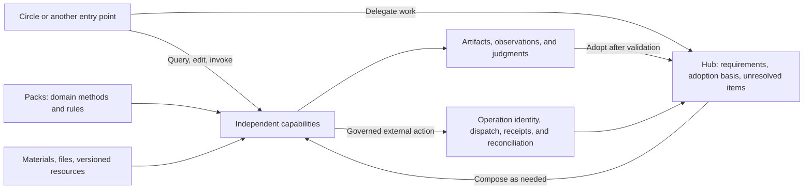

# Complete Plan for Migrating Existing Capabilities to Hub

**Status: migration design proposal, 2026-10-20. This document defines target behavior, implementation order, and acceptance gates. It does not claim that the capabilities have been migrated, deployed, or accepted in a real environment.** The [Chinese version](hub-migration-plan.md) is authoritative. The existing design specifications remain in force; contract changes require separate implementation under the compatibility plan below.

## 1 What users will get

Users continue to query materials, edit files, and use tools in Circle. When they delegate work, they can select inputs and request a PLM query, test-case review, mind-map compilation, verification run, failure investigation, or publication of results. Each capability can be used independently or composed with others. After a change of entry point, method, or requirements, the system explains which results remain applicable, which need reassessment, and which external operations remain unresolved, then continues the original work.

**Circle provides the workbench and runtime; packs provide independently callable domain capabilities and methods; Hub accepts delegated work and manages shared resources and governed operations.** Other clients, channels, and triggers use the same contracts. The aim is to reduce repeated configuration, repeated implementation, and unnecessary rework while retaining the basis for complete delivery and actual effects.

The scope includes the 75 requirements and 12 work categories in the existing research. Ownership, phases, and acceptance criteria for every requirement are in the [complete requirements coverage table](hub-migration-coverage.md). These numbers describe requirements coverage, not the number of currently available features. Mind-map compilation, PLM queries, and test-case review are the first applications; they must not define Hub's business boundaries.

### What is not being migrated

- Old InfoTest and CES business code, orchestration processes, configuration, and database structures will not become runtime dependencies of the new Hub. Wrapping the old services does not count as migration. Existing behavior, issues, and results retained under controlled access provide requirements and acceptance samples.
- Existing Circle, Hub, and circle-packs implementations are reused at verified versions. Their new invocation and composition paths still require acceptance.
- Third-party enterprise systems and target test frameworks remain external systems with independent versions, permissions, and operational owners. New TypeScript adapters use their official interfaces without introducing the old InfoTest/CES orchestration layer.
- Personal files, sessions, memory, and ongoing services are not forced to become work items. Ordinary queries and editing do not require a complete delivery specification.

## 2 The verified starting point

The following are source-code baselines, not substitutes for deployment receipts or real business acceptance. The Hub baseline is from `main` refreshed on 2026-10-20. The Circle and packs baselines are fixed local commits read during this review; they are not claimed to be the latest releases of those repositories.

| Component | Fixed commit | Reusable implementation and actual limits |
|---|---|---|
| Hub | `ca66002fb6bfc3220547d0fdd895bfae83345943` | Durable tasks, revisions, permissions, assets, sources, evidence, operation records, execution flows, and hosted Circle RPC; production identity, cross-host operation, and the new contracts still need implementation |
| Circle | `029370b44b45585673e85fc01110787afafcae4b` | Workbench, files and diffs, terminal, AgentRuntime, local tasks, and Hub views; a local restart marks in-flight tasks as interrupted or needing review, which is not automatic continuation |
| circle-packs | `e46e76de5a388f1157386fbadb00a436157942f0` | Domain Q&A, defect claims, test-case review, and mind-map compilation skills, plus APV product methods and execution flows; APV is an existing implementation example, while the target covers all product lines |

Key facts:

- The [PLM catalog](https://github.com/circle-platforms/circle-hub/blob/ca66002fb6bfc3220547d0fdd895bfae83345943/packages/connectors/src/tool-packages.ts) already provides product listing, defect search, and detail tools. Search pagination is local processing over a mirrored list. This does not establish complete source-side pagination, attachments, requirement stories, or writes to a test repository.
- [General tool invocation](https://github.com/circle-platforms/circle-hub/blob/ca66002fb6bfc3220547d0fdd895bfae83345943/packages/tools/src/catalog.ts) currently creates a task and operation first, then either waits synchronously or returns the task. The proposed lightweight invocation contract must not be described as already implemented.
- The [existing execution driver](https://github.com/circle-platforms/circle-hub/blob/ca66002fb6bfc3220547d0fdd895bfae83345943/packages/execution/src/flow-driver.ts) and [product-specific pure transition](https://github.com/circle-platforms/circle-packs/blob/e46e76de5a388f1157386fbadb00a436157942f0/products/apv/tools/execution-transition.ts) can be retained. The current provider path for external writes requires a remote job and lease; it cannot be applied unchanged to every synchronous write.
- The [mind-map compilation manifest](https://github.com/circle-platforms/circle-packs/blob/e46e76de5a388f1157386fbadb00a436157942f0/skills/apv-mindmap-compile/skillpack.json) contains per-case output paths, while the [RPC collector](https://github.com/circle-platforms/circle-hub/blob/ca66002fb6bfc3220547d0fdd895bfae83345943/packages/runtime/src/circle-rpc.ts) collects literal paths. The delivery contract must fully account for dynamic outputs and runs with zero successful cases.
- The [review skill](https://github.com/circle-platforms/circle-packs/tree/e46e76de5a388f1157386fbadb00a436157942f0/skills/apv-case-review) currently reads compilation-batch JSON; it is not yet a reviewer for arbitrary original xlsx files or strategies. It needs independent input support, consistent manifest and script output locations, and host checks of required-check completion records, judgment producers, and sources.
- The RPC acceptance pin in the [compatibility matrix](compatibility.md) differs from the Circle commit read in this review. Adopting a new runtime requires separate compatibility acceptance. Unmerged enterprise governance, Linux isolation, and the [roadmap PR](https://github.com/circle-platforms/circle-hub/pull/12) do not count as existing capabilities.

## 3 Compose all functionality within one architecture



The arrows represent calls and references, not a fixed pipeline. Parsing, retrieval, command lookup, document generation, review, compilation, execution, and reporting are independently callable. Composition passes only identified inputs and outputs. An existing artifact can be verified directly; an existing run can produce a report independently; a query does not automatically start compilation.

| Content | Responsibility and implementation location |
|---|---|
| Editor, file grants, terminal, diffs, sessions, personal memory | Reuse Circle; private content is uploaded or shared only when the user selects and authorizes it |
| Materials, knowledge, artifacts, source versions, and indexes | Retain independent resource lifecycles; Hub handles sharing, permissions, and references, while capabilities handle formats and domain interpretation |
| Candidate generation, rule checks, review, compilation, and diagnosis | Ordinary TypeScript and optional Skills in packs; deterministic steps need not call a model |
| Work revisions, human questions, adoption basis, and complete delivery | Hub provides common contracts; approved methods define the meaning of domain acceptance |
| Writes to devices, hosts, cloud documents, test repositories, and other external systems | Hub constrains actual actions; system adapters execute them, retain original receipts, and declare recovery capabilities |
| Connector synchronization, subscriptions, scheduled rules, and monitoring | Ongoing resources with records for individual runs; a particular run or exception can give rise to work |
| Model protocols, tracing, usage, deployment, and retention | Runtime and host infrastructure; a trace does not serve as a business conclusion |

This does not create a service for every row. The first version continues to use the existing Hub process, database, object storage, and workers; modules are divided by dependencies and responsibilities. Circle's local state and Hub's state retain their actual owners, and the unified interface routes operations back to those owners.

## 4 The minimum contract for work continuity

### 4.1 Producing a result and adopting a result

A capability produces a result. The work records which result was adopted for a requirement at the current revision, and on what basis. Old artifacts and conclusions retain their original ownership and revision associations. Reuse across revisions creates a new adoption record; it must not rewrite an old record to make it appear to originate from the new revision.

The following are **logical fields to be implemented**. They can use existing records, input revisions, and association tables. They do not require a separate service, universal IR, or graph database:

| Record | Information it must express |
|---|---|
| Accepted requirement | Stable `itemId`, references to the goal and acceptance contract, input revision, scope, necessity, time range, and the decision authorizing a change |
| Capability output | Producing capability and configuration versions, actual inputs and read references, content digest, coverage, missing items, assumptions, and producer type |
| Result adoption | Current requirement and revision, reference to the original result, check contract and version, applicability conclusion and basis, and unmet assumptions |
| External operation | Existing `operationId`, request digest, principal, target, resource identity, and requirement association; remote request identity fixed before dispatch, and the reconciliation contract |
| Successor association | Original task and revision, new task and revision, adopted results, original operations still unresolved, and handoff scope; actual owner and current authorization |
| Unresolved-items view | Reasons, missing evidence, responsible party, and permitted next choices derived from requirements, adoption records, operations, and human decisions |

An adoption conclusion must at least express applicable, inapplicable, and undetermined. It does not replace existing task or operation states. Nor may a pack gain the status of fact merely by declaring a `script` label in its output. The host verifies actual producers, check invocations, and original-source references; a script producer type does not by itself establish that a domain judgment is sufficient.

### 4.2 Retain responsibilities without automatically granting permissions

Unresolved items include parts of the current requirements that lack sufficient support, and matters left by operations that have happened or may have happened. This is a view of responsibilities, not an automatic execution list.

Continuing work must distinguish artifact reuse, evidence reassessment, obtaining current authorization, reconciling an original operation, and executing a new operation. Missing evidence does not imply that a write should be repeated. Canceling a goal must not delete an unknown effect. A responsibility to reconcile does not automatically authorize queries, lease renewal, resource release, or compensation.

An original operation is recovered under its original identity. Two independent intents with identical parameters can be different operations; content digests must not automatically merge them. Conversely, the same intent must not receive a new key and be dispatched again because the pack, entry point, or work item changed. Handoffs across work items require an explicitly authorized association; resource freezing and identity resolution remain consistent across entry points.

When reconciliation is permanently impossible, the contract must define deadlines, escalation, resource protection, and a disposition decision by an authorized party. The handling process may end while the facts remain unknown; administrative closure must not be displayed as a resolved effect.

### 4.3 Theoretical assumptions and implementation obligations

- Selective reuse depends on actual input isolation. If the model that generated A saw B's context, B is a potential dependency. Dependencies include queries with no matches, listing scope, permission filtering, time, and environment. Broaden reassessment when dependency completeness cannot be established.
- Identical schemas, names, or `pass` values do not establish semantic equivalence between packs. A replacement method must be checked against the original acceptance contract. When comparison is impossible, retain the original materials and reassess; do not automatically weaken requirements.
- An observation supports only its object, scope, and point in time. A historical test pass cannot issue an expected result for a new specification, and a live observation cannot become a permanently valid cache.
- Before every dispatch, recheck the actual requirement revision, inputs, authorization, and resource conditions. An internal transaction and version check are not atomic conditional execution at the target. Retain an unknown state when the target cannot deduplicate or reconcile.
- Passing every individual check does not necessarily cover the complete goal. Requirement decomposition and verification sufficiency still need support from domain methods and their applicability scope. Exhausting a budget does not mean no solution exists; an ongoing requirement cannot be permanently discharged by a single pass.

These obligations retain the [conditions and counterexamples in the theory research](design/truth-docked-architecture.md). They add no promise of overall correctness, exactly-once effects in arbitrary external systems, or guaranteed convergence.

### 4.4 Continuing work does not mean reopening an old task

Existing `Tasks.revise` does not allow changes to terminal or `unknown` tasks, and a new pack cannot overwrite an old method pin. In the compatible implementation, input changes that satisfy existing conditions continue to use the original revision path. Continuation from terminal or unknown tasks, or continuation that requires replacing a frozen method, creates a successor task with explicit references to the original task, results, and operations. Users can follow one continuing work relationship, while every execution instance retains its true ID, owner, and contract.

Delivery by a successor task must check all unresolved effects within the associated scope, not only operations under the new `inputRevisionId`. Referenced old operations remain reconciled by their original owner. An association neither copies operations nor transfers permissions, and it does not require recovering the old model's internal reasoning. The successor association itself must be checked for permissions, cycles, duplicate handoffs, and coverage of responsibilities. It must not create an unlimited chain of handoffs that hides unfinished items.

New records first run as parallel assessments in synthetic replay without changing old results or dispatches. After the assessments agree, enable adoption under the same contract, then enable cross-method continuation with explicit semantic correspondence. Old records default to “not assessed under the new contract”; they must not be bulk-backfilled as satisfying the new guarantees.

## 5 How the primary applications migrate

### 5.1 PLM and enterprise-material queries

**Independent entry point:** Users select the system, object type, product, and version, then search by an explicit identifier or criteria. They view the body, history, relationships, and attachments they are permitted to read. Results show the source version, collection time, coverage, and permission limits. They can be used directly for Q&A or selected as inputs to review or compilation.

The migration separates source adaptation, common collection/pagination/references, and domain interpretation of objects. PLM, defect systems, requirements systems, and test repositories have separate adapters. Identifiers must include their system and object type. Failure to find an explicit identifier must not silently turn into a name search; users must be able to select among multiple candidates.

Existing mirrored-list queries retain their actual guarantees. Before adding source-side pagination, fields, attachments, or relationships, define the source contract and retain request scope, page or cursor, completeness, and source revision. If the source lacks snapshots and changes during a scan, disclose non-atomic coverage. A no-match result can describe only the complete scope actually searched.

Current bulk detail retrieval accepts at most 100 IDs. Subsequent clients must split requests and account for coverage. Retaining an original response does not establish that its body and attachments have been fully extracted. Attachment adapters check the same-origin or approved-target boundary, object ownership, revision, type, size, and download permission; they must not fetch files from arbitrary source links. The existence of a build does not establish that it has been officially released.

A reference selected for subsequent work is bound to the original material and its version, while later actions still check current read permission. Personal upstream credentials must not become shared organizational credentials. Permissions within the same Hub scope must not be treated automatically as source-side ACLs. Test-repository writes use the separate write-operation contract.

**Delivery and acceptance:** Normal queries, no matches, identical identifiers across systems, missing pages, login pages, permission denial, source changes, unreadable attachments, and rate limits are separately observable. Selected results enter review or compilation without manual copying, and citations can read back the corresponding original material. All public samples are synthetic.

### 5.2 Test-case and strategy review

**Independent entry point:** Upload xlsx or text, or directly select a queried case set. Bind requirements, specifications, product version, and review scope to receive per-item findings, coverage gaps, evidence, and suggested revisions.

Shared capabilities handle table structure, identifier preservation, source locations, check scheduling, human questions, and reports. Product packs handle command semantics, requirement-coverage rules, verifiable expected results, and risk interpretation. Editing previews and formal checks call the same rule implementations; the formal boundary must revalidate the actual inputs.

Retain separate results and producers for structural checks, command checks, and domain judgments. Independent review follows the original contract. Structural validity cannot replace semantic completeness, model findings must not masquerade as script-established facts, and a completed review is not a passed device verification.

First correct the existing manifest/script output locations and the delivery decision that still allows a report when required steps are missing. A report may describe an incomplete review, but it must also list unfinished checks and uncovered inputs. The mere existence of a file must not satisfy all requirements.

**Delivery and acceptance:** Every original case has an accounted-for outcome. Long identifiers, merged cells, and steps spanning rows are preserved. Findings locate the original cell or item and their supporting basis. Removing any required check permits only a result that discloses the missing check. After changes to some cases, reassess adoption or review according to actual dependencies without needlessly redoing unrelated items.

### 5.3 Compilation from mind maps and other inputs

**Independent entry point:** Mind maps, pasted text, structured steps, and cases from a test repository enter the same compilation work. Users select the target framework, product version, specifications, and necessary environment materials.

Retain two distinct uses. The existing built-in `mindmap-compile` guarantees structural extraction and workbook readback; it does not assess test quality. The domain skill additionally authors executable test artifacts. The former can finish independently without a testbed or lease. The latter prepares inputs required by its method and explicitly states that its artifacts have not yet run on a device. The more complex path must not replace the lightweight capability.

The default composition is: read original material → normalize source items → recompose while preserving intent → check specification consistency and clarify → generate per-case candidates → run deterministic checks and scenario review → produce workbooks and a complete delivery report. This is an available method; each capability remains independently callable.

Parsing and source-item tracking, candidate generation and review, derived builds, and delivery manifests can be shared. Command languages, framework functions, assertions, lifecycle rules, workbook dialects, and device mappings belong in their corresponding packs. Command catalogs and language queries independently serve Q&A, configuration, and editing; they are not limited to mind-map compilation accessories.

The migration must close these existing gaps:

1. Input manifests explicitly declare and obtain the required specifications, command trees, execution contracts, and environment observations. Missing materials are reported against specific requirements; they must not silently default to empty while results continue to be certified.
2. Original mind-map atoms, splits and merges, and external SPEC or defect references are all bound to actual original materials. A statement that something is “checked by the server” cannot remain without corresponding execution evidence.
3. Outputs become a constrained artifact collection: a fixed report, optional workbooks, and per-case check files. The host collects and validates paths, sizes, types, and digests. Dynamic lists must not permit arbitrary-path export.
4. When all cases are unsupported or lack sufficient evidence, still deliver a complete report of the input partitions. Do not fabricate an empty successful workbook to satisfy a fixed-output requirement.
5. Assertion windows, counts, denominators, before/after comparisons, absence conditions, and exemptions have actual representations. Model confidence cannot replace checks of expressibility or ability to distinguish the relevant outcomes.
6. Individual-case passes, final combined-workbook passes, and actual device verdicts are recorded separately. If combining workbooks changes bytes, the combined artifact cannot inherit the original execution results.

Compilation must also deliver referenceable per-case candidates, intent and expected-result sources, bound versions, and check evidence through a public domain-capability contract. Subsequent review reads through these references without depending on compiler-private directories or intermediate files that were not delivered. This does not require a new universal IR.

**Delivery and acceptance:** The complete input set maps to traceable partitions of delivered, failed, quarantined, or unfinished items. Retain per-case identities, scenarios, and sources of expected behavior; validate workbooks against the target contract. ZIP container bytes need not match the old implementation. A compilation pass means only that the declared artifact conditions are satisfied; it does not automatically authorize execution, archival, or publication.

### 5.4 Existing execution flows and real-environment verification

Retain the existing responsibility boundaries: a domain-specific pure transition proposes the next step, the generic driver manages durable state and operations, and an adapter handles the target-system protocol. Reuse existing product-flow methods and synthetic regression conditions, and complete the common operation modes. Do not impose one product's submit/status/result/lease combination on every capability.

Existing `apv-case-execute.json` declares phases; `apv-case-execute-v2.json` is the one associated with the actual TypeScript transition. The migration uses the real execution contract and call chain, aligning source parameters in skill instructions with v2 method, resource, source, and controlled-byte bindings. Retired execution entry points remain read-only history; they are not restored as a migration shortcut.

| Operation mode | Minimum contract | When the response is lost |
|---|---|---|
| Read-only query or observation | Object, scope, coverage, point in time, inputs and outputs; declare actual side effects | Reread within permissions and limits, but do not present a new observation as one from the old point in time |
| Synchronous write | Exact target and content, current authorization, prerequisite version or condition, stable request identity, effect receipt | Verify under the original identity or retrieve idempotently; otherwise remain unknown |
| Asynchronous job | Submission, status, result, reconciliation, and optional cancellation; declare resource occupancy and actual remote support individually | Query the original job; the end of a local wait does not mean the remote job stopped |

Target-framework adapters and device-protocol adapters remain separate. Environment checks are read-only by default; initialization, installation, cleanup, and serial-port resets are explicit governed writes. Resource occupancy distinguishes internal Hub claims from actual remote leases. A fencing guarantee must be enforced at a point that can reject the old executor.

**Complete application:** Select a checked artifact and target environment → observe versions and topology → validate execution conditions and required existing approvals → fix the operation intent → dispatch → retain receipts, status, and original evidence → interpret using the domain method → independently verify → deliver. Reconcile the original operation first when its outcome is unknown. Fixing a parser adds an interpretation; it does not rewrite facts that have already occurred.

The current recovery gap after a lost receipt, when the remote identity has not been persisted, requires target support for discovery/deduplication by a request key fixed before dispatch, or an independent reconciliation mechanism. Without target-side support, the product must honestly retain an unknown state.

### 5.5 Include the other work categories

| Work | Composition and delivery | Boundaries retained independently |
|---|---|---|
| Product Q&A, configuration queries, and explanation | Retrieval/catalog → original-material readback → answer or configuration candidate → optional review | Configuration candidates are separate from actual execution; a conclusion may be withheld when evidence is missing |
| Defects or requirements to test specifications | Identified source → claim extraction → domain interpretation → specification or case candidate | Actual behavior must not be written as expected behavior; ambiguity remains explicit |
| Failure investigation and rework | Original evidence from the same run → competing causes → required observations/experiments → revision candidate | Service recovery does not prove the root cause; a later pass does not overwrite an earlier failure |
| Technical documents and reports | Adopt existing materials, judgments, and results → generate document → readback acceptance | Generation, delivery, and external publication are recorded separately |
| External publication and formal test-case archival | Fixed artifact and target → governed write → remote-effect readback | Publication failure does not change an old device verdict; topic and owner must be bound precisely |
| Knowledge organization and experience feedback | Observation/experience candidate → source and applicability scope → authorized sharing | Personal memory does not automatically become an organizational fact; an old PASS does not issue a new expected result |
| Publication of material and capability catalogs | Original collection → derivation → completeness check → version switch | Queries use the selected version; missing items prevent publication of a “complete” snapshot |
| WeCom and other channels | Identity binding → message/attachment grouping → original-work reference → response/delivery | A channel does not keep a second business-state system; an old response must not enter a new revision |
| Environment and platform operations | Plan → authorize → prepare/upgrade → observe → recover and audit | Operations must not be hidden inside compilation preflight; cleanup must not delete originals still needed for recovery |

## 6 Frontend design

Continue extending the Circle workbench, reusing files, editing, diffs, terminals, sessions, and Hub views. Common entry points reflect what users want to do: query materials, review cases, compile, execute, and view results. Domain tables and diagnostics use views suited to their content; not everything is forced into a generic JSON form.

The work page has three groups of information: **adopted results, items still requiring attention, and questions requiring a user decision**. Each item expands to show requirements, versions, original materials, checks, and the basis for operations. Execution location and actual owner are visible. Existing phases and statuses are shown with their existing meanings; the three groups are views, not another conflicting state machine.

Specific interactions:

- Start: select a capability, inputs, and scope. Fill in existing context automatically, and ask only for missing decisions or decisions that expand scope. Show selected files and sharing scope before upload.
- Query: retain search criteria and coverage. Selected original materials pass directly into subsequent work. Downloading does not permanently inherit source-side authorization.
- Review/compile: locate original content, findings, and artifacts item by item, and show unprocessed items. Before a change, show which results are affected; a model's verbal claim must not write a completed state.
- Human questions: group related conflicts while retaining complete sources and impacts. Bind responses to the question identity and revision. Do not repeatedly request authorization that is already valid.
- Take over: read the current work, events, and adoption basis, and obtain current permissions. Do not require recovering another model's internal reasoning or copying private sessions.
- Stop: distinguish ending observation, stopping local inference, requesting work cancellation, and observing that the remote execution has stopped.
- Deliver: download actual artifacts and inspect the passed scope, unfinished items, and unknown effects. Generating a report must not turn the entire work green.

The desktop retains its existing Chinese and English rules, and the terminal retains its existing English rules. Keyboard behavior, errors, and permission feedback remain consistent. Accept the development application first, then the packaged application, using isolated data directories and synthetic projects.

## 7 Protocol interaction and compatibility

Continue using existing identity, scope, error envelopes, and event cursors. HTTP, MCP, CLI, and Circle adapters consume the same capability schema. Identity in public protocols is established by server-side authentication, not by trusting the caller's claim.

| Interaction | Currently available starting point | Target extension |
|---|---|---|
| Discover/invoke | `/v1/tools`, `/v1/tools/{name}/call`, MCP tools | Explicit capability versions, inputs/outputs, effect modes, and host support; synchronous waiting must not masquerade as a synchronous-effect contract |
| Accept work | `/v1/tasks/submit`, skill runs, module execute | Stable delegation identity across entry points and a durable acceptance receipt; the original-work reference can be recovered |
| Observe/catch up | Task status/events/result, notification catch-up | Adoption basis, unresolved items, and coverage; recover from durable records and the current snapshot after the event window expires |
| Respond/revise | `/v1/tasks/{taskId}/input` | Bind the original question and expected revision; reject stale responses or explicitly invalidate them |
| Cancel/reconcile | Existing cancel/reconcile and operation records | Connect actual client actions; distinguish request acceptance, observed stopping, and remaining uncertainty; reconciliation may be blocked without permission |
| Adopt results | Existing records/checklists | Add an adoption basis for the current revision; old results cannot simply be rebound as new facts |

These extensions do not announce new endpoints as already implemented. Implementation PRs must update `packages/contracts`, the [client handoff](client-api-handoff.md), pack schemas, and the [compatibility matrix](compatibility.md) together.

Bindings, actions, and outputs in the current `hub-execution-transition/1` use strict schemas. Hooks have only five fixed events, and notifications also use a field allowlist. If new adoption or continuation behavior requires authoritative actions, bindings, check events, or frontend projections, explicitly version the contract or negotiate an extension. Such information must not be hidden in ordinary Tool outputs or arbitrary state and then treated as platform fact. Current Hub MCP long-running tasks return a Hub-specific task reference; this does not establish compatibility with official MCP Tasks or A2A.

```mermaid
sequenceDiagram
    participant C as Circle or another entry point
    participant H as Hub
    participant P as Capability executor
    participant X as External system
    C->>H: Invoke capability or delegate work, with stable request identity
    opt Asynchronous work
        H-->>C: Durably accepted work reference
    end
    H->>P: Exact inputs, method version, permitted capabilities
    P-->>H: Artifacts, basis, missing items, or proposed next steps
    opt An external action is needed
        H->>H: Check current revision and permissions; persist operation intent
        H->>X: Fixed request identity and actual parameters
        X-->>H: Receipt or job reference
    end
    H->>H: Validate outputs and receipts
    opt Accepted work
        H->>H: Assess applicability; project adoptions and unresolved items
    end
    alt Synchronous invocation
        H-->>C: Actual result, basis, and applicability scope
    else Asynchronous work
        C->>H: Catch up, respond, or request cancellation against original work
        H-->>C: Current facts, delivery scope, and pending items
    end
```

A request timeout does not mean the request was not accepted. The principal, scope, and retention period of idempotency keys must be explicit. After retention expires, look up the original work or operation first; do not generate a new key and automatically repeat it. Authorization, requirement revisions, and resource conditions are checked again at the dispatch boundary. Historical approval explains only past actions.

## 8 Pack structure and coding requirements

Authors maintain capability entry points, inputs and outputs, dependencies, effect requirements, applicability assumptions, and acceptance methods. An optional Skill describes composition. Initially preserve compatibility with the two existing manifest types, `skill-pack` and `product-line`, and generate catalogs and host projections through the publishing entry point. Renaming them does not establish unified loading.

Shared code initially uses ordinary libraries and build tools; publication generates self-contained frozen modules. Runtime imports between packs are currently prohibited. Any necessary new dependency mechanism requires a separate contract version. Product rules remain in product packs, and protocols for PLM, documents, test frameworks, and other systems remain in their adapters. Do not add product-specific branches to Hub's core.

| Implementation repository | Work package | Completion condition |
|---|---|---|
| circle-hub | Capability/artifact-collection contracts, adoption associations, unresolved-item projections, synchronous writes and reconciliation, source coverage, organizational integration | Interfaces, storage migrations, permissions, and recovery counterexamples are delivered together |
| circle | Shared capability entry points, work views, per-item questions/diffs, real action wiring, takeover of original work | Use the real runtime/bridge; accept desktop development and packaged applications and the terminal contract |
| circle-packs | Query interpretation, review, compilation, and other domain methods; versioned acceptance and shared builds | Manifests, script/judgment markers, and artifact collections match actual invocations; validate within packs and through host loading separately |
| System-adapter implementations | PLM/material/test-repository/document/device/framework protocols and deployment contracts | Individually exercise read/write modes, coverage, identity, failure, and reconciliation capabilities |

New self-maintained code and executable skill scripts use TypeScript. Convert existing pack `.mjs` files to TypeScript under the relevant contract when migrating their capabilities; builds may generate published artifacts. Do not hand an unvalidated source format directly to an old runner. Do not copy old Python business logic.

Every behavior change starts with a sample reproducing the original issue, followed by implementation. Tests inspect actual files, the next request, durable records, and synthetic external effects; interface text is not execution proof. The host validates dynamic paths, sources, and producers. Packs must not read arbitrary host files or bypass governed outbound actions.

## 9 Deployment and data migration

### 9.1 Deploy according to actual needs

| Use scope | Required environment | Must not additionally require |
|---|---|---|
| Personal editing, local-material queries, pure transformations | Circle and authorized local capabilities, with model configuration where needed | A device testbed, remote leases, or a complete team-service deployment |
| Team queries, shared materials, review, and compilation | Hub, PostgreSQL, object storage, relevant workers, approved packs; a pinned Circle runtime when models are involved | Execution devices or initialization permissions |
| Device/host verification | The governed-work environment above, plus new adapters, reachable target environments, resource identities, and occupancy mechanisms actually supported | Unsupported remote leases or invented job interfaces |
| Enterprise channels and publication | Relevant identity mappings, connectors, secret configuration, callbacks/subscriptions or polling, and permission at publication targets | Shared personal accounts or automatic approval of business changes |

The current service/worker channels, same-host object files, and isolation support have explicit limitations. The diagram does not establish production readiness across hosts or on Linux. Initial synthetic integration uses the supported same-host environment. Cross-host transport, object access, machine identity, network boundaries, and isolation on the target operating system each require implementation and acceptance. See the [existing deployment and runtime limits](compatibility.md).

Production integration also requires enterprise identity and revocation, TLS, secret management, backup and recovery, capacity and retention, worker draining and upgrades, audit access, and an inventory of actual dependency versions. Phase 5 is the overall release gate; it does not allow earlier phases to omit permissions or isolation.

### 9.2 Migrate data without inventing history

| Object | Migration method | Verification |
|---|---|---|
| Originals, materials, and artifacts | Export with authorization; map original-system identities to new references; retain source versions, digests, ACLs, and retention requirements | Check bytes, reference readback, and cross-identity negative cases; record format conversions separately as derivations |
| Catalogs, indexes, and caches | Rebuild from authorized originals rather than moving them wholesale as authoritative originals | Check completeness, versions, and missing items; source changes can invalidate them |
| Historical tasks, logs, and verdicts | Read-only historical records identifying the original system and validation level; missing evidence remains missing | Do not turn historical `succeeded` into new Hub acceptance |
| In-flight work and unknown effects | By default, the original executor still completes or reconciles them; Hub may reference read-only status | Do not copy them into new executable tasks or redispatch unknown writes |
| In-flight operations with a valid explicit handoff | Hand off only when target identity, original request key, receipt/reconciliation, and resource-protection contracts hold | One owner for the action; prevent the old executor from further dispatch or conflicting effects |
| Credentials and approvals | Rebind organizationally managed identities and current policy; retain historical approvals as historical evidence | Do not transfer personal secrets or treat old approvals as permanent permission |
| Personal memory and experience | Preserve private ownership through selection; shared experience undergoes source and applicability review | Migration does not automatically publish it or make it factual |

Cut over by capability and scope. Preserve samples and comparisons first, then validate with synthetic or isolated inputs. After approval, enable a limited scope in the designated environment. Stop old entry points from accepting new work only after the exit criteria are met. Do not let both systems write the same resource for a “shadow comparison.”

For rollback, first stop new acceptance and drain or freeze in-flight operations, then switch back to verified packs and configuration. Arbitrary mixing of old and new flow workers is not currently guaranteed. Upgrade by draining old workers, retaining terminal or reconciliation records, starting new workers, and activating the new policy last.

Storage migration verifies historical migration SHAs and rejects database migrations unknown to the current program. After a schema addition, an immediate return to the old binary therefore cannot be promised. Prefer stopping new entry points and using a corrective version compatible with the new schema. Any necessary restoration of a consistent backup must be verified separately, with reconciliation of effects that occurred after the backup. Code or database rollback cannot undo writes that have already happened or unknown operations. Data migration uses incremental, reentrant imports and independent reconciliation without overwriting originals.

## 10 Implementation order and phase deliverables

Phases express dependency order and acceptance batches, not calendar commitments. The requirements coverage table assigns each requirement a primary completion phase. Foundational capabilities are built before their first use.

| Phase | Deliverables | Gate for entering the next phase |
|---|---|---|
| **0 Contracts and sample baseline** | Freeze sources and current behavior; confirm requirement/artifact/adoption/operation contracts; sanitized samples and independent expected results; compare current and target schemas | All 75 requirements have owners; new continuation counterexamples are reproducible; no private originals enter the public repository |
| **1 Materials and PLM queries** | Source collection, structural reading, versioned catalogs, query readback, PLM adaptation, and input selection in Circle | Pagination/ACL/version/attachment boundaries are visible; Q&A, review, and compilation can reference the same original |
| **2 Review and mind-map compilation** | Shared parsing and validation; domain methods; dynamic artifact manifests; adoption at the current revision; complete input partitions and reports | Negative cases for zero successes, missing required checks, external specifications, long identifiers, distorted scenarios, and partial edits pass; independent review still works from delivery references after closing the compilation workspace; no writes to real external systems |
| **3 Governed execution and work continuation** | Three operation modes; reuse and extend existing execution flows; target adaptation, reconciliation of original operations, and continuation after changing entry point or method | Lost receipts, process restarts, late reports, revision races, revocation, and cancellation do not cause omissions or duplicate effects |
| **4 Publication channels and knowledge feedback** | Report/document publication, formal test-case archival, experience review, WeCom and other channels, ongoing synchronization, and trigger rules | Messages/attachments/questions cannot cross work boundaries; writes can be read back; publication failure does not change old judgments; channel interruptions are recoverable |
| **5 Production integration and migration closure** | Enterprise identity, target deployment support, backup/recovery, retention/cleanup, staged rollout/rollback, and capability-by-capability retirement of old entry points | Real-environment acceptance by scope, operation/data reconciliation, runbooks, and responsible owners are complete; all deferred items are explicit |

Within each phase, repositories advance in compatibility order: **Hub contracts and implementation → Circle adaptation → pack versions and activation**. Development may proceed in parallel, but a new pack must not be activated before the host supports it. Each work package gets a separate PR stating inputs and outputs, version ranges, permissions, failure paths, and tests. Do not combine business rewrites, data migration, and deployment in one large PR.

## 11 Acceptance plan and definition of completion

### 11.1 Evidence layers

1. **Static verification:** Requirements, schemas, manifests, permissions, and dependencies are complete and consistent; original references and provenance are traceable. This establishes consistency of declarations, not execution.
2. **Pure capabilities:** Parsing, transformations, rules, and reports use synthetic and authorized sanitized samples; inspect actual content, scope, and unfinished items.
3. **Synthetic Hub integration:** Temporary PostgreSQL, synthetic sources and targets, and scripted models; inspect actual persistence, requests, files, and controlled side effects.
4. **Client delivery:** Circle development and packaged applications, reconnection catch-up, human responses, cancellation, and continuation from at least one other entry point; UI text does not substitute for effects.
5. **Designated real environment:** Use authorized sources, product builds, target frameworks, and devices, recording exact versions, bytes, operations, and business judgments. Report source read access, device execution, model quality, and publication separately.

Report tests, skips, not-run cases, failures, and unresolved cases separately. Passing pack tests, passing synthetic Hub integration, reading real sources, passing device tests, and formal publication cannot substitute for one another.

### 11.2 Continuation scenarios that must be established first

Run the same class of experiment for knowledge judgment, artifact generation/verification, and external change/publication:

1. Pack P generates an independent result A, reaches a judgment about result B, and dispatches operation C. C fails after remote acceptance but before the receipt is persisted.
2. Change B's requirements and switch to pack Q and another entry point. Q continues through the public contract and cannot depend on P's private step names.
3. For A, which remains applicable under isolated inputs, retain the original artifact and add a current adoption basis. B's old judgment is not automatically inherited. C must be reconciled under its original identity.
4. Withdraw the goal associated with C and revoke write permission. Retain matters arising from existing effects, prohibit redispatch with a new key and unauthorized compensation, and allow blocked or unknown outcomes when reconciliation permission is revoked.
5. Add counterexamples involving hidden dependencies, identical schemas with different semantics, conditions changing before dispatch, independent new intents with identical parameters, and expired event windows.

Fix the criteria in advance; the model under test must not certify its own pass. Compare the existing Hub baseline and the new contract for invalid reuse, duplicate effects, omitted responsibilities, stale authorization, unnecessary recomputation, human restatements of history, and repeated code written by pack authors. Any invalid inheritance, omission, or unauthorized effect refutes the corresponding guarantee. Efficiency gains cannot offset those errors.

Validate public contracts with at least one additional product pack whose input format, domain rules, and external-resource semantics differ. If implementation requires a product-name branch, revisit the responsibility boundaries rather than turning an example into a core special case.

Add a separate acceptance case for the compilation-to-review handoff: after the temporary compilation workspace is closed or deleted, another pack completes review using only delivery references. The original requirements, per-case coverage, and evidence remain readable. If required handoff items are missing, explicitly refuse to claim a complete review.

### 11.3 When a capability counts as migrated

All of the following must hold: coverage of required effects and inputs/outputs; actual invocation from Circle or another entry point; verifiable producers and sources; expressible applicability and missing items; execution under current permissions; evidence for failure, cancellation, and recovery behavior; complete deployment dependencies and runbooks; and acceptance and approval in the target environment. Completing only a manifest, interface, or pack tests does not count as migration completion.

Close the migration against all 75 requirements and the new continuation acceptance cases individually. Continue listing unimplemented items, unknown source contracts, pending authorization, and unsupported scope. Do not claim completion by reducing the denominator.

## 12 How the current specifications evolve

| Specification | Retain | Revisions to make explicit during implementation |
|---|---|---|
| [Object standard](design/object-standard.md), [roles](design/roles.md) | Authoritative state, originals/assets/evidence, scoped authorization, actual role policies | Local resources and independent capabilities do not require a complete work contract; assignment does not automatically grant private read access |
| [Approvals and enforcement](design/approvals-and-enforcement.md) | Change sets bound to exact actions, runtime enforcement, independent decisions, and declared exceptions | Policy determines whether a new synchronous write or effect requires a change set; do not turn every read into an approval |
| [Execution flows](design/execution-flow-packs.md) | Product-specific pure transitions, generic driver, actual receipts, unknowns, and originals | Extend operation modes, reconciliation without a remote identity, and unresolved effects across revisions; version breaking changes |
| [Product-line packs](design/product-line-pack.md), [module installation](module-installation.md) | Frozen bytes, independent versions, separation of installation, approval, and activation | Dynamic artifact collections, dependency builds, complete inputs, method/check contracts, and host support |
| [Circle integration](design/circle-integration.md), [levels and elements](design/levels-and-elements.md) | Thin adapters, scope, event catch-up, actual owners | Adoption basis and unresolved-item projections, common editing/diagnostic views, actual cancellation and takeover |
| [Primitives](design/harness-primitives.md), [permission export](design/permission-export.md), [vocabulary](design/vocabulary.md) | Neutral capability contracts, refusal to broaden permissions when they cannot be represented, existing state meanings | Separate format compatibility from runtime compatibility; version new relationships without changing the meaning of `succeeded` or `completed` by implication |
| [Theory research](design/truth-docked-architecture.md) | Assumptions about coverage, time, semantic preservation, judgment sufficiency, and finite validation | Test applicability with concrete adoption/continuation counterexamples; do not treat conditional propositions as platform-wide guarantees |

These are contract changes awaiting implementation. This proposal does not modify existing state enums, error codes, deployment configuration, or historical acceptance records. When an old client does not support a new guarantee, explicitly reduce the capability offered or reject the work; do not silently return the same success marker.

## 13 Prior work and validation of the proposed innovation

[Temporal](https://docs.temporal.io/activity-definition) describes historical reuse of completed calls and the retry boundary for unreported effects. [Bazel](https://bazel.build/basics/hermeticity) emphasizes isolation and complete inputs. [Doyle's TMS](https://dspace.mit.edu/handle/1721.1/5733) studies the reasons for conclusions and the revision of assumptions. These are established mechanisms informing this proposal, not new theory introduced by it.

The product value to validate is that, under explicit contracts for dependencies, semantics, permissions, and effects, users can change methods or entry points and still continue the same work on an accountable basis. Ordinary queries and editing remain direct, and pack authors do not repeatedly implement platform responsibilities. Cross-domain experiments and the costs to authors and users together determine whether this design is worth adopting.
