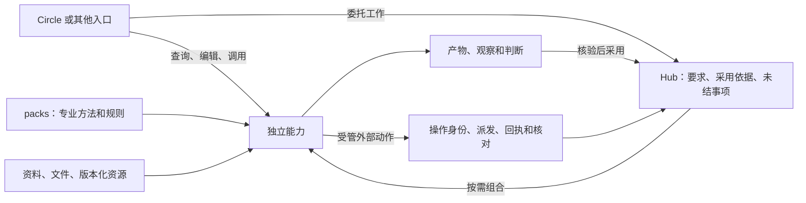
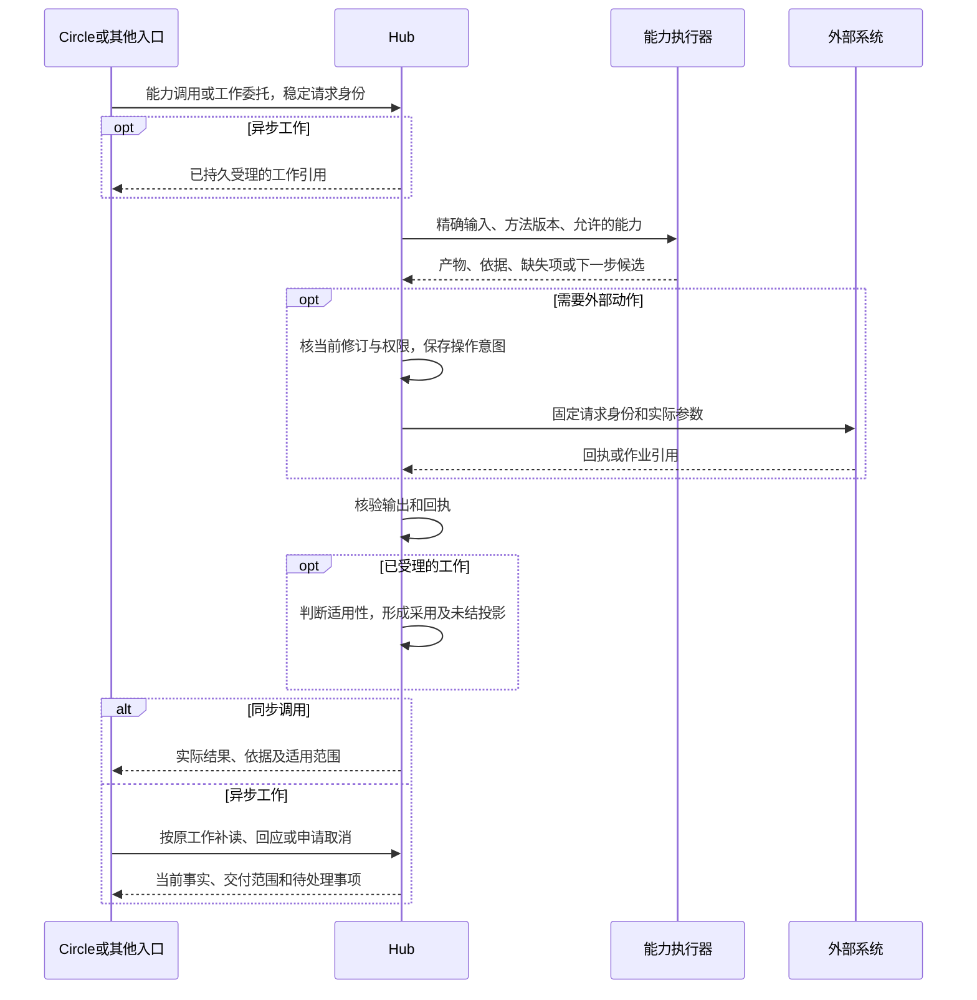

# 既有能力迁入 Hub 的完整方案

**状态：迁移设计提案，2026-10-20。本文规定目标行为、实施顺序和验收门槛；不表示能力已经迁移、部署或通过真实环境验收。** 中文为准，[English](hub-migration-plan.en.md)。原设计规范保持有效，契约变化须按本文的兼容计划另行实现。

## 1 用户最终得到什么

用户继续在 Circle 中查询资料、编辑文件、使用工具。需要完成一项委托时，可以选择输入，要求查询 PLM、评审用例、编译脑图、执行验证、调查失败或发布结果。各能力可以独立使用，也可以组合。换入口、换方法或修改要求后，系统说明哪些成果仍可采用、哪些需要重核、哪些外部操作尚未查清，并沿原工作继续。

**Circle 提供工作台和运行能力；packs 提供可独立调用的专业能力与方法；Hub 承接受托工作、共享资源和受管操作。** 其他客户端、渠道及触发器通过同一合同接入。目标是减少重复配置、重复实现和无谓重做，同时保留完整交付及实际效果的依据。

范围包括既有研究中的 75 项需求和 12 类工作，逐项归属、阶段和验收见[完整需求覆盖表](hub-migration-coverage.md)。这些数量是需求覆盖口径，不是当前可用功能数。脑图编译、PLM 查询和用例评审是首批应用，不能成为 Hub 的业务边界。

### 非迁移对象

- InfoTest、CES 的旧业务代码、编排进程、配置和数据库结构不作为新 Hub 的运行依赖，也不通过包装旧服务冒充完成迁移。既有行为、问题和受控保存的结果用于提取需求与验收样本。
- 既有 Circle、Hub 和 circle-packs 的现行实现按核实的版本复用；仍需对新的调用与组合方式重新验收。
- 第三方企业系统及目标测试框架是外部系统，有独立版本、权限与运维责任；新 TypeScript 适配器通过其正式接口操作，不引入旧 InfoTest/CES 编排层。
- 个人文件、会话、记忆和持续服务不强制变成工作。普通查询或编辑也不要求填写完整交付规格。

## 2 已核实的起点

以下为源码基线，不能替代部署回执或真实业务验收。Hub 基线来自 2026-10-20 刷新后的 `main`；Circle、packs 为本轮读取的本地固定提交，未据此宣称是各仓库最新发行。

| 部件 | 固定提交 | 可复用内容及实际限制 |
|---|---|---|
| Hub | `ca66002fb6bfc3220547d0fdd895bfae83345943` | 持久任务、修订、权限、资产、来源、证据、操作记录、执行流及 Circle RPC 托管；生产身份、跨主机运行和新增合同仍须完成 |
| Circle | `029370b44b45585673e85fc01110787afafcae4b` | 工作台、文件与差异、终端、AgentRuntime、本地任务及 Hub 视图；本地重启把在途任务标为中断/待复核，不等于自动续跑 |
| circle-packs | `e46e76de5a388f1157386fbadb00a436157942f0` | 专业问答、缺陷声明、用例评审、脑图编译技能，APV 产品方法与执行流；APV 是现有实现样例，目标覆盖所有产品线 |

关键事实：

- [PLM 目录](https://github.com/circle-platforms/circle-hub/blob/ca66002fb6bfc3220547d0fdd895bfae83345943/packages/connectors/src/tool-packages.ts)已有产品列表、缺陷搜索和详情工具；搜索分页是镜像列表上的本地处理。不能据此宣称已有源端完整分页、附件、需求 story 或测试库写入。
- [通用工具调用](https://github.com/circle-platforms/circle-hub/blob/ca66002fb6bfc3220547d0fdd895bfae83345943/packages/tools/src/catalog.ts)当前先建立任务和操作，再同步等待或返回任务。目标中的轻量调用合同不能被描述为已经实现。
- [现有执行驱动](https://github.com/circle-platforms/circle-hub/blob/ca66002fb6bfc3220547d0fdd895bfae83345943/packages/execution/src/flow-driver.ts)与[产品纯转换](https://github.com/circle-platforms/circle-packs/blob/e46e76de5a388f1157386fbadb00a436157942f0/products/apv/tools/execution-transition.ts)可以保留。当前 provider 外部写路径要求远端作业及租约，不适合原样套用于每种同步写。
- [脑图编译清单](https://github.com/circle-platforms/circle-packs/blob/e46e76de5a388f1157386fbadb00a436157942f0/skills/apv-mindmap-compile/skillpack.json)含逐案输出路径，而[RPC 收集器](https://github.com/circle-platforms/circle-hub/blob/ca66002fb6bfc3220547d0fdd895bfae83345943/packages/runtime/src/circle-rpc.ts)按字面路径收集；动态输出、零成功用例时的交付集合须闭合。
- [评审技能](https://github.com/circle-platforms/circle-packs/tree/e46e76de5a388f1157386fbadb00a436157942f0/skills/apv-case-review)当前读取编译批次 JSON，尚非任意原始 xlsx/策略评审器；需要扩充独立输入，统一清单与脚本输出位置，并由宿主核对必需检查的完成记录、判定生产者及来源。
- [兼容矩阵](compatibility.md)列出的 RPC 验收 pin 与本轮读取的 Circle 提交不同；选用新运行时必须单独完成兼容验收。未合并的企业治理、Linux 隔离与[路线图 PR](https://github.com/circle-platforms/circle-hub/pull/12)不计入现有能力。

## 3 用同一架构组合全部功能

箭头表示调用和引用，不规定固定流水线。解析、检索、命令查询、文档生成、评审、编译、执行和报告能单独调用；组合只传递有身份的输入输出。已有制品可以直接验证，已有运行可以单独生成报告，查询不自动启动编译。

| 内容 | 责任与实现位置 |
|---|---|
| 编辑器、文件授权、终端、差异、会话、个人记忆 | 复用 Circle；私人内容只有在用户选定并授权时才上传或共享 |
| 资料、知识、制品、来源版本与索引 | 保持独立资源生命周期；Hub 处理共享、权限与引用，格式和专业解释由能力实现 |
| 候选生成、规则检查、复核、编译、诊断 | packs 中的普通 TypeScript 和可选 Skill；确定性步骤不必调用模型 |
| 工作修订、人工问题、采用依据、完整交付 | Hub 提供通用合同；领域验收含义由获准方法提供 |
| 设备、主机、云文档、测试库及其他外部写入 | Hub 约束实际动作；系统适配器执行，保存原始回执并声明恢复能力 |
| 连接器同步、订阅、定时规则、监控 | 持续资源及各次运行记录；某次运行或异常可形成工作 |
| 模型协议、跟踪、用量、部署与保留 | 运行器和宿主基础设施；trace 不充当业务结论 |

这不是为每一行建立服务。第一版继续使用现有 Hub 进程、数据库、对象存储和 worker；模块按依赖与责任划分。Circle 本地状态与 Hub 状态保留各自真实所有者，统一界面将操作路由回所有者。

## 4 工作连续性的最小合同

### 4.1 产生结果与采用结果

能力负责产生结果；工作记录“某项要求在当前修订下，依据什么采用了哪份结果”。旧产物和旧结论保持原归属。跨修订复用时新增采用记录，不能改写旧记录使它看似产生于新修订。

下列为**待实现的逻辑字段**，可存入现有 records、input revisions 与关联表，不规定新增独立服务、通用 IR 或图数据库：

| 记录 | 必须表达的信息 |
|---|---|
| 已受理要求 | 稳定 `itemId`、目标与验收合同引用、输入修订、范围、必要性、时间范围；变更决定引用 |
| 能力输出 | 生产能力与配置版本、真实输入及读取引用、内容摘要、覆盖范围、缺失项、前提、生产者类型 |
| 结果采用 | 当前要求/修订、原结果引用、检查合同及版本、适用性结论和依据、尚未满足的前提 |
| 外部操作 | 现有 `operationId`、请求摘要、主体、目标、资源身份、要求关联；派发前固定的远端请求身份及核对合同 |
| 后继关联 | 原任务/修订、新任务/修订、所采用结果、仍未结清的原操作及交接范围；实际所有者和当前授权 |
| 未结视图 | 从要求、采用记录、操作和人工决定派生出原因、所缺依据、处理者及下一步允许的选择 |

采用结论至少能表达适用、不适用和未确定。它不替代现有 task/operation 状态，也不允许包在输出中自报一个 `script` 标签便获得事实资格。实际生产者、检查调用与原件引用由宿主核实；脚本类型也不自动证明领域判定充分。

### 4.2 保留责任而不自动产生权限

未结事项包括当前要求中尚未充分支持的部分，以及已发生或可能发生的操作留下的待处理事项。它是责任视图，不是自动执行清单。

继续工作须区分：复用产物、重判证据、取得当前授权、核对原操作、执行新操作。缺证据不能推导为重复写；取消目标不能删掉未知效果；核对责任不能自动授权查询、续租、释放或补偿。

原操作恢复沿原身份进行。相同参数的两次独立意图可以是不同操作，不按内容摘要自动合并；同一意图也不能因换包、换入口或新建工作而换键重派。跨工作接手须显式授权关联，资源冻结及身份解析跨入口保持一致。

永久无法核对时，合同须规定期限、升级处理、资源保护和有权者的处置决定。允许处理流程结束而事实仍未知；不能把行政关闭显示为效果已查清。

### 4.3 理论前提及实现义务

- 选择性复用依赖真实的输入隔离。生成 A 的模型若看过 B 的上下文，B 是潜在依赖；包括未命中查询、列表范围、权限过滤、时间和环境。无法证明依赖完整时扩大重核范围。
- 同 schema、同名称或同 `pass` 不证明两个包语义等价。方法替换必须沿原验收合同检查；无法比较时保留原件，重新判断，不自动放宽要求。
- 观察只支持其对象、范围和时点。历史测试通过不能替新规格签发 expected，现场观察不能作为永不过期缓存。
- 每次派发重新核对实际要求修订、输入、授权和资源条件。内部事务与版本检查不等于目标端原子条件执行；目标不支持去重或核对时保留未知。
- 每项检查通过不必然覆盖完整目标，要求分解与验证充分性仍需领域方法及适用范围支持。预算耗尽不表示无解；持续性要求也不能靠一次通过永久注销。

这些义务沿用[理论研究中的条件与反例](design/truth-docked-architecture.md)，不增加整体正确性、任意外部系统 exactly-once 或必然收敛的承诺。

### 4.4 连续工作不等于重开旧任务

现有 `Tasks.revise` 不允许修改终态或 `unknown` 任务；旧方法 pin 也不能被新包覆盖。兼容实现中，符合现行条件的输入变更仍走原修订路径；终态、未知任务或需要替换冻结方法的接续，建立后继任务并明确关联原任务、结果和操作。用户可沿同一工作关系查看，但每个执行实例保留真实 ID、所有者和合同。

后继任务的交付必须检查关联范围内所有未结效果，不能只查询新 `inputRevisionId` 下的操作。被引用的旧操作仍在原所有者处核对；关联不复制操作、不转移权限，也不要求恢复旧模型内部推理。后继关联本身须检查权限、循环、重复交接和责任覆盖，不能制造无限接手链隐藏未完成项。

新记录先在合成回放中形成旁路评估，不改变旧结果和派发；核对一致后再启用同合同采用，最后开放明确语义对应的跨方法接续。旧记录默认“未按新合同评估”，不能批量回填为新保证已满足。

## 5 重点应用如何迁移

### 5.1 PLM 及企业资料查询

**独立入口：** 用户选择系统、对象类型、产品及版本，按明确编号或条件检索；查看正文、历史、关联和允许读取的附件。结果展示来源版本、采集时间、覆盖及权限限制，可以直接用于问答，也可以选入评审或编译。

迁移拆分为来源适配、通用采集/分页/引用、专业对象解释。PLM、缺陷系统、需求系统和测试库分别适配，编号必须带系统与对象类型。显式编号找不到不能偷偷改成名称搜索；多候选须可选择。

现有镜像列表查询保留其真实保证。新增源端分页、字段、附件或关联前，先定义源合同，保留请求范围、页次/游标、完整性和源修订；源无快照能力且扫描中变化时，披露非原子覆盖。查询无命中仅能描述实际搜索的完整范围。

当前详情批量最多 100 个 ID，后续客户端须分批并交代覆盖；原响应留存不等于已完整提取正文和附件。附件适配检查同源/获准目标、对象归属、修订、类型、容量和下载权限，不能沿任意来源链接取文件。构建存在不证明该构建已正式发布。

引用进入下一工作时绑定原件与版本，后续动作仍检查当前读权。不能把个人上游凭据变成组织共享凭据，不能把 Hub 内同范围权限自动当作源端 ACL。测试库写入另走写操作合同。

**交付与验收：** 正常查询、无命中、同编号跨系统、分页遗漏、登录页、无权、源变化、附件不可读和限流分别可观察；选中结果无需人工转抄即可进入评审/编译，且引文能回读对应原件。公开样例全部合成。

### 5.2 用例与策略评审

**独立入口：** 上传 xlsx/文本，或直接选择查询得到的用例集；绑定需求、规格、产品版本及评审范围，得到逐项发现、覆盖缺口、证据和修订建议。

公共能力承担表格结构读取、编号保真、来源定位、检查调度、人工问题和报告。产品包承担命令语义、需求覆盖规则、可验证预期与风险解释。相同规则实现供编辑预览和正式检查调用，正式边界必须对实际输入重新核验。

保留结构检查、命令检查和专业判断各自的结果及生产者；独立复核按原合同执行。结构合法不能代替语义完整，模型发现不能伪装成脚本事实，评审完成不能当作设备验证通过。

先修齐现有清单/脚本输出位置，以及缺少必需步骤时仍能生成报告的交付判定。报告可以描述未完成评审，但必须同时列出未完成检查和未覆盖输入，不得仅因文件存在就满足全部要求。

**交付与验收：** 原始用例全集都有去向；长编号、合并单元格、跨行步骤不丢；发现能定位原单元格/条目及依据；删去任一必要检查后，只能交付带缺项的结果。修改部分用例后，按真实依赖重新采用或复核，不无故重做无关项。

### 5.3 脑图与其他输入编译

**独立入口：** 脑图、复制文本、结构化步骤、测试库用例进入同一编译工作。用户选择目标框架、产品版本、规格及必要的环境资料。

保留两种不同用途：现有内置 `mindmap-compile` 的保证是结构提取和工作簿回读，不评价测试质量；专业技能进一步编写可执行测试制品。前者可以独立完成，无需床或租约；后者按方法要求准备输入，并明确制品尚未上机。不能用后一条复杂流程替掉前一条轻量能力。

默认组合为：读取原件 → 规范化源项 → 保留意图的重组 → 规格一致性与澄清 → 逐案候选 → 确定性检查与场景复核 → 工作簿及完整交付报告。它是可用方法；各能力仍能单独调用。

解析与源项追踪、候选/复核、派生构建和交付清单可以共享。命令语言、框架函数、断言、生命周期、工作簿方言和设备映射属于对应包。命令目录及语言查询独立服务于问答、配置和编辑，不限定为脑图编译附件。

迁移必须闭合以下已有缺口：

1. 输入清单明确声明并取得所需规格、命令树、执行合同与环境观察。缺材料报告具体要求，不能默认为空而继续签发。
2. 原脑图原子、拆分合并及外部 SPEC/缺陷引用都绑定实际原件。不能沿用“由服务端检查”的说明而没有对应执行证据。
3. 输出改为受约束的产物集合：固定报告加可选工作簿、逐案检查文件；路径、大小、类型和摘要由宿主收集验证。动态列表不能变成任意路径导出。
4. 全部用例不支持或证据不足时，仍交付完整分区报告；不伪造空成功工作簿满足固定输出要求。
5. 断言的窗口、计数、分母、前后比较、缺失性及豁免有实际载体；模型置信度不能代替可表达性或辨别力检查。
6. 单案通过、最终合卷通过和实际设备判决分别记录；合卷改字节后不能继承原运行结果。

编译还须通过公开的领域能力合同，交付可引用的逐案候选、意图与期望来源、绑定版本及检查依据。后续评审按这些引用读取，不依赖编译器私有目录或未交付中间文件；这不要求新的通用 IR。

**交付与验收：** 输入全集对应已交付、失败、隔离或未完成的可追溯分区；保留逐案身份、场景和期望来源，工作簿按目标合同核验。无需要求 ZIP 容器字节与旧实现相同。编译通过只表示已声明的制品条件满足，不自动获得执行、归档或发布权限。

### 5.4 已有执行流与真实环境验证

保留既有职责边界：领域纯转换决定下一步候选，通用驱动管理持久状态与操作，adapter 处理目标系统协议。复用现有 product flow 的方法和合成回归条件，补齐通用模式，不将一个产品的 submit/status/result/lease 组合强加给全部能力。

现有 `apv-case-execute.json` 是阶段声明，`apv-case-execute-v2.json` 才关联实际 TypeScript transition。迁移使用真实执行合同与调用链，校准技能说明中的来源参数与 v2 的方法、资源、来源、受控字节绑定。已退役的旧执行入口继续只读历史，不恢复为新迁移的捷径。

| 操作模式 | 最小合同 | 丢失响应时 |
|---|---|---|
| 只读查询/观察 | 对象、范围、覆盖、时点、输入及输出；声明实际副作用 | 可在许可与限额内重读，但不把新观察伪装成旧时点 |
| 同步写入 | 精确目标与内容、当前授权、前置版本/条件、稳定请求身份、效果回执 | 按原身份查证或幂等重取；无能力则未知 |
| 异步作业 | 提交、状态、结果、核对、可选取消；资源占用及远端支持逐项声明 | 查询原作业；不得把本地等待结束当作远端停止 |

目标框架适配与设备协议适配分开。环境检查原则上只读；初始化、安装、清场、串口重置是明确的受管写。资源占用区分 Hub 内部领取与远端真实租约；需要 fencing 的保证必须在能够拒绝旧执行者的位置兑现。

**完整应用：** 选择已检查制品及目标环境 → 观察版本/拓扑 → 核验执行条件和需要的既有批准 → 固定操作意图 → 派发 → 保存回执、状态与原件 → 专业解释 → 独立核验 → 交付。未知结果先核对原操作；修复解析器只新增解释，不能改写已经发生的事实。

当前回执丢失且远端身份未保存的恢复缺口，需要目标支持派发前固定请求键的发现/去重，或有独立核对机制。没有目标端支持时，产品必须诚实保留未知。

### 5.5 其他工作一并纳入

| 工作 | 组合与交付 | 独立保留的边界 |
|---|---|---|
| 产品问答、配置查询与解释 | 检索/目录 → 原件回读 → 回答或配置候选 → 可选复核 | 配置候选与实际执行分开；没有证据可以不下结论 |
| 缺陷/需求到测试规格 | 有身份的来源 → 声明提取 → 专业解释 → 规格/用例候选 | actual 不能写成 expected，歧义显式保留 |
| 故障调查与返工 | 同次运行原件 → 竞争原因 → 所需观察/实验 → 修订候选 | 服务恢复不证明根因；后来通过不覆盖原失败 |
| 技术文档与报告 | 采用已有资料、判断和结果 → 生成文档 → 回读验收 | 生成、交付、对外发布分别记录 |
| 外部发布与正式用例归档 | 固定制品/目标 → 受管写 → 回读远端效果 | 发布失败不改旧设备判决；同主题与拥有者必须精确绑定 |
| 知识整理与经验回填 | 观察/经验候选 → 来源与适用范围 → 获准共享 | 个人记忆不自动成为组织事实，旧 PASS 不签发新 expected |
| 资料及能力目录发布 | 原件采集 → 派生 → 完整性检查 → 版本切换 | 查询使用已选版本；缺件不能发布“完整”快照 |
| 企微及其他渠道 | 身份绑定 → 消息/附件归并 → 原工作引用 → 回应/交付 | 渠道不保存第二套业务状态，旧回应不落入新修订 |
| 环境与平台运维 | 计划 → 授权 → 准备/升级 → 观察 → 恢复与审计 | 不能暗藏在编译预检；清理不得删仍用于恢复的原件 |

## 6 前端设计

继续扩展 Circle 工作台，复用文件、编辑、差异、终端、会话及 Hub 视图。常用入口按用户要做的事呈现：查询资料、评审用例、编译、执行、查看结果。专业表格和诊断使用适合内容的视图，不强制全部渲染成通用 JSON 表单。

工作页保持三组信息：**已采用的成果、仍需处理的事项、需要用户决定的问题**。每项能展开要求、版本、原件、检查和操作依据；运行位置及实际所有者可见。现有 phase/status 原样按其语义展示，三组信息只是视图，不增加相互矛盾的状态机。

具体交互：

- 发起：选择能力、输入及范围；自动填充已有上下文，只对缺失或扩大范围的决定询问。上传前显示选定文件和共享范围。
- 查询：保留检索条件与覆盖，选中原件直接进入后续工作；下载不等于源端授权可永久继承。
- 评审/编译：逐条定位原内容、发现和产物；显示未处理条目。修改时先展示哪些结果受影响，不能靠模型口述写入完成状态。
- 人工问题：合并相关冲突，保留完整来源和影响，回应绑定问题身份和修订。已有有效授权不反复询问。
- 接手：读取当前工作、事件和采用依据，重新取得当前权限；不要求恢复另一模型的内部推理或复制私人会话。
- 停止：结束查看、停止本地推理、申请取消工作、远端已观察到停止分别表达。
- 交付：下载实际制品，查看通过范围、未完成项及未知效果；报告生成不能让整项工作变绿。

桌面沿现有中英文规则，终端沿现有英文规则；键盘、错误和权限反馈保持一致。先验收开发版，再验收打包版，使用隔离数据目录和合成项目。

## 7 协议交互与兼容

继续使用现有身份、scope、错误信封和事件游标；HTTP、MCP、CLI 与 Circle 适配器消费同一能力 schema。公开协议中的身份由服务端鉴权确定，不信任调用方自报。

| 交互 | 当前可用起点 | 目标扩展 |
|---|---|---|
| 发现/调用 | `/v1/tools`、`/v1/tools/{name}/call`、MCP tools | 明确能力版本、输入输出、效果模式与宿主支持；同步等待不冒充同步效果合同 |
| 受理工作 | `/v1/tasks/submit`、skill runs、module execute | 多入口稳定委托身份和持久受理回执；原工作引用可恢复 |
| 查看/补读 | tasks status/events/result、通知补读 | 采用依据、未结事项和覆盖；过窗后用持久记录与当前快照恢复 |
| 回应/修订 | `/v1/tasks/{taskId}/input` | 绑定原问题及 expected revision；旧回应拒绝或明确作废 |
| 取消/核对 | 既有 cancel/reconcile 与操作记录 | 接齐客户端动作，区分受理、已观察停止及仍未知；无权限核对可受阻 |
| 采用结果 | 现有 records/checklists | 新增当前修订的采用依据；旧结果不可直接改绑为新事实 |

上述扩展没有预先宣布新的已实现端点。实现 PR 必须同时更新 `packages/contracts`、[客户端交接](client-api-handoff.md)、包 schema 和[兼容矩阵](compatibility.md)。

现行 `hub-execution-transition/1` 的绑定、动作和输出是严格 schema，Hook 只有五个固定事件，通知也采用字段白名单。新采用/接续若需要权威动作、绑定、检查事件或前端投影，必须显式升版或协商扩展；不能藏进普通 Tool 输出或任意 state 后视为平台事实。当前 Hub MCP 长任务返回自有任务引用，不据此宣称已兼容官方 MCP Tasks 或 A2A。

请求超时不能等价为未受理。幂等键的主体、范围和保留期限须显式规定；超出保留期先查原工作/操作，不能生成新键自动重做。授权、要求修订及资源条件在派发边界复核，历史批准只解释过去的动作。

## 8 包结构与编码要求

作者维护能力入口、输入输出、依赖、效果需求、适用前提和验收方法；可选 Skill 描述组合方式。现有 `skill-pack` 与 `product-line` 两类清单先保持兼容，经发布入口生成目录和宿主投影，不能改个名称就宣称统一装载。

共享代码先采用普通库和构建工具；发布时生成自包含的冻结模块。当前不允许包间运行时 import，新依赖方式若必要须另行升版。产品规则留在产品包，PLM、文档、测试框架等系统协议留在对应适配器，不把产品分支加入 Hub 核心。

| 实施仓库 | 工作包 | 完成条件 |
|---|---|---|
| circle-hub | 能力/产物集合合同、采用关联、未结投影、同步写与核对、来源覆盖、组织接入 | 接口、存储迁移、权限和恢复负例同时交付 |
| circle | 共享能力入口、工作视图、逐项问题/差异、真实动作接线、原工作接手 | 使用真实 runtime/bridge；桌面开发与打包、终端合同均验收 |
| circle-packs | 查询解释、评审、编译及其他专业方法；版本化验收与共享构建 | 清单、脚本/判断标记、产物集合与实际调用相符；包内及宿主装载分别验收 |
| 系统适配实现 | PLM/资料/测试库/文档/设备/框架协议及部署合同 | 读写模式、覆盖、身份、故障和核对能力逐项实测 |

新自维护代码与可执行技能脚本使用 TypeScript。现有包的 `.mjs` 在迁移对应能力时按合同转为 TypeScript，发布产物可由构建生成；不能将未经装载验证的源格式直接交给旧运行器。不复制旧 Python 业务逻辑。

所有行为变更先有能复现原问题的样例，再实现；测试核真实文件、下一请求、持久记录和外部合成效果，不以界面文本作为执行证明。动态路径、来源和生产者由宿主验证；包不能读取任意宿主文件或绕过受管出口。

## 9 部署和数据迁移

### 9.1 按实际需要部署

| 使用范围 | 所需环境 | 不应额外要求 |
|---|---|---|
| 个人编辑、查询本地材料、纯转换 | Circle 与获准本地能力，必要的模型配置 | 设备床、远端租约和整套团队服务 |
| 团队查询、共享资料、评审与编译 | Hub、PostgreSQL、对象存储、相应 worker、获准 packs；涉及模型时使用固定 Circle runtime | 执行设备和初始化权限 |
| 设备/主机验证 | 上述受管工作环境，加新适配器与可达目标环境、资源身份及实际支持的占用机制 | 不支持的远端租约或虚构作业接口 |
| 企业渠道与发布 | 对应身份映射、连接器、机密配置、回调/订阅或轮询、发布目标权限 | 共享个人账号或自动批准业务变更 |

当前源码的服务与 worker 通道、同机对象文件和隔离支持有明确限制，不能按图直接宣称多机/Linux 生产可部署。第一批合成集成沿已支持的同机环境进行；跨主机传输、对象访问、机器身份、网络边界和目标操作系统隔离必须分别实现与验收。参考[现有部署与运行限制](compatibility.md)。

生产接入还需要企业身份/撤权、TLS、密钥托管、备份恢复、容量与保留、worker 排空和升级、审计访问以及真实依赖版本清单。阶段 5 是整体放行门槛，不表示前面阶段可以缺少权限或隔离。

### 9.2 迁移数据而不伪造历史

| 对象 | 迁移方式 | 核验 |
|---|---|---|
| 原件、资料及制品 | 经授权导出，生成原系统身份到新引用的映射，保留来源版本、摘要、ACL、保留要求 | 字节核对、引用可回读、跨身份负例；格式转换另记派生关系 |
| 目录、索引和缓存 | 从获准原件重新构建，不当权威原件整体搬运 | 完整性、版本与缺件检查，原件变化能失效 |
| 历史任务、日志和判决 | 只读历史记录，标明原系统与验证层级，缺少证据保持缺失 | 不将历史 succeeded 改成新 Hub 已验收 |
| 在途工作和未知效果 | 默认仍由原执行者完成或核对；Hub 可引用只读状态 | 不复制为可执行新任务，不重派未知写 |
| 可明确交接的在途操作 | 仅在目标身份、原请求键、回执/核对和资源保护合同成立时显式交接 | 单一动作所有者；旧执行者被阻止继续派发或产生冲突 |
| 凭据和批准 | 重新绑定组织托管身份与当前策略；历史批准保留为历史依据 | 不搬运个人秘密，不将旧批准当永久权限 |
| 个人记忆与经验 | 经选择保留私人归属；共享经验走来源与适用性审查 | 不因迁移自动公开或成为事实 |

切换按能力与范围进行：先保存样本与对照，使用合成/隔离输入验证；经批准再在指定环境小范围启用；满足退出条件后停止旧入口受理新工作。不得让两套系统同时写同一资源来做“影子比较”。

回退先停止新受理、排空或冻结在途操作，再切回已验证包与配置。当前不保证新旧 flow worker 任意混跑，升级顺序为排空旧 worker、保留终态或核对记录、启动新 worker，最后激活新 policy。

存储迁移校验历史迁移 SHA，并拒绝当前程序不认识的数据库迁移；因此新增 schema 后不能承诺直接切回旧二进制。优先停止新入口并使用兼容新 schema 的修复版本；必要的一致性备份恢复须单独验证，并对备份后已发生的效果重新对账。已发生的写入和未知操作不能靠代码或数据库回滚撤销。数据迁移采用增量、可重入导入与独立核对，不覆盖原件。

## 10 实施顺序与阶段交付

阶段表示依赖顺序与验收批次，不是日期承诺。需求覆盖表给每项需求标出主要完成阶段；基础能力在首次使用前建设。

| 阶段 | 交付 | 进入下一阶段的门槛 |
|---|---|---|
| **0 合同与样本基线** | 冻结来源与现状；确认要求/产物/采用/操作合同；脱敏样本与独立预期；现行与目标 schema 对照 | 75 项需求有归属，新增续接反例可复现；无私有原件进入公开仓库 |
| **1 资料与 PLM 查询** | 来源采集、结构读取、版本目录、查询回读、PLM 适配及 Circle 选择输入 | 分页/ACL/版本/附件边界可见；同一原件能被问答、评审和编译引用 |
| **2 评审与脑图编译** | 共享解析和验证；专业方法；动态产物清单；当前修订采用；完整输入分区与报告 | 零成功、缺必需检查、外部规格、长编号、场景失真及局部修改负例通过；关闭编译工作区后仍可凭交付引用独立评审；不写入真实外部系统 |
| **3 受管执行与工作接续** | 三种操作模式；复用并扩展现有执行流；目标适配、原操作核对、换入口/方法续接 | 回执丢失、进程重启、迟到报告、修订竞争、撤权及取消不会造成漏记或重复效果 |
| **4 发布渠道与知识回填** | 报告/文档发布、正式用例归档、经验审查、企微等渠道、持续同步与触发规则 | 消息/附件/问题不串工作；写入可回读；发布失败不改旧判断；渠道中断可恢复 |
| **5 生产接入与迁移收尾** | 企业身份、目标部署支持、备份恢复、保留清理、灰度与回退、逐能力停止旧入口 | 真实环境逐范围验收、操作与数据对账、运行手册和责任人齐全；所有延期项显式记录 |

每个阶段跨仓库按 **Hub 合同及实现 → Circle 适配 → packs 版本与激活** 的兼容顺序推进；可并行开发，但不能在宿主未支持时激活新版包。每个工作包单独 PR，写明输入输出、版本范围、权限、失败路径与测试；不用一个大 PR 混合业务重写、数据迁移和部署。

## 11 验收计划和完成定义

### 11.1 分层证据

1. **静态核对：** 需求、schema、清单、权限与依赖闭合，原件引用和来源可追溯。证明声明一致，不证明运行。
2. **纯能力：** 解析、转换、规则、报告使用合成及获准脱敏样本，核实际内容、范围与未完成项。
3. **Hub 合成集成：** 临时 PostgreSQL、合成来源/目标、脚本模型；核真实持久化、请求、文件及受控副作用。
4. **客户端交付：** Circle 开发与打包、断线补读、人工回应、取消及至少一个其他入口接续；不以 UI 文案代替效果。
5. **指定真实环境：** 使用获得授权的源、产品构建、目标框架和设备，记录精确版本、字节、操作与业务判断；来源只读、设备执行、模型质量和发布分别出结论。

测试、skip、未运行、失败和未决分别报告。包内绿、Hub 合成绿、真实源可读、设备通过和正式发布不可互相替代。

### 11.2 必须先证明的接续场景

对知识判断、制品生成/验证和外部变更/发布三类工作分别执行同类实验：

1. 包 P 生成独立成果 A，形成成果 B 的判定，并派发操作 C。C 在远端接受后、回执落库前故障。
2. 修改 B 的要求，换包 Q 和另一个入口；Q 通过公开合同接续，不能依赖 P 的私有步骤名。
3. 对隔离输入下仍适用的 A，保留原产物并新增当前采用依据；B 的旧判定不自动继承；C 必须按原身份核对。
4. 撤回 C 对应目标并撤销写权，仍保留已有效果的处置事项，禁止新键重派和未经授权的补偿；撤销核对权后允许受阻/未知。
5. 加入隐藏依赖、同 schema 不同语义、条件在派发前变化、同参数独立新意图，以及事件过窗的反例。

预先固定判定标准，不能由被测模型给自己签发通过。比较现有 Hub 基线与新合同下的错误复用、重复效果、漏记事项、过期授权、无谓重算、人工重述历史次数和包作者重复代码。任一次错误继承、漏记或未经授权的效果都反驳对应保证；效率收益不能抵消这些错误。

公共合同至少再用一个输入格式、专业规则和外部资源语义不同的产品包验证；实现中若需要加入产品名称分支，应重新检查责任边界，不能把样例变成核心特例。

编译到评审另设交接验收：关闭或删除临时编译工作区后，另一包只用交付引用完成评审；原要求、逐案覆盖和证据可回读，缺少必需交接项时明确拒绝完整评审。

### 11.3 一项能力何时算迁移完成

同时满足：需求效果与输入输出覆盖；Circle/其他入口可实际调用；生产者与来源可核；适用性和缺失项可表达；当前权限执行；故障/取消/恢复有实证；部署依赖与运行手册齐全；目标环境验收与批准完成。只完成清单、接口或包内测试，不计为迁移完成。

整项迁移按 75 项需求和新增接续验收逐项结账。未实现、来源合同未知、等待授权或暂不支持的项目继续列出，不通过缩小统计分母宣称完成。

## 12 现行规范如何演进

| 规范 | 保留 | 实施时需要明确的修订 |
|---|---|---|
| [对象标准](design/object-standard.md)、[角色](design/roles.md) | 权威状态、原件/资产/证据、按范围授权、实际角色政策 | 本地资源与独立能力无需强制完整工作；分派不自动授予私有读取 |
| [审批与执行链](design/approvals-and-enforcement.md) | 变更集与精确动作绑定、运行时执行链、独立决定及已声明例外 | 新同步写/新效果沿策略决定是否需要变更集；不得把每次读取都改成审批 |
| [执行流](design/execution-flow-packs.md) | 产品纯转换、通用驱动、真实回执、未知与原件 | 扩展操作模式、无远端身份时的核对、跨修订未结效果；有破坏性变化则升版 |
| [产品线包](design/product-line-pack.md)、[模块安装](module-installation.md) | 冻结字节、独立版本、安装/批准/激活分离 | 动态产物集合、依赖构建、输入闭合、方法/检查合同与宿主支持 |
| [Circle 集成](design/circle-integration.md)、[层级与元素](design/levels-and-elements.md) | 薄适配、范围、事件补读、实际所有者 | 采用依据和未结投影、通用编辑/诊断视图、真正取消与接手 |
| [原语](design/harness-primitives.md)、[权限导出](design/permission-export.md)、[术语](design/vocabulary.md) | 中立能力合同、无法表达时拒绝扩大权限、现有状态含义 | 格式与运行兼容分列；新增关系有版本，不偷换 succeeded/completed 含义 |
| [理论研究](design/truth-docked-architecture.md) | 覆盖、时点、语义保持、判定充分性及有限验证的前提 | 用具体采用/接续反例检验适用性，不将条件命题当整个平台保证 |

这些是待实施的契约变更清单。本提案不修改现行状态枚举、错误码、部署配置或历史验收记录。老客户端不支持新保证时，明确降低可提供的能力或拒绝该工作，不能悄悄给出同样的成功标记。

## 13 经验来源与创新验证

[Temporal](https://docs.temporal.io/activity-definition)说明完成调用的历史复用及未报告效果重试的边界；[Bazel](https://bazel.build/basics/hermeticity)强调隔离与完整输入；[Doyle 的 TMS](https://dspace.mit.edu/handle/1721.1/5733)研究结论理由与假设修订。这些是借鉴的既有机制，不是本方案的新理论。

本方案要验证的产品价值是：在明确的依赖、语义、权限和效果合同下，用户更换方法或入口后仍可有依据地继续同一工作；同时普通查询与编辑保持直接，包作者无需重复实现平台责任。跨领域实验和作者/用户成本共同决定这种设计是否值得采用。
