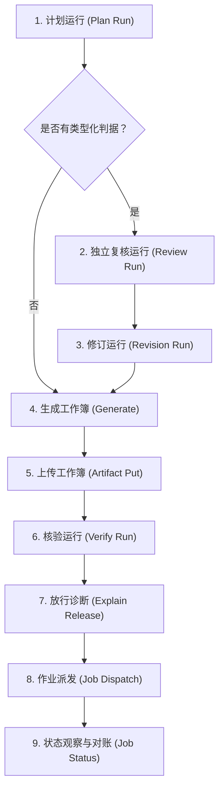

# R5 真实台架派发运维手册

> 本手册面向 Circle-Hub 平台运维管理员，用于指导真实台架（Test Bed）派发运维中的配置对齐、版本升级、床面门状态流转、床面占用（bed hold）处置及端到端派发全流程排错。所有执行器、作业、运行、用例及地址均采用规范占位符（如 `<执行器>`、`<作业摘要>`、`ORBIT/COMET`、`192.0.2.x`），严禁写入真实资产标识。

---

## 一、执行器登记冻结与运行快照机制

### 1.1 核心原理
当管理员发起核验运行（`circle-hub run start`）时，核心会在运行创建事务中将当前数据库中已启用的执行器登记表解析为 SHA-256 摘要，与核心边界政策版本（`run.policy`）一同持久化冻结在运行快照（`run.executors`）中。

在执行 `circle-hub job dispatch --run <核验运行> --executor <执行器>` 时，派发服务通过放行边界第 6 款（`hub/dispatch/effect-gate.ts` 中的 `global` 检查）校验环境与执行器定义：
1. 当前数据库中的执行器登记必须处于启用状态，且当前解析摘要必须完全等于核验运行中冻结的快照摘要（`registry[executor] === resolved_digest`）；
2. 运行锁定的政策版本必须等于现行核心政策版本；
3. 执行器声明的环境（如 `staging` / `production`）必须与运行快照一致。

### 1.2 故障现象与根因
- **现象**：修改执行器配置后，直接拿改动前已建好的核验运行继续派发。
- **拒绝回执**：阶段为 `boundary_refused`，错误码为 `BOUNDARY_POLICY_DENIED`（第 6 款）：
  ```text
  核心政策、所用执行器登记或声明环境与运行快照不符；请开新修订
  ```
- **根因**：执行器定义一旦变更（无论是探针列表、核验函数身份、协议版本或回调字段），其配置解析摘要即刻改变，导致旧核验运行冻结的快照与当前执行器定义不一致。
- **下一步动作**：**执行器改动后，旧核验运行不可再派发**。必须使用相同的输入原件重新开启一次新的核验运行，生成绑定最新执行器快照的运行记录，再执行派发。

### 1.3 执行器变更影响矩阵

| 变更场景 | 涉及修改的执行器字段 | 字段示例 / 变更说明 | 是否需新开核验运行 | 下一步动作 |
| :--- | :--- | :--- | :--- | :--- |
| **工作流包升版** | `proof.warrant_id` | 改为 `<工作流包>.workbook_verified@<新版>` | **必须新开** | 更新执行器定义后，重新开启核验运行再派发 |
| **网关协议版本更新** | `reconciliation.protocol_versions` | 数组中追加网关会话版本（如 `["1", "2"]`） | **必须新开** | 更新执行器定义后，重新开启核验运行再派发 |
| **网关结果归属认证** | `premises.result_ownership` | 更新 `version` 及 `evidence` 数组 | **必须新开** | 存入认证证据，更新执行器定义后重新开启核验运行 |
| **请求日志协议认证** | `premises.request_journal` | 更新 `version` 及 `evidence` 数组 | **必须新开** | 存入日志证据，更新执行器定义后重新开启核验运行 |
| **台架探针集调整** | `probes` | 增删探测项或调整工具调用参数 | **必须新开** | 先登记探针基线，更新执行器定义后重新开启核验运行 |
| **结果指针与对账映射** | `result` / `reconciliation` | 调整 JSON 指针、状态映射字典 | **必须新开** | 更新执行器定义后，重新开启核验运行再派发 |
| **网络端点 / 凭据名更新** | `transport.url` / `credential` | 调整执行器通信 URL 或切换凭据名引用 | **必须新开** | 更新执行器定义后，重新开启核验运行再派发 |
| **仅密钥密文字节轮换** | 无（通过 `secret set` 轮换） | 执行器定义文件未变，仅金库中密文更新 | **无需新开** | 运行快照只锁定凭据名引用，密文轮换后旧运行可直接派发 |

---

## 二、关键版本升级与配置对齐清单

### 2.1 case-compile 工作流包升版本
- **发现方式**：
  在派发前运行放行诊断命令：
  ```bash
  circle-hub job explain-release --run <核验运行> --executor <执行器>
  ```
  命令返回非零退出码（退出码 1），输出第 3 款诊断未通过：
  ```text
  proof.claims.warrant_id: 核验函数身份等于执行器指定身份 [false]
  ```
- **故障根因**：
  新版本 `case-compile` 生产的工作簿核验事实主张中，其凭证标识为 `<工作流包>.workbook_verified@<新版本>`；而执行器定义的 `proof.warrant_id` 仍停留在旧版本（如 `@0.1.0`），导致身份比对失败。
- **怎么改**：
  编辑执行器定义 JSON 文件，将 `proof.warrant_id` 更新为新版本精确标识：
  ```json
  "proof": {
    "warrant_id": "case-compile.workbook_verified@<新版本>"
  }
  ```
  执行更新命令：
  ```bash
  circle-hub executor update <执行器> <执行器定义文件.json>
  ```
- **证据存放**：
  该核验事实由 `case-compile` 在核验运行时由包内沙箱函数自动生产并写入运行结果记录中，无需手动采集外部文件。
- **下一步动作**：执行器更新后，重新开一次核验运行，再次执行 `job explain-release` 确认 `proof.claims.warrant_id` 为 `[true]` 后派发。

### 2.2 网关（Gateway）升版本
网关（MCP Gateway / 执行代理）升级后，执行器定义中必须同步对齐协议支持版本与归属认证前提，否则会在派发时遭到拒绝。

#### 1) 投递协议版本未对齐
- **发现方式**：
  执行派发时，预检阶段抛出错误中断：
  ```text
  投递会话版本未登记请求协议支持
  ```
  提示：`管理员核对发送会话版本及协议证据，登记该版本支持或更换受支持版本后重新派发；尚未提交`。
- **故障根因**：
  网关建立 MCP 连接并在 `initialize` 阶段上报了其当前实现的 `serverVersion`，但该版本未包含在执行器定义的 `reconciliation.protocol_versions` 数组白名单中。
- **怎么改**：
  核实网关版本的协议规范文档与支持证据，在执行器定义中追加该版本：
  ```json
  "reconciliation": {
    "protocol_versions": ["<旧版本>", "<新版本>"]
  }
  ```
  运行 `circle-hub executor update <执行器> <定义文件.json>` 更新。

#### 2) 结果归属前提（result_ownership）未认证
- **发现方式**：
  1. 运行 `circle-hub job explain-release` 时输出：
     ```text
     无判定前提 result_ownership；缺事实：执行器未登记结果归属前提 result_ownership
     ```
  2. 派发执行后，作业轮次判定滞留在无判定状态，状态输出：
     ```text
     本结果的归属值相符，但当前目标版本的归属前提尚未认证
     ```
     提示：`请管理员复核 ... 的归属证据，为该目标版本登记 result_ownership 认证；认证用于后续核验，本作业保留无判定，不重交`。
- **故障根因**：
  执行器定义中声明的 `premises.result_ownership.version`（以及存在 `request_journal` 前提时的版本）必须与网关当前实际会话版本**逐字完全相同**，且所引用的原件证据必须在对象库中完整存在。网关升级后，旧版本的认证证据无法自动适用于新版本。
- **怎么改与证据存放**：
  1. 取得网关新版本的协议实现规格与归属机制说明，保存为本地证据文件 `gateway-evidence.json`；
  2. 将证据原件存入 Hub 对象库：
     ```bash
     circle-hub artifact put --file gateway-evidence.json
     ```
     记录命令返回的原件引用（形如 `src:<64位SHA-256>`）；
  3. 在执行器定义的 `premises` 中登记认证前提：
     ```json
     "premises": {
       "result_ownership": {
         "version": "<网关新版本>",
         "evidence": ["src:<64位SHA-256>"]
       }
     }
     ```
  4. 运行 `circle-hub executor update <执行器> <定义文件.json>` 更新执行器；
  5. 重新开核验运行后派发。

---

## 三、床面门（Bed Surface Gate）与探针基线运维

### 3.1 运行机制
为防止用例在脏台架上执行或污染共享台架，派发机制在真正下发作业前（Pre-check）和作业收尾后（Post-check）分别读取一遍执行器声明的探针集（`probes`），将抓取到的探针原文与系统登记的基线进行**逐行逐字比较**。

### 3.2 基线管理命令
```bash
# 1. 在床面确认干净时，为执行器的指定探针登记当前抓取为新基线（理由必填或选填说明）
circle-hub bed baseline record <执行器> --probe <探针ID> [--reason <说明>]

# 2. 列出指定执行器（或全部执行器）已登记的所有探针基线摘要与登记信息
circle-hub bed baseline list [<执行器>]

# 3. 打印指定探针当前登记的基线原文正文
circle-hub bed baseline show <执行器> --probe <探针ID>
```

### 3.3 重新登记基线的标准时机
严禁在出现残留报错时盲目登记基线掩盖问题。仅在以下经过管理员核准的场景下重新登记：
1. **台架冷/热重启后**：设备完成系统自检，初始化服务加载完毕，确认处于纯净初始态；
2. **正规网络或环境变更后**：设备完成了计划内的网络拓扑、接口地址或路由策略调整，并经人工核验无误；
3. **残留彻底清理后**：上一次作业产生的临时配置或接口已被清理脚本消除，经比对确认已完全干净。

### 3.4 探针门禁三种报错的区别与处置

| 报错文字 | 触发阶段 | 错误本质与判定逻辑 | 管理员处置出口（下一步动作） |
| :--- | :--- | :--- | :--- |
| **`床面探针缺失：<探针ID>`** | 跑前 / 跑后抓取 | **I/O 级失败**。执行器调用的探测工具失败、超时或返回数据中未包含声明的探针字段，连当前现场都没读到。 | 检查执行器探针网络连接与认证凭据，确认台架探针服务正常响应后重试。 |
| **`未登记基线，无法判残留。来源探针 <探针ID>`** | 跑前门禁比对 | **缺少标准参照物**。探针读到了当前床面原文，但在 `bed_baseline` 记录表中管理员从未为该探针登记过基线。 | 由管理员登录台架确认当前状态纯净，执行 `circle-hub bed baseline record <执行器> --probe <探针ID> --reason <理由>` 登记基线。 |
| **`床面存在残留，与登记基线不一致。来源探针 <探针ID>；第 X 行改变: - exp / + act`** | 跑前残留核验 | **现场脏，与标准不符**。探针抓取成功，基线也存在，但原文逐行逐字比对出现差异，存在未清理的路由、配置或接口。 | 1. 优先由清理责任人按提示命令（如 `item.cleanup.command`）执行清理后重试；<br>2. 若确认为正规系统变更后的合法新状态，由管理员确认干净后更新基线（`bed baseline record` 带理由）。 |
| **`该床尚未恢复，不能派发。来源探针 <探针ID>`** | 跑前占用核验 | **历史未结清阻断**。上一次派发留下了未结清的 open 占用，当前读出的状态与上次占用时的快照不一致（详见第四节）。 | 按下节指引清理残留，或经管理员确认干净后通过 `bed hold clear` 显式结清。 |

---

## 四、床面占用（bed hold）与故障出口

### 4.1 机制原理与正常流转
1. **产生 open 占用**：派发作业收尾时，系统再次抓取床面探针。若跑后抓取与跑前抓取原文不一致（`unrestored`），或作业异常中断导致未完成确认恢复，系统会自动在事件日志中追加一条 `state: "open"` 的 `bed_hold` 记录；
2. **下一次派发自动结清**：下一次派发启动时，跑前门禁首先检测是否存在 open 占用。若存在，会将本次抓取的探针原文与上次留下的占用快照逐项比对：
   - 比对完全一致（说明环境已恢复至上次占用前的干净基线），系统自动追加一条 `state: "clear"` 的 `bed_hold` 记录，自动解封并继续放行；
   - 比对不一致，阻断派发并抛出：`该床尚未恢复，不能派发。来源探针 <探针ID>`。

### 4.2 现状已知坑点与死锁场景
1. **探针集变动导致比对无法完成**：若管理员在中途更新了执行器定义中的探针列表，导致新旧探针集不完全一致或交集为空，系统无法完成对等比对，导致门禁永久死锁；
2. **收尾偶发二轮后读遗留误占用**：当真实设备响应迟缓或后台异步任务收尾延迟时，收尾阶段可能触发两轮后读比对，偶发性地将良性延迟误判为 `unrestored`，留下错误的 open 占用。

### 4.3 管理员显式结清出口（bed hold clear）
为解决上述死锁与误占用，平台提供了管理员显式结清机制：
- **命令语法**：
  ```bash
  circle-hub bed hold clear <执行器> --reason <单行理由>
  ```
- **权限与约束**：
  1. 仅限平台管理员执行，普通用户无权调用；
  2. `--reason` 参数必填且必须为单行非空说明，严禁包含换行符；
  3. 仅在当前台架存在未结清的 `open` 占用时，追加一条 `state: "clear"`、结清方式为 `admin` 的新记录，**绝对不篡改或删除历史记录**；
  4. 若当前没有 open 占用，命令幂等输出 `没有未结清的占用`，不写入任何新记录。
- **成功回执示例**：
  ```text
  已结清占用：执行器 <执行器>；台架 <台架>；作业 <作业摘要前12位>；方式 admin
  ```
- **使用前置原则**：
  管理员**必须首先登录真实台架设备**，人工排查并确认当前床面确实处于干净状态（例如设备已完成物理重启、上一次用例遗留的配置与进程已被完全手工清除），方可执行结清命令。

---

## 五、工作簿一次性派发约束（一次一簿）

### 5.1 约束机制
核验运行在启动时，其放行条件（`submit_verified_workbook` 效果行）被赋予了严格的执行额度预算（`budget.count = 1`）。派发服务在通过放行边界第 4 款（`EFFECT_BUDGET_EXHAUSTED`）时，会在数据库中锁定并消费该核验运行名下的效果行预算（`dispatch.effect-budget:<核验运行>:<效果行ID>`）。

### 5.2 重复派发拒绝现象
若尝试对同一个核验运行执行第二次派发：
```bash
circle-hub job dispatch --run <同一核验运行> --executor <执行器>
```
命令将被边界第 4 款直接拒绝：
```text
效果行 submit_verified_workbook 的次数、时长或期限预算用完；请开始新修订或缩小范围
```

### 5.3 哪些情况会被认定为“同一份”？
| 判定维度 | 行为特征 | 是否允许再次派发 | 判定原因 |
| :--- | :--- | :--- | :--- |
| **直接重复派发** | 使用相同的 `--run <核验运行>` 再次执行 dispatch | **严格拒绝** | 该核验运行的效果行配额计数已达上限（1 次已耗尽）。 |
| **前次派发中断重试** | 上次派发在建立连接前因网络抖动中断，直接重新 dispatch 该运行 | **严格拒绝** | 只要配额锁定与预检记录已持久化，即视为已消耗。 |
| **重复上传同一工作簿** | 将原 `.xlsx` 文件重新上传生成新的 `src:<SHA-256>`，但绑定的计划运行前驱未变 | **严格拒绝** | 工作簿配方中的计划前驱与原件摘要关联未更新，核验事实冲突。 |
| **全新计划与修订流** | 开启新的计划运行 → 生成新工作簿 → 上传 → 开新核验运行 | **允许派发** | 具备全新的计划前驱与独立的核验运行配额。 |

**正规重派出口**：要重新执行派发，必须启动全新的流程修订（见第六节）。

---

## 六、端到端派发全流程总览与速查表



### 6.1 各阶段操作速查表

| 步骤 | 操作阶段 | 命令示例 | 成功表现 / 关键标识 | 常见拒绝原因与下一步动作 |
| :--- | :--- | :--- | :--- | :--- |
| **1** | **计划运行** | `circle-hub run start --pack case-compile --product <产品> --build <构建> --input subject=... --param autoid=<用例ID>` | 状态为 `completed`；产出目标条目投影；记录新运行号 `<计划运行>` | **参数/原件错误**：检查 `--param` 与输入原件引用是否完整。 |
| **2** | **类型化判据复核** | `circle-hub run start --pack case-review-verify --product <产品> --build <构建> --predecessor <计划运行> --input subject=...` | **注意**：必须有 `location`，且 review 要求项为 `satisfied`（**不能只看运行已受理 `accepted`**）。产出快照记录与结果记录。 | **独立性违规**：必须由非作者独立账号发起复核；缺少 `location` 时拒绝。 |
| **3** | **修订运行** | `circle-hub run start --pack case-compile --product <产品> --build <构建> --predecessor <计划运行> --input criteria_review=rec:<结果摘要> --input criteria_review_run=rec:<快照摘要>` | 状态为 `completed`；`criteria_review` 槽位绑定有效；生成用例配方（recipe） | **复核未满足**：若复核结论为 `refute` 或槽位未绑定，编译拒绝。 |
| **4** | **生成工作簿** | `node packs/workflow/case-compile/tools/generate-workbook.ts --run <修订运行> --output workbook.xlsx` | 成功导出本地 `workbook.xlsx` 文件，内含配方摘要与待测资产清单哈希 | **环境缺项**：核对节点环境依赖，确保清单与执行器匹配。 |
| **5** | **上传工作簿** | `circle-hub artifact put --file workbook.xlsx` | 输出原件引用：`src:<工作簿SHA-256>` | **文件不可读**：检查本地文件路径与读取权限。 |
| **6** | **核验运行** | `circle-hub run start --pack case-compile --product <产品> --build <构建> --predecessor <修订运行> --input workbook=src:<工作簿SHA-256>` | 产出 `workbook_verified` 事实主张；`delivered` 分区包含用例；赋予 `submit_verified_workbook` 效果行 | **工作簿字节不匹配**：工作簿内容被擅自篡改，与前驱配方不一致。 |
| **7** | **放行诊断** | `circle-hub job explain-release --run <核验运行> --executor <执行器>` | 退出码为 0；九款条件全部显示为 `satisfied: true`；无未决前提 | **身份不匹配**：见第二节，核对 `proof.warrant_id` 与网关协议版本。 |
| **8** | **作业派发** | `circle-hub job dispatch --run <核验运行> --executor <执行器>` | 派发成功，输出作业摘要 `<作业摘要>`，进入观察与执行轮次 | **床面未恢复/基线不符**：见第三、四节处理床面门或结清占用。 |
| **9** | **状态与对账** | `circle-hub job status <作业摘要>`<br>中断恢复：`circle-hub job resume <作业摘要>` | 显示作业阶段（`phase`）、判定终态（`terminal`）、结果引用与事件计数 | **保留无判定**：检查 `result_ownership` 是否认证；必要时执行 `dispose`。 |
