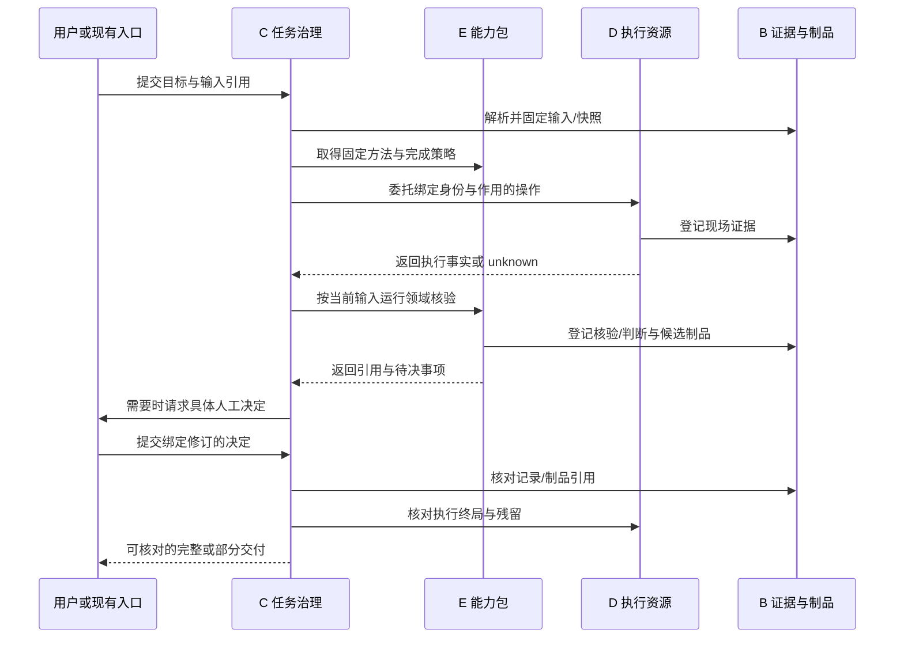

# C/D/E 实现讨论 V1

日期：2026-10-10。状态：**设计检查与实现提案，未采纳为新的实现基线。** 用户要求在知识库讨论之后继续讨论其余三类，Circle 本轮不展开；用户选择 **C 优先评估 Temporal TS**。这确定评估顺序，不代表已采用 Temporal、固定包版本或授权实施。

本轮只检查资料、写设计与计划、发布到私有 GitHub；不修改业务代码、不安装依赖、不启动服务、不运行设备/浏览器实验。A 保持已有入口职责；B 的知识库设计沿用 ADR 0003，仅使用其引用和登记接口。F/G 继续作为横切工程。

后续需求修订：用户要求 Circle 发起 Web 操作时全过程实时可见，并认可 Otty 并排/普通终端外部 Chrome 两种布局，记录为 [ADR 0014](decisions/0014-operator-visibility.md)。因此 A 的薄展示契约进入讨论，Circle 核心仍不展开；D 的浏览器/终端要提供同会话实际视图，方案与待执行验收见[可见性计划](operator-visibility-plan-v1.md)。后续 P2-6 是 HTTP 流程级，不能满足该新增可见性要求。本页原固定检查记录保留，不改写历史结论。

## 1. 检查基线与当前事实

检查对象：私有仓库 `qingshanfeihu/infosec-platform` 的 `main`，初始基线 `42364bd`；发布前补读 P2-4/P2-5 并固定提交 [`1a59d6f`](https://github.com/qingshanfeihu/infosec-platform/commit/1a59d6f)。后续新增 V04/APV 内存夹具及 D 的 markUnknown/unknown 守卫，未改变下文指出的 C 门禁与 D 停止/对账核验路径；源码定位保留原提交。检查内容包括 README、议程、相关 ADR、知识与对象基线、共同契约、适配/验收计划、P1/P2 记录，以及下表所列 TS 源码。

| 对象 | 当前可见的产物 | 这次确认的边界 |
|---|---|---|
| C 任务与协作治理 | `packages/platform/src/tasks.ts` 的阶段机、待输入和清单门禁；P2-1 记录 | 单进程内存参考实现，不能据此声称持久恢复、可信身份、并发推进或跨用户治理已完成 |
| D 操作执行与资源 | `operations.ts`、`leases.ts` 的内存操作、租约和幂等逻辑；P2-1 记录 | 没有从该核心代码得到真实设备/浏览器/子进程执行证明；R02 的租约测试不等于实际进程被杀后的对账实验 |
| E 能力包与业务规则 | `packages/chain-v05` 的主题树/content.json → IR → 工作簿；P2-2 记录 | 当前按深度映射节点为行；没有证明业务命令/预期编译、`.xmind` 二进制版本兼容或全量旧功能迁移 |
| D 模拟设备纵切 | P2-5 内存 APV 夹具/驱动与场景记录，平台增补 markUnknown | 回读核对和模拟变更计数有历史记录；逻辑延迟非真实计时，没有证明真实协议、进程级 R02 或真机行为 |
| E 用例评审 | `packages/chain-v04/src/service.ts` 与 P2-4 记录 | 四个声明维度的规则式 scripted 方法；校准位置仅信息对照、修订文本为测试夹具，不构成任意用例的语义评审质量证明 |
| B（本轮不展开） | knowledge/assessor/chain-v01 包；P2-3 记录 | 存在最小实现和 scripted 校准记录；不等于知识库 V1 完整实现或真实模型质量通过 |

本轮**未重跑业务测试**。历史数字和完成声明以 [P2-1](p2-1-platform-record.md)、[P2-2](p2-2-v05-record.md)、[P2-3](p2-3-v01-record.md)、[P2-4](p2-4-v04-record.md)、[P2-5](p2-5-v02-record.md) 原记录为准；本页只确认文件内容存在并检查其中的范围，不签发新的 L1/L2 通过结果。

## 2. 设计检查发现与处置

| 编号 | 发现及来源 | 对后续实现的要求 |
|---|---|---|
| DOC-01 | README、议程、架构和验证矩阵仍含“无业务实现”“下一步 P1-2”“当前 L0”等旧口径，与 P1/P2 文件不一致 | 同步入口文档，分开设计基线、已有参考实现、历史执行记录和本轮未验证项；不据此补判整链通过 |
| DOC-02 | 两份不同的 ADR 都使用 `0010`（[产品范围](decisions/0010-product-line-scope.md)、[P1 收口](decisions/0010-p1-closing.md)） | 本轮引用完整文件名区分；编号归一保留为编辑维护事项，不改写已接受决定或历史引用 |
| C-01 | [`TaskService.transition`](https://github.com/qingshanfeihu/infosec-platform/blob/42364bd8bc00036ce8a19a7ebb471d669044a349/packages/platform/src/tasks.ts#L74) 是公共方法；[阶段表](https://github.com/qingshanfeihu/infosec-platform/blob/42364bd8bc00036ce8a19a7ebb471d669044a349/packages/contracts/src/vocab.ts#L105) 允许 under-review → delivered。检查门禁只在 `deliver()` 路径 | 所有进入 delivered 的路径均须经过同一权威检查，通用迁移接口不能形成旁路 |
| C-02 | [`satisfyItem`](https://github.com/qingshanfeihu/infosec-platform/blob/42364bd8bc00036ce8a19a7ebb471d669044a349/packages/platform/src/tasks.ts#L183) 直接写布尔值；[`evaluateCompletion`](https://github.com/qingshanfeihu/infosec-platform/blob/42364bd8bc00036ce8a19a7ebb471d669044a349/packages/contracts/src/records.ts#L119) 只检查传入项，空数组也无 missing | C 应从已绑定的完成策略确定必需项，并解析记录引用；调用者提交“已满足”或删空清单不能成为交付依据 |
| C-03 | [`TaskService`](https://github.com/qingshanfeihu/infosec-platform/blob/42364bd8bc00036ce8a19a7ebb471d669044a349/packages/platform/src/tasks.ts#L40) 持有 Map；查询/迁移未接收可信身份上下文，返回内部记录 | 持久受理、角色校验、分区读取、修订冲突和审计必须落在权威路径；内部可变对象不能作为客户端写入通道 |
| D-01 | [`confirmStopped`](https://github.com/qingshanfeihu/infosec-platform/blob/42364bd8bc00036ce8a19a7ebb471d669044a349/packages/platform/src/operations.ts#L230) 不要求停止证据即推进取消状态；[`reconcile`](https://github.com/qingshanfeihu/infosec-platform/blob/42364bd8bc00036ce8a19a7ebb471d669044a349/packages/platform/src/operations.ts#L295) 的最终结论接收 outcome/evidenceNote，代码未核对实际执行端记录 | 停止与对账必须由可信执行适配器观察并出具可解析证据；调用者不能凭结论或说明文字签发现场事实 |
| D-02 | [`writeGuard`](https://github.com/qingshanfeihu/infosec-platform/blob/42364bd8bc00036ce8a19a7ebb471d669044a349/packages/platform/src/operations.ts#L208) 和租约只在本进程检查 | 执行出口须强制核对；对不识别 fencing token 的设备，平台还须保证旧 worker 无法继续发命令，失联时不得立即把资源重新分配为可写 |
| E-01 | [`compileRows`](https://github.com/qingshanfeihu/infosec-platform/blob/42364bd8bc00036ce8a19a7ebb471d669044a349/packages/chain-v05/src/compile.ts#L25) 的当前规则为深度 ≥ 2 生成行 | 保留结构纵切的准确名称与范围，专业编译另外定义业务 IR、来源约束和判据；不把结构通过扩大成旧编译能力等价 |

以上 C/D 项是**源码可见的检查路径缺口**，不是本轮执行复现报告。本轮不修代码。实现评审应先确认内部参考 API 的暴露边界，再用第 7 节样本复现并修复；不得直接继承包 README 中更宽的保证。`Registry` 位于 platform 包是物理合并，本身不违反逻辑边界：证据/产物权威仍属 B，C 消费引用。

## 3. C：任务与协作治理

### 3.1 面向用户的能力

用户给出一个产品任务，关闭入口后仍能查询进展、补充资料、回应问题或接管；输入改变后旧审批和旧结论不会授权新版本；交付有明确的产物、证据和未完成事项。一个简单任务可直接执行，一个长任务可分阶段，批量任务可保留失败子集。支持需求、开发、定位、测试、发布和维护的共同生命周期。

C 持有目标、输入修订、计划修订、run/阶段推进、待人工决定、授权与预算、任务审计及完成准入。E 给出领域流程和必需检查，D 给出执行事实，B 保存记录与内容；C 不自行发明产品判据。

### 3.2 逻辑模块与记录（提案）

| 模块 | 记录与权威检查 |
|---|---|
| Task service | Task、InputRevision、PlanRevision、Step、Run；每次写入绑定 `(tenantId, scopeId, taskId, expectedRevision)`，冲突拒绝而非静默覆盖 |
| Decision service | PendingInput、Decision、Override；从可信身份取得角色，绑定当前输入和具体问题；保留过期、重复与冲突响应 |
| Policy/budget service | scope 成员、授权引用、允许作用、截止时限、用量；沿用 ADR 0012 的四角色，不从 prompt 签发身份 |
| Completion service | 固定版本的必需项策略 + 检查结果；读取 E/B/D 的真实记录，核对范围、修订、未知与人工签字；在交付事务中复核输入未变化 |
| Durable runner | 定时器、等待、事件唤醒、阶段重试、崩溃恢复；只通过任务服务推进领域状态，不拥有另一套可直接写的任务终态 |

PlanRevision 是分解方案，InputRevision 是用户目标/资料/参数与绑定；普通重排计划不应让所有无关资料失效，但改变检查集合、操作范围或交付对象须重新验证受影响的审批与结果。明确依赖后只复用仍有效的步骤，不把任务进度清零，也不复用旧修订批准的新写操作。

单任务设明确负责人；协作者得到范围、输入、产物和证据引用。并行步骤只在依赖独立且资源许可时启动。多 agent 是可选执行方式，数量和收益另行比较；C 不承担另一个通用模型推理循环。

### 3.3 持久运行路线

| 路线 | 适用性与代价 | 本轮建议 |
|---|---|---|
| **Temporal TS + C 的业务存储** | 复用 Workflow/Activity/Worker、等待与恢复能力；增加服务运维、流程升级和重放兼容要求。Workflow 确定性推进，模型/API/数据库交互放 Activity | **用户选择优先评估。** 用同一任务/故障样本证明权威边界，再决定是否采用；无本轮安装或部署 |
| PostgreSQL 任务表 + TS worker | 可少引入一套服务；需要自行承担可靠唤醒、定时器、worker 故障、重复消息、历史与流程升级 | 保留替代路线。若任务只需有限阶段，可评估其成本；不默认开发通用工作流引擎 |

Temporal 的上述原语和确定性约束来自 [TS 官方指南](https://docs.temporal.io/develop/typescript)与 [Workflow 定义](https://docs.temporal.io/workflow-definition)。选择框架是本项目提案。PostgreSQL 的 `SKIP LOCKED` 可用于多消费者队列表，但不能提供一般一致读取，见 [SELECT 文档](https://www.postgresql.org/docs/18/sql-select.html)；不能仅靠取队列的行锁推断远端副作用只发生一次。

若采用 Temporal，建议明确两类状态：Temporal history 管定时器、调度和重放；C 的事务记录管输入、身份、人工决定和交付。客户端调用 C，C 事务写入领域变更与 outbox；中继按固定事件身份向运行层发送，消费者幂等处理。Activity 通过 C/D 接口取当前版本并执行，不同时直写两套状态。该组合的崩溃、重复投递和恢复是必测项；流程代码版本与任务计划版本分别固定，已有 run 不静默换用新流程。

### 3.4 受理与交付

受理先验证身份/范围、绑定输入、能力版本、预计作用和截止时限，再事务保存任务/幂等记录/唤醒记录；成功持久提交后返回 accepted。当前内存参考实现不满足这个保证。

交付先从固定完成策略展开所有必需项，再解析 Verification/Assessment/Decision、D 对账和 B 制品引用。每项保存核验结果、范围与依据；`satisfied` 只能是核验后的投影。校验缺项、陈旧输入、未决 unknown 或清理失败均不能完整交付。若 E 定义允许的 partial，并有相应人工接受，可交付明确的部分成果；任务交付与外部接收确认分别登记。详情沿用 [VER-03](common-contracts-v1.md)及[完成清单](completion-checklists-v1.md)。

## 4. D：操作执行与资源

### 4.1 形态与接口（提案）

一个执行控制面加按资源/故障边界隔离的 TS workers：工作区/子进程、设备通道、浏览器、外部工程系统。控制面登记资源身份和当前环境修订，管操作/attempt、租约、准入与回执；worker 持有真实进程和连接。可以先一个控制面，worker 数量随网络、权限和资源隔离需要确定。

复用已经冻结的 `submit/status/result/input/cancel/reconcile` 六调用语义，不新增平行的成功词表。每次 attempt 有独立身份和开始/结束/最近心跳、目标身份、执行程序版本、租约/fencing、实际作用和证据引用。保留 24h 去重、7d 结果保留、60s 租约/20s 心跳的 ADR 0011 基线；这些是可配置参数，不重定数值。

操作的 EffectDescriptor 描述连接/占用、本地写入、远端变更和传输等作用，`read` 标签本身不足以允许自动重派。幂等比较覆盖可信分区、目标和所有执行绑定；同一去重键不能跨 scope 返回他人的操作。既定去重键规则若需更改，另行修订 ADR 0011；本稿不静默改协议。

### 4.2 执行链

1. 验证任务委托、作用和目标；固定身份/版本/指定通道。不能由模型自行切换到更方便的目标或通道。
2. 持久受理操作与 attempt；获取有效租约。紧邻实际副作用的执行出口再次核对权限、输入、目标和 fencing。
3. 执行并持续记录实际收发/进程/页面观察；证据按 B 契约登记。回执上传失败不能改写为“未执行”。
4. 将执行结果与 E 的业务核验分开；变更接受、配置读回、运行状态、流量结果各自记录。
5. 清理并核对遗留；无法确认现场时保留 unknown 和核对入口，C 不将其当作完整成功。

传统 SSH设备不一定验证平台 token。建议平台统一受控执行出口，派发前拒绝旧 token，并隔离/关闭旧 worker 的写通道；操作已发出或旧 worker 无法确认停手时，保持资源不可重新写入并对账。数据库租约过期只撤销权限，**不证明旧设备命令已经停止**。若无法实现这一边界，应限制该操作的自动接管，而不是宣称具备远端 fencing。

### 4.3 三类首批 worker

| Worker | 初期能力与输出 | 专业规则来源 |
|---|---|---|
| Workspace/process | 隔离工作区、文件/命令/构建测试、退出码与进程树、产物、取消后的实际存活核对 | E 的需求/代码/测试/发布规则；D 不因退出码 0 判断任务完成 |
| Device | 身份发现、原始 SSH收发、采集、受控变更/读回/清理 | E 的产品与版本适配、命令、预期和业务判据；首个 APV fixture 不代表其他产品线兼容 |
| Browser | 独立 context、DOM/定位、截图/网络/trace、下载与受控人工输入 | E 的页面方法、前置条件、脚本和业务断言；凭据/MFA 只由敏感通道注入 |

浏览器建议优先评估 Playwright 公共 TS API 与 Test 的隔离/断言/trace；[BrowserContext 文档](https://playwright.dev/docs/browser-contexts)说明其隔离模型，[认证文档](https://playwright.dev/docs/auth)说明认证状态包含可冒用账号的敏感 cookie/header。平台的 scope、任务和执行治理仍由 C/D 实现；context 不是完整安全沙箱。视觉探索、稳定脚本、API 分别声明能力，HTTP 登录流程通过不能冒充浏览器操作通过。

### 4.4 取消与恢复

沿用 cancel-requested、cancel-delivered、stopped-observed 与残留核对四段。C 收请求；D 确认送达；worker 观察进程树/远端操作/页面作用；D 保存证据并处置资源。没有真实观察的 `confirmStopped()` 不作为生产路径。取消后既有副作用仍需列出，需补偿的操作单独准入。

若用 Temporal，不把 Activity 取消异常或 Workflow 终结映射为设备已停止。官方 [TS cancellation 文档](https://docs.temporal.io/develop/typescript/workflows/cancellation)说明普通 Activity 通过 heartbeat 收取消，默认 TRY_CANCEL 可在 Activity 仍运行时返回；即使等待 Activity 确认，也仍需 D 核对实际远端和残留。

恢复按稳定 operation 身份查询执行端状态与实际作用。仅在证据证明上次未执行或可安全继续时决定后续；结果不明的写操作不自动重派。超出去重窗口也不代表可以无条件重新写入，重试前仍检查历史未知与目标状态。

## 5. E：能力包与业务规则

### 5.1 交付形态

建议一个能力包包含方法说明、TS 程序、版本化输入/输出 schema、领域核验规则、流程模板及独立样本。先把现有 chain-v05 与 chain-v04 按同一边界组织，再接诊断、需求/代码、测试与发布维护能力，不预先固定 skill 数量。

SKILL.md 沿用 [Agent Skills 规范](https://agentskills.io/specification)，配套脚本全部 TS。平台另有能力清单，用于可执行接口、作用、依赖与版本校验；它与 skill 文案分别负责运行契约和方法说明，不发明第二套 skill 文档标准。声明可用、运行可用、验证通过分别记录。

### 5.2 候选清单字段

| 内容 | 表达的约束 |
|---|---|
| capabilityPackId、packVersion、contentHash | 固定实际使用的包内容；升级不替换正在运行任务的绑定 |
| contractRange、input/output schema、entrypoints | 与 F 契约兼容的可调用程序；不兼容显式拒绝 |
| product/version/task applicability | 产品线、型号/版本、任务类型与不支持范围；命令等产品语义不写入 C 核心 |
| knowledgeRequirements、requiredOperations、effects | 需要的来源/快照、D 操作与权限；说明不会自行赋予执行权 |
| completionPolicyVersion、verifiers、assessmentMethods | 必需的程序核验、判断/弃权、人工签字和 partial 规则；C 执行共同完成准入 |
| provenance、samples、validationRefs | 方法/规则依据、独立回归与已测范围；没有验证回执的声明标为未验证 |

先复用 contracts 的已冻词表/schema。新 pack 清单先讨论其兼容和运行需求，再冻结具体 schema；本轮不给出可直接作为对外 API 的代码。

### 5.3 专业工作分工

程序处理结构、位置映射、哈希、精确参数、确定的规范和产物格式；模型只承担需理解的意图、歧义和支持性判断，保存方法/版本/证据及弃权。人工决定进入 C。模型输出一个命令候选仍需 E 核验和 C/D 准入，不能直接进 shell 或设备。

E 可以在本地库、C 的流程步骤或 D 的隔离 worker 中执行；耗时、资源和副作用决定位置，规则所有权不变。E 产出 VerificationRecord、Assessment/findings、待澄清请求、候选产物与后续建议；E 不直接写任务 delivered、操作 succeeded 或 B 的发布指针。

### 5.4 按场景扩展

| 能力 | 先讨论/实现的闭环 | 保留的验收边界 |
|---|---|---|
| 脑图/用例编译 | 原节点 → 结构 IR → 业务 case IR → 来源/命令/预期核验 → 工作簿；不解释的内容列清单 | 当前只有结构层；真实 XMind、业务字段与设备用例通过另验收 |
| 用例/需求评审 | 固定输入与规范 → 机械 finding/语义 finding → 人工处置 → 新修订复审 | 报告包含版本、位置、严重级、规则/依据；scripted 校准不证明真实模型质量 |
| 故障定位与修复 | 固定环境 → 采集 → 假设/证据 → 复现 → 受控修改 → 回归 → 报告 | 假设不冒充根因；实际与 expected 分开；无证据不强行归因 |
| 开发、测试、发布维护 | 需求/代码/版本 → 隔离修改与检查 → 制品 → 批准的发布/回退 → 实际核验 | 不由单元测试通过推出发布成功；外部写入和升级为独立 D 操作 |

E 的流程模板告诉 C“该领域需要做哪些步骤和检查”；C 管等待、重试、修订与交付；D 管外部操作；B 管原件和结果。相同操作可被多个能力包复用，产品包不自建另一套租约/任务服务。

## 6. 三类组成一条任务链

示例为“定位某版本异常并交付修复报告”：E 定义需要什么规范与观测，D 采集/复现/修改，B 保存证据，C 等待决定与核验交付。缺设备、缺规范或原因不明时停在明确等待/未知并指出缺项；不要求为了闭环而产生确定根因。

## 7. 实施前的验证计划

以下全部是**待执行的复现/验收样本**，不改变本轮规划范围。每次未来验证固定提交、包/契约版本、输入 bytes/SHA、身份/scope、目标修订、run/operation/attempt、时间与真实效果。修复测试覆盖直接 API、组合服务和暴露入口，不能只保护一条包装路径。

| ID | 复现/故障场景 | 必须证明的结果 |
|---|---|---|
| C-T01 | 无清单依次迁移至 under-review，再直接请求 delivered；或提交空清单/任意 satisfied/refId | 每条路径均按领域必需项拒绝；有效引用和所需人工决定齐全才交付 |
| C-T02 | 旧输入的决定/制品、跨 scope 查询、无角色的人签字、两个推进者用同一旧修订写入 | 拒绝陈旧/越权和并发冲突；审计可查且当前任务不被推进 |
| C-T03 | 事务提交前后杀 C/中继/runner、重复/乱序唤醒；等待人工时重启 | accepted 的任务可恢复；未提交任务不冒充已受理；重复事件不重复阶段/操作 |
| C-T04 | Temporal 流程代码升级时仍有旧任务；接管新 run，保留原待决和已发生作用 | 旧流程能按固定版本恢复；不会重放副作用；不转移私人会话和原批准者身份 |
| D-T01 | 仅调 confirmStopped 或传入说明文字/任意 outcome 试图对账 | 没有可信执行记录不能落停止或确定终局；保留 unknown/实际运行状态 |
| D-T02 | 旧 worker 租约失效但仍连设备；新 worker 请求写；执行完成后回执前杀进程 | 出口拒绝陈旧写，资源未核对不重新分配为可写；实测作用次数和远端状态，不用 attempts 数代替 |
| D-T03 | 取消本地调用、Workflow 或 worker，但子进程/远端任务仍运行 | 区分四段；实际核对进程/远端和残留；无法确认不报已停止 |
| D-T04 | 两任务浏览器登录、会话过期/MFA、下载；指定 SSH通道的分页/CRLF/长输出 | 不串用 context/凭据；实际业务断言和原始通道证据保留；HTTP 路径不代替浏览器验收 |
| D-T05 | 同一幂等键在不同 scope/目标/输入绑定提交；超过窗口后重提仍未知的变更 | 不泄露/返回错误分区的旧操作；仍未知的副作用先对账，不以窗口结束为重写许可 |
| E-T01 | 同一规则缺陷分别出现在单项/批量、不同产品/协议；未支持节点、无来源预期、旧输入返工 | 通用契约保护，各问题有独立复现；不按样本 ID 编码特例；不把 actual 写回 expected |
| E-T02 | 升级包但已有 run 固定旧包；范围外请求、模型弃权/错误 supports；partial 未获接受 | 固定内容身份，不静默换规则；机械/语义结果分开；未决与不完整成果按真实状态交付 |

C-T03/04 是 Temporal 与替代路线的评估样本；比较恢复正确性、重复作用、升级成本和运维开销，再决定选型。D/E 隔离纵切与领域范围按已有 P2 计划继续设计；真实目标、真实模型、部署仍在各自后续范围。R01/R02/R04 的真实进程实验不能被时钟快进的内存测试替代。

## 8. 下一轮应形成的决定

| 议题 | 当前建议 | 尚需确定的范围 |
|---|---|---|
| C 持久运行 | **已选优先评估 Temporal TS**；业务状态与调度历史分别明确权威。**评估与定案已完成（2026-10-10，ADR 0022）**：C-T03/C-T04 对比后采用 PostgreSQL 任务表路线为持久运行基线，Temporal 保留为备选（再评估触发条件见 ADR 0022），证据见 `docs/p3-2-runtime-evaluation-record.md` | 存储/事务/outbox、流程升级、任务修订与预算、身份接入及包版本（「实测后是否采用」一项已由 ADR 0022 关闭） |
| D 执行控制面 | 统一控制面 + 隔离 TS workers，Browser 优先评估 Playwright | 首批工作区/设备/浏览器的具体操作面、强制出口、无法远端 fencing 时的限制与清理 |
| E 能力组织 | skill 方法 + TS 程序/schema/规则 + 版本清单；随任务链扩展 | 首批业务 IR/评审维度、方法依据、完成策略、partial 与真实脑图范围 |

讨论顺序建议 **C 的恢复与完成权威 → D 的副作用与对账 → E 的专业规则与扩展**；三者用第 6 节同一任务核对，不先把某类做成完整平台再接下一类。P2-4/5 的新增记录按其原范围阅读，P2-6 不因本稿被宣布完成或重排；实施变更在接受相应设计后另行记录。

## 9. 本轮检查方式与参考

本轮进行了 GitHub 远端/提交核对、设计与所列 TS 源码静态阅读、官方文档查阅，以及 Markdown 本地链接/格式与文档变更范围检查。没有安装平台依赖、运行包测试或验证服务，没有连接设备/浏览器/模型。官方文档读取日期为本页日期；其能力说明不证明本平台已经实现，具体版本在评估时固定。

沿用资料：[对象 V1](object-boundaries-v1.md)、[共同契约](common-contracts-v1.md)、[基础验证](foundation-validation-plan.md)、[P2 计划](p2-vertical-slice-plan.md)、[同类调研](research/comparable-platforms.md)。本页不重新讨论知识模型和 harness 内部实现。
