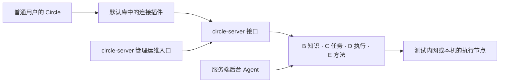

# Circle 与 circle-server 怎样一起开发和发布

2026-10-11。产品分工见 [ADR 0028](decisions/0028-circle-server-split.md)；本页的同步流程、发布门禁和 GitHub 安排是工程提案，不是已创建仓库或已运行服务的声明。

## 用户怎样使用

普通用户安装 Circle，在默认插件库启用服务端连接插件，填写 IP 或域名及需要的端口，完成登录，再选择有权使用的项目。之后通过原有会话工作，查看任务、实际操作与证据，回应问题、审批获准动作或接管操作。

没有配置 server 时，Circle 继续作为通用 harness 使用。插件不单独创建仓库或 Project，起步随 Circle 发行包交付。模块路径和宿主能力在实施前核验；现有前端组合样本不代表运行插件已经可用。地址保存在用户配置中，登录凭据走受控存储，不进入提示词或 Git。

管理员和运维使用 circle-server 自己的入口维护人员、资源、任务、资料和能力包。专用管理控制台可复用 Circle 的窗口与界面基础；后台常驻运行，管理界面通过受认证的接口访问它。关闭管理窗口不停止后台；首次初始化和无图形桌面的故障恢复还需要服务端管理命令，具体形态在实施前确定。

插件提交、观察和回应工作，状态与强制检查由 B/C/D/E 持有。关闭 Circle 不自动取消服务端已受理的任务，重连读取原任务；自主分析由服务端后台 Agent 推进。取消请求、实际停止和最终交付分别核验。

SSH 的实际输出和 Web 的实际页面来自 D 的同一执行会话，查看和接管分别授权。客户端本地另开的页面不能代替远端现场，截图附件不能代替全过程可见性。

## 仓库和共同工作怎样分

| 位置 | 维护什么 |
|---|---|
| Circle 仓库 | 通用运行内核、客户端、默认库连接插件、客户端测试与发行包 |
| circle-server 仓库 | B/C/D/E、后台 Agent 接入、执行节点、管理运维端与服务端发布 |
| infosec-platform 仓库 | 产品设计、共同契约、样本、隔离参考实现和跨仓库工作索引；现有代码不自动成为已完成迁移 |
| 现有私有 GitHub Project | 两个产品的共同目标、依赖、版本组合和交付状态 |

本次核对到 Circle 仓库公开，infosec-platform 私有，已有[私有产品看板](https://github.com/users/qingshanfeihu/projects/1)。circle-server 的可见性尚未决定。若需要私有，应采用独立私有衍生仓库并保留 upstream 来源；GitHub 公共仓库的网络 fork 保持公开，不能单独改为私有，见 [GitHub fork 规则](https://docs.github.com/en/pull-requests/reference/forks#visibility-of-forks)。新仓库只引入选定公开基线，先审查继承的 CI 和发布入口，再配置自己的发行目标。

## 重叠的代码怎样维护

共同代码需要有一个原件、固定版本和负责人。一次修改要列明影响哪些使用者。

| 共同部分 | 建议的维护方式 |
|---|---|
| Agent、模型协议、上下文、通用工具与技能加载 | Circle 持有通用原件；server 按版本复用，企业适配留在 server |
| 窗口、布局、会话显示、原始结果和通用组件 | 复用选定 Circle 界面版本；server 管理页面单独维护 |
| 服务端协议、类型和调用代码 | F 的契约保留单一原件；插件/server 各记录生成或适配来源，不手改两份 schema |
| 兼容样本 | 按同一预期分别验证客户端、插件和 server |

B 的知识、C 的任务与权限、D 的租约和连接、E 的专业规则不复制到普通用户插件。Circle 本地只读开关和 approval 设置不承担服务端最终鉴权。

Circle 的个人会话 SQLite、JobRegistry 和本地安全策略不直接替代服务端的持久任务、多人授权和资源隔离；服务端继续沿用 [ADR 0022](decisions/0022-durable-runtime-selection.md)。暂不新建 circle-core 项目，也不要求为抽公共包改造当前 Circle。先固定模块来源，再评估稳定公共包。

## 代码怎样同步和回流

1. 每批共同代码登记 Circle 源提交、文件范围、内容摘要、许可证、server 修改与对应测试。发行固定版本和 SHA，不跟随浮动 main 自动变更。
2. 在 server 同步分支对照上次来源与新上游，合并共同模块变化。混合客户端专用改动的提交先拆范围，冲突和私有适配写入同步 PR。
3. 验证受影响的后台 Agent、管理端和连接插件；通用行为的缺陷要有独立复现。编译通过不自动触发合并或发布。
4. 通用修复从 Circle 公开基线建立干净分支，按授权范围回流；私有配置、业务代码、日志及提交历史不进入公开 PR。
5. 更新实际采用的来源。延后的上游变化记录原因，共同修复与业务功能分开提交。

客户端安装器、个人设置和用户数据迁移与 server 部署分别审查，不能随同步一起盲目更新。无图形桌面运行、审批回调和后台恢复单独验证。

选基线时区分公开发行、进行中的 PR 与本地未提交构建。2026-10-11 只读看到 Circle 本地主干为 411d53d，最新公开发行为 v1.0.4；[桌面 PR #24](https://github.com/qingshanfeihu/circle/pull/24)和[运行接入 PR #26](https://github.com/qingshanfeihu/circle/pull/26)仍为草稿。这是观察，不是本页已选好的派生基线。

## 两条发布线怎样兼容

Circle 和 circle-server 独立发布，版本号不必同步增长。Circle 发行固定连接插件的实现；server 发行固定后台、管理端、worker、共同代码和能力包版本。插件没有第三条独立产品发布线。

每个 server 发行保存兼容清单：已测 Circle 版本与客户端形态、插件修订、server/API、worker、能力包、数据库迁移范围、构建 SHA、制品摘要及检查回执。“支持”来自实测组合，不由版本范围字符串直接推出。

| 组合或变化 | 必须验证 |
|---|---|
| 当前 Circle + 当前 server | 登录、越权拒绝、任务提交/查询、人工回应、真实操作显示和证据读取 |
| 受支持旧 Circle + 新 server | 协商、缺少能力的明确拒绝；不静默丢字段或降低检查 |
| 新 Circle + 受支持旧 server | 默认插件的兼容面与错误，不强迫全部用户同时升级 |
| server/worker 升级、重启 | 在途任务、待审批、旧流程版本、租约、原始输出与副作用核对 |
| server 回滚 | 数据库、事件与原任务/证据兼容，不能只回退代码 |

起步支持当前与上一受支持发行是建议，具体版本和期限尚未冻结。开发验证用脚本模型、回环 gateway 和隔离资源，不调用真实用户数据或生产设备。

协议变化先形成设计和样本，再补默认插件，验证新旧组合后按迁移条件发布。已有协议能表达的 server 功能由 server 自己迭代，不必要求 Circle 核心升级。

协调发布按一个经过验证的版本组合交付：分别构建并保存原始制品，完成组合检查，形成清单，再部署到授权环境并检查。发布期间不重新编译替换已测制品。迁移与回滚覆盖运行中的任务和数据库，凭据与发布权限按各自范围控制。

## GitHub 怎样组织

继续使用[现有私有产品 Project](https://github.com/users/qingshanfeihu/projects/1)，不要因分仓库而复制产品待办。Project 可以跨多个仓库，但项目权限不自动授予私有仓库内容访问，见 [跨仓库 Projects](https://docs.github.com/en/issues/planning-and-tracking-with-projects/automating-your-project/automating-projects-using-actions)、[Project 权限](https://docs.github.com/en/issues/planning-and-tracking-with-projects/managing-your-project/managing-access-to-your-projects)。

一个完整目标保留一个上层工作项。Circle 通用问题和默认插件在 Circle 开 Issue；server 后台、管理和运维在 server 开 Issue；跨端协议、同步和发布由上层项关联两侧任务与 PR。插件没有另一个产品 Project。

使用同一 owner 的跨仓库子 Issue 时先核对权限和关系限制。server 仓库未建立的任务先留在当前私有规划项，不制造不存在的链接。私有上层项可关联公开通用修复，公开正文不包含企业上下文。

看板现有 Repository、父子任务、阶段、优先级、迭代和工作类型先复用；需要时再增加“组件”和“目标发行”，提供客户端/默认插件、后台/执行、管理运维、同步 PR 和待发布组合视图。这些字段扩展仍为提案。

例如“断线后继续设备排障”关联插件重连取回原任务、server 保留任务与现场、共同验证重复请求和未知结果。两边 PR 分别合并后，上层目标仍需组合验收，不能在第一份 PR 合并时关闭。

每次协调发布保留发行工作项，关联两侧 release、兼容清单、迁移/回滚和未验证范围。源码完成、功能验收和已发布状态分别表达。同步机器人可创建提案和检查要求，不自动合并、公开私有修复或部署。

后续若加 Project 自动登记，需要按仓库配置；普通 GITHUB_TOKEN 不能访问 Project，授权需另配。当前不增加凭据或开启新自动化，见 [GitHub 官方说明](https://docs.github.com/en/issues/planning-and-tracking-with-projects/automating-your-project/automating-projects-using-actions)。

## 下一步的实施准备

这些准备工作集中登记在[规划 Issue #23](https://github.com/qingshanfeihu/infosec-platform/issues/23)，关联现有私有总 Project，状态保持待规划、未排期。

| 工作 | 先交付什么 |
|---|---|
| 派生基线与仓库 | CLI/桌面/插件能力、模块来源、可见性和继承工作流审查 |
| 默认连接插件 | 地址配置、认证、项目选择、协商、任务/人工输入/现场流与错误范围 |
| server 与管理入口 | 常驻后台、后台 Agent、专用管理端、无界面恢复和执行节点边界 |
| 同步和发布 | 来源记录、干净回流、两条发布线、兼容清单与独立失败样本 |
| 共同工作重排 | 同一 Project 中关联两侧故事、Issue、PR、依赖和发行目标 |

已有知识库、共同契约和 PostgreSQL 基线不重新从头设计。参考实现按独立行为与来源核对后确定采用范围。先用合成环境验证用户连接、后台继续、管理员维护与越权拒绝，随后推进获准的真实产品环境验收。本次只发布设计与准备任务，未创建 server 仓库或迁移代码。
