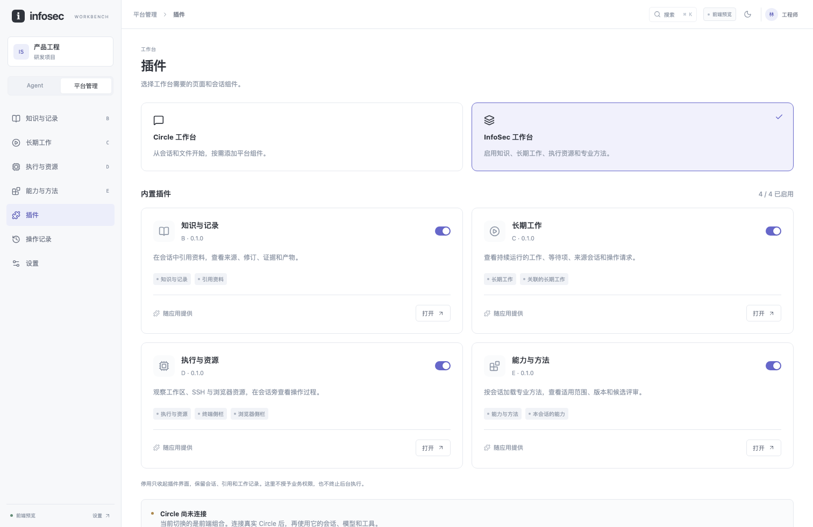
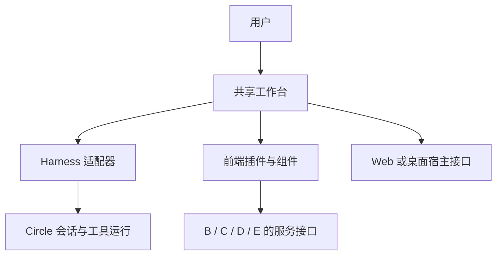

# 同一套工作台，组合不同的产品能力

2026-10-11 最新分工见 [ADR 0028](../decisions/0028-circle-server-split.md)：连接插件归 Circle 默认插件库，用户配置 server 地址并认证，管理运维归 circle-server。下面的完整平台组合保留为组件与合成样本；正式产品不再把企业管理页面全部放进普通 Circle。代码与发布安排见[双产品计划](../circle-server-plan.md)。

2026-10-11。用户认可现有前端方向，提出通过插件把它作为 Circle 的应用界面，并集成平台组件。本轮先实现可评审的前端组合；完整 Circle 连接、第三方插件协议和桌面宿主继续按提案推进。

## 用户会怎样使用

只需要与 Agent 工作时，打开 Circle 工作台：选择会话、发送消息、加入文件、查看上下文和工具输出。需要平台能力时，再启用相应插件。引用产品资料，就启用知识与记录；要跟进离开会话后仍继续的工作，就启用长期工作；要观察设备、SSH 和浏览器，就启用执行与资源。

这些可以组成同一个应用，也可以提供不同的默认组合。Circle 图形界面和完整 InfoSec 平台共享工作台，不需要分别维护两套聊天、弹层、主题和导航。

当前前端的“插件”页已有 Circle / InfoSec 两种组合，也允许单独启停四个内置插件。这里切换的是界面组合，Circle 本身尚未连接。停用插件不会删除已有会话、资料引用或工作记录，也不会停止任何执行。

[Circle 基础布局](assets/workbench-plugins/circle-composition.png)保留同一会话和已引用的资料，收起平台插件提供的入口。

## 各部分负责什么

| 部分 | 负责的内容 |
|---|---|
| 通用工作台 | 窗口布局、会话、输入、文件预览、原始工具结果、主题、搜索、通知和插件位置 |
| Harness 适配器 | 把 Circle 的会话、消息流、模型、工具、人工响应与中断状态接到界面；未来可以换其他 harness |
| 前端插件 | 提供页面、会话旁的面板、上下文组件、输入区操作及关联记录入口 |
| B/C/D/E 服务与能力 | 各自保存业务记录、执行强制检查与实际操作，插件只调用并显示结果 |
| 桌面或 Web 宿主 | 文件选择、下载及受限的本地能力；桌面进程、IPC 与浏览器会话接入另行实现 |

插件数量不等于运行对象数量。一个产品插件可以同时提供资料入口、专业方法和结果视图；B/C/D/E 的状态仍分别由原来的拥有者管理。同一个对象也可以有多个产品组件。所有页面的显示与交互仍属于 A，插件清单中的 B/C/D/E 标记说明它关联哪类业务对象。

这借鉴了 [Backstage 的前端插件与扩展注册](https://backstage.io/docs/frontend-system/building-plugins/index/)：插件提供页面或组件，应用负责组合。桌面、本地和远端的运行位置则参考 [VS Code Extension Host](https://code.visualstudio.com/api/advanced-topics/extension-host)区分。当前继续使用已有 React、Router、Radix 等组件，只实现与本工作台直接有关的组合接口，没有引入整套 Backstage 或 VS Code 内核。

## 当前前端已经实现的接口

[`Workbench`](../../packages/workbench-ui/src/workbench.tsx)接收数据适配器、宿主适配器和明确导入的插件列表。核心路由和侧栏根据注册结果显示页面；新页面不需要再加入一个写死的对象分支。

[`WorkbenchPlugin`](../../packages/workbench-ui/src/plugins/types.ts)声明标识、版本、接口版本、依赖，以及下面这些界面内容。

| 注册项 | 在哪里出现 |
|---|---|
| `pages` | 管理导航、页面路由与全局搜索的页面列表 |
| `panels` | 会话右侧的终端、浏览器等面板 |
| `contextWidgets` | 当前会话的能力、关联长期工作等组件 |
| `contextActions` | 输入区的“引用资料”等操作 |
| `recordPage` | 工具记录或上下文跳转到所属对象的详情 |

B/C/D/E 的四个页面和各自组件已经拆出原来的大管理页，作为内置插件注册。插件启停、组合选择和失效书签有明确反馈；原始工具输入输出始终留在会话里。

注册器检查重复标识、页面冲突、保留位置、接口版本、缺失依赖和依赖循环。启用依赖插件时补齐依赖，仍被使用的依赖不能直接停用。用户的业务权限由原有权限结果决定，插件启用状态不能授予读取或操作权限。

渲染错误由组件错误边界显示在发生问题的位置。它不隔离任意 JavaScript、异步事件、网络访问或文件能力。当前只支持审阅过、随应用打包的第一方插件，没有远程下载执行、插件市场或第三方沙盒。

当前 `WorkbenchGateway` 仍是同步的本地预览接口，包含合成的 A–E 数据。它不是已经冻结的通用运行 SDK。接真实 Circle 时，还需拆清会话通道与 B/C/D/E 客户端，并实现异步受理、事件重连和未知状态；这一步不会通过改一个插件名字来完成。

## Circle 当前可以提供什么

本轮只读核对了 Circle `1.0.4`，提交 `9b532727e4433f2d0fa6a0d222a4509daf7f15e4`，与当时远端 `main` 一致。当前 Circle 已是 TypeScript 实现。

- [RPC](https://github.com/qingshanfeihu/circle/blob/9b532727e4433f2d0fa6a0d222a4509daf7f15e4/docs/rpc.md)已有持续进程、消息流、继续输入、后续消息、中断、模型切换和会话读取，可以作为接入研究的起点。
- 同一文档明确：RPC 没有审批卡片回答通道，且不加载 MCP、扩展和自定义命令。[CLI](https://github.com/qingshanfeihu/circle/blob/9b532727e4433f2d0fa6a0d222a4509daf7f15e4/src/cli.ts#L589)以 `headless: true` 创建运行时，[初始化](https://github.com/qingshanfeihu/circle/blob/9b532727e4433f2d0fa6a0d222a4509daf7f15e4/src/runtime.ts#L729)在该模式直接返回，跳过这些集成的加载。
- [Circle 扩展](https://github.com/qingshanfeihu/circle/blob/9b532727e4433f2d0fa6a0d222a4509daf7f15e4/docs/extensions.md)可注册工具、命令、中间件、子 agent 和工具结果 renderer。其中 [renderer](https://github.com/qingshanfeihu/circle/blob/9b532727e4433f2d0fa6a0d222a4509daf7f15e4/src/extensions.ts#L196)返回文本行，不是 React 页面协议。

因此，一个完整集成包可以分别提供 Circle 的运行能力和本工作台的界面组件，通过版本与契约关联。前端启用一个页面不会自动安装或运行 Circle 扩展。实际接入需要补齐或选择合适的传输层，不能默认用 `--yolo` 绕过缺失的人工交互。

本轮没有修改或运行 Circle，没有读取真实会话、凭据，也没有调用模型。

## 接下来怎样推进

先在当前前端完成组件组合与用户评审，再接 Circle 的真实会话链。第一条真实链应覆盖发送与流式输出、工具输入输出、暂停/继续、人工问题与审批、断线恢复和同一会话重开。会话取消与 D 的远端停止继续分开记录。

B/C/D/E 的页面逐个替换预览适配器，保持各自的数据与权限拥有者。桌面宿主随后承载相同前端，补齐本地进程、受限 IPC 和同一设备浏览器会话的显示。独立发布第三方插件之前，再确定插件签名、版本兼容、信任、撤回和进程隔离。

[本轮检查记录](../validation/workbench-plugins-20261011.md)说明哪些已实际检查，哪些仍是接入计划。
