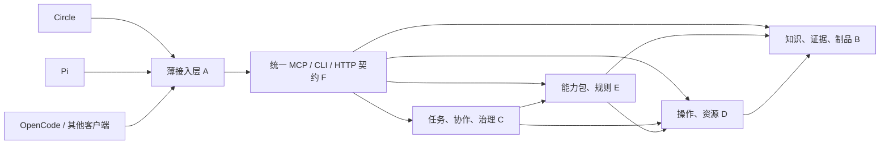

# 可替换 Harness 与四类平台对象的适配计划

日期：2026-10-10。状态：方向已由用户明确；下列接口、模块、能力协商与测试安排为提案，未实施。

2026-10-11 补充：Circle 默认插件库提供连接插件，用户配置 server IP/域名并认证；B/C/D/E 与管理运维归 circle-server，不另建插件项目或 Web 管理站点。代码同步与发布兼容见[双产品计划](circle-server-plan.md)和 [ADR 0028](decisions/0028-circle-server-split.md)。具体版本仍需核验，不能从插件清单存在推断连接已实现。

后续新增展示要求见 [ADR 0014](decisions/0014-operator-visibility.md)：Web 全过程实时可见；有浏览器面板时并排，普通终端可打开外部 Chrome。薄适配需关联 D 的同一执行会话查看页，不能把媒体附件/模型能读图片当成用户实时观看。布局和观察/控制能力须实际验证，详见[操作可见性计划](operator-visibility-plan-v1.md)。

## 1. 已确认的边界

A 是通用入口与 agent 运行职责。Circle 是当前候选客户端，平台也应能由 Pi、OpenCode 或其他满足接入条件的 harness 使用。保留 Circle 不表示产品平台必须依赖 Circle。

B 知识/证据/制品、C 任务/协作治理、D 操作/资源、E 能力包/业务规则共同组成可复用平台能力。四类对象通过统一契约适配不同 A，不能每换一个 harness 就重写四套业务逻辑。

F 的契约、SDK/薄适配器和 G 的验证材料是横切工程，均不成为额外运行权威。五类是逻辑责任，不要求五个服务器。设备、浏览器、数据库、对象存储是资源或基础设施，并不是新业务对象。

图中 API 是 facade/契约，不持有第五套平台业务状态。其鉴权结果来自可信身份链；模型传入的用户名、tenant 或 scope 不能签发权限。

## 2. 四类对象向接入层提供什么

以下能力名只帮助讨论，不是冻结的 wire API 或已实现工具名。

| 对象 | 候选能力面 | 持有的状态与约束 |
|---|---|---|
| B | 查询/读取来源、固定快照、登记/读取证据与制品、查看引用与差异 | 产品/版本/scope、六类知识记录、原件身份、不可变快照与制品修订；不信任模型自报来源 |
| C | 创建/查询/接管任务、取得阶段、提交人工响应、请求取消、检验交付 | goal/task/run/actor 与依赖、授权/预算、输入修订、完成准入；聊天结束不自动完成任务 |
| D | 发现目标/能力、取得资源、提交/查询/核对操作、请求停止、读取现场回执 | device/browser/workspace/session、lease/fencing、operation/attempt、进程和副作用；断连不表示停止 |
| E | 枚举/读取能力包、解析脑图/用例、生成/检查 IR、评审/编译/报告、执行版本化方法 | 规则/skill/workflow/程序版本和适用范围；专业判据不由通用任务服务临时编造 |

E 的算法可以在受 D 管理的 worker 中运行；这不改变其规则归属。B/C/D/E 可以先模块化同进程，按资源与故障边界再决定哪些 worker 独立。

## 3. 最小共同契约

| 部分 | 计划必须表达的内容 |
|---|---|
| 身份与范围 | 可信 principal/tenant/scope 与授权引用；客户端只可选择授权范围内的 task/target，不能自行扩权 |
| 绑定输入 | 输入原件与 SHA、产品/版本、knowledge snapshot、规则/能力包版本、目标身份与环境修订 |
| 独立身份 | conversation 与 task/run、operation/attempt、resource/lease、artifact/evidence 不混用；允许跨 harness 引用 |
| 操作作用 | 读取/修改对象、远端与本地写入、资源占用、传输与可重试条件；不能只用 readOnly 一项提示 |
| 持久任务 | 提交后取得 handle；status/result/input/cancel/reconcile 分开；服务持久受理后才返回受理成功 |
| 结果与错误 | 受理、执行结果、业务验证、交付状态分别表达；failed/unknown/partial/not-run 等不压成单一 success |
| 证据与制品 | 引用到不可变内容、输入、run、target 和相关时间；原始 bytes 保留，摘要与裁剪不替代原件 |
| 人工决定 | 对应请求 ID、输入修订、决定者身份和作用范围；过期或重复响应不能推进新修订任务 |
| 兼容与能力 | schema/API 版本、可用能力和限制；不支持的字段/媒体/流程显式处理；同一语义只有一个业务实现 |

这些字段由拥有者进行运行时检查；TS 静态类型只是开发辅助。目标是降低误解与幻觉进入执行路径的机会，不作“类型化即可消除幻觉”的承诺。

## 4. 接入机制

| 路径 | 提案 | 需要验证的边界 |
|---|---|---|
| MCP | 使用官方 TS SDK；共享 schema 暴露 tools，客户端支持时暴露 resources/媒体与 Tasks 扩展 | 以实际协商版本为准；不假设所有客户端支持资源、Tasks、结构化结果或相同认证 |
| CLI | TS 客户端提供参数化命令、稳定 JSON 结果、退出码与证据 URI；stdin/file 承载复杂输入 | 对没有 MCP 或自动化模式有限制的 harness，仍访问同一后端。stdout 不混入进度 prose；不同失败语义不能丢失 |
| HTTP / SDK | 为无交互程序、测试、界面和 TS 适配器提供统一业务面 | 与 MCP/CLI 消费相同 B/C/D/E 实现和强制检查；不是旁路 |
| Skills | 共用专业说明、资源与版本清单；从 B/F 取得所需资料 | 每个 harness 的发现、加载、信任和附件行为需薄适配；skill 文案不保存凭据或长期状态 |
| Hook / extension | 映射输入、人工响应、进度、媒体和句柄；保存本地 task 引用 | 可观察、可阻断、最终通知不是同一种事件。客户端 hook 不承担唯一授权/发布/完成边界 |

stdio 代理可由 harness 启动，但平台任务与远端操作生命周期不能绑在代理进程上；代理退出表示客户端断开，管理员停止平台服务是另一种动作。真实 D 的资源/运行状态仍需核对。

当前客户端事实与来源见[同类项目调研](research/comparable-platforms.md#2-harness-接入的当前事实)。Circle 自动化模式的 MCP 限制可先用 CLI/薄扩展适配，不要求本轮修改 Circle。各路径具体包版本在实现议题确定。

## 5. 三档兼容性与降级

1. **最低接入**：能执行平台 CLI 或调用普通 MCP tools，携带 task/operation 引用并读取 JSON；通过 submit/status/result/input/cancel 支撑长任务。没有图片能力时可做结构化 Web 操作与接管，不能宣称具有视觉判断。
2. **完整交互**：原生工具、资源、媒体、人工输入与进度呈现；适配器保留原结果/证据，展示不改变权威状态。
3. **增强接入**：支持 Tasks 扩展、通知或专属 UI 事件时减少轮询、改善体验；不能成为 B/C/D/E 的必需业务语义。

不满足最低条件的客户端应清晰拒绝相应能力。所谓可替换是平台语义和状态可复用，不是所有 harness 的 UI、模型和媒体质量完全相同。

## 6. 必须证明的更换实验

- 固定同一平台版本、产品快照、能力包、样本与预算。Circle/Pi/OpenCode 各完成五条基础链，逐条记录其实际路径与能力限制。
- Circle 提交任务后退出，Pi 通过相同 task ID 在授权范围内查询/接管；Web 登录会话、设备租约、任务阶段、制品与证据留在原拥有者。OpenCode 再查询和交付。
- 更换客户端不重复提交已受理操作、不重新利用失效租约、不遗失待人工输入、不把模型结束信号当任务完成。
- 普通 tools/CLI 与支持 Tasks 的路径产出相同业务状态；任务 TTL 或 MCP handle 到期不能默默删除平台记录，需定义映射及重新获取方式。
- 一方以无权用户接管、伪造 receipt、引用错误输入或请求已过期目标，应被同一服务端边界拒绝；断网或取消结果未知时保持可核对状态。

只有官方 MCP 测试客户端通过，最多证明协议链通；配置文件或 schema 存在也不证明三种 harness 都可用。真实客户端 smoke、跨客户端接管、实际效果与模型质量分别验收。

## 7. 计划中的工程资产

候选资产为 shared contracts/TS client、MCP facade/CLI、B/C/D 核心模块及 workers、E 产品能力包、多 harness 薄适配、独立验证样本和回执。可先单仓组织；这里不创建目录、package 或服务。

任何被保留的历史功能都需映射到 A–E；F/G 只提供公共材料。无法放置的行为先审查职责，而非增加“万能 server”。与完整迁移的验收规则见[基础验证计划](foundation-validation-plan.md)。
