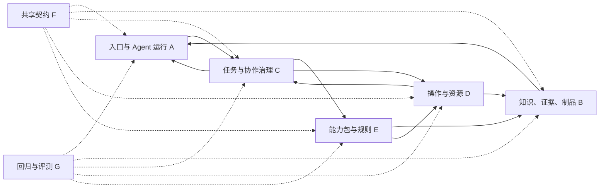

# 运行对象与能力归属 V1

2026-10-11 补充：B/C/D/E 由 circle-server 承担，用户通过 Circle 默认连接插件访问；server 的后台 Agent 与管理界面仍属于 A 的运行/交互职责。名称和部署位置不改变下列状态拥有者，见 [ADR 0028](decisions/0028-circle-server-split.md)。

日期：2026-10-10。

状态：按用户要求，对名下项目完成源码盘点后形成的职责基线；不是已经完成 TS 重写或部署的声明。

调研见[项目能力审计](research/project-capability-audit.md)，逐项依据见[CSV 清单](research/inventory/capability-catalog.csv)与[结构化清单](research/inventory/capability-catalog.json)。决策见 [ADR 0004](decisions/0004-runtime-object-boundaries.md)。

## 1. 调整原五类建设对象

原分类混合了运行对象与工程资产。“新 TS 平台服务”同时含知识、任务和身份；“共享契约与评测工程”则不是与服务器同一性质的运行对象。

V1 保留五类运行职责，单列两类横切工程：

| ID | 对象 | 负责的权威状态/规则 | 不应承接的权威 |
|---|---|---|---|
| A | 入口与 Agent 运行 | 可替换 Circle/Pi/OpenCode 等 harness、其他入口、原始会话、模型调用、上下文投影、技能加载与局部交互 | 产品事实、长期任务完成、远端实际停止 |
| B | 产品知识、证据与制品 | 来源修订、实体/声明/判断、证据、知识快照、制品身份/版本/发布指针 | 聊天线程状态、设备活跃连接、模型自报完成 |
| C | 任务与协作治理 | 目标、阶段/依赖、运行与交接、人工决定、身份/租户/政策、完成准入与业务审计 | 产品业务判据、设备是否真实空闲、知识推断真假 |
| D | 操作执行与资源 | 工作区/设备/浏览器/外部系统操作、实际进程/连接、租约和防陈旧令牌、现场回执 | 产品规范、模型结论、上层任务是否完全交付 |
| E | 能力包与业务规则 | 专业 skills、编译/分析/报告算法、产品适配规则、领域验证、业务流程模板 | 通用运行事实、凭据、全局知识原件与快照 |
| F | 共享契约与基础库（横切） | 共用类型、协议、身份/错误/回执格式、兼容策略与 SDK/适配器生成 | 独立的业务任务或“包办所有验证”的服务 |
| G | 验证、评测与实验（横切） | 复现样本、回归、协议对拍、故障实验、质量/成本/延迟测量 | 生产运行中的审批、判据或完成权威 |

ID 标记逻辑职责，不是七个必须独立部署的进程。单个用户入口、CLI 或 MCP facade 可以组合多个对象，但其内部状态和规则的写入者要清楚。

SSH 的具体展开见 [SSH 职责计划](ssh-responsibility-plan-v1.md)：显示组件/布局归 A，真实连接/输出流/控制权归 D，授权/接管决定归 C，产品命令/模式/判据归 E，资料/证据归 B。查看页和流服务前后端应分别归属，不能因都叫“终端”而合并成新的运行权威。

## 2. 原分类到新分类

| 原建设对象 | 本轮决定 |
|---|---|
| Circle | 成为 A 的既有候选实现；Pi/OpenCode 等可替换，Web/消息入口也属 A。Circle 保留，平台不绑定它 |
| 新 TS 平台服务 | 拆清 B（知识/证据/制品）和 C（任务/协作/治理）的职责，物理部署可先同进程 |
| 新 TS 执行网关与 workers | D；worker 进程中运行的专业算法仍由 E 定义 |
| 新 TS 产品扩展包 | E；其中通用契约提取到 F，harness 薄接入留 A，真实外部操作归 D |
| 共享契约与评测工程 | 分为 F 与 G，作为横切工程，不再充当第五个万能运行对象 |

与知识库 V1 的六类记录是不同维度。SourceRevision/Evidence/Entity/Claim/Assessment/KnowledgeSnapshot 仍属于 B 的知识模型；任务、会话和执行事件按对应职责持有。

## 3. 单项能力的分类依据

按该项能力的目的、负责修改或生产的状态、实际作用、输入来源和消费方分类，不按仓库、目录、名称前缀、MCP 包装、skill 文件格式或 read_only 提示分类。

分类记录包含主归属、协作对象、是否需要拆职责、源码提交/行号和未执行验证的边界。协作依赖不自动表示代码有缺陷，也不要求拆成很多新服务。

程序负责能在已绑定材料、规则、身份和范围内确定的结构/核验/执行。语义理解交给 Jev/LLM，并保留判断依据与未知。使用模型不增加一个运行对象：问题内容由 B/E 定义，通用推理适配由 A/F 提供，授权和预算在 C 的范围内。

## 4. 必须区分的状态空间

- 会话：A 的 conversation/thread/checkpoint，保存模型和工具交互原始历史。
- 任务：C 的目标、阶段、交接、运行与完成状态。
- 执行：D 的 operation/process/device/browser session/lease；实际存活与副作用以执行端为准。
- 知识/制品：B 的 source revision/snapshot/artifact/assessment 与发布指针。

不同层次可以互相引用，不能因为都叫 session、task 或 status 就共用一套身份和终态。“本地调用被取消”“远端收到取消”“进程已经停止”“任务仍未交付”分别表达。

## 5. 重要边界裁决

### 编译与流程

块语言、Excel 结构、命令/来源规则、判据和语义方法归 E。C 承载阶段、重试、并发、人工响应和收口；D 执行；B 保存原件、证据和产物。compile_engine_run、svc_* 可保留为组合 facade，不能把专业规则全部写进通用任务内核。

### 知识与记忆

会话 checkpoint 和私有项目工作记忆以 A 的上下文需求为主；产品知识与可复用证据进入 B。C 提供身份与范围。个人记忆不会默认变成跨用户共享产品事实。remember 等组合入口需要明确写入对象和适用范围。

### 验证器

| 检查 | 规则/职责归属 |
|---|---|
| schema、协议、身份格式 | F 提供共用契约，各拥有者执行 |
| 来源/哈希/索引闭包、知识发布 | B |
| 任务准入/状态/完成闭包 | C，消费 E 与 D/B 的结果 |
| 权限最终核对、租约、现场执行前检查 | D/B 等副作用端执行，政策来源 C |
| 产品语法、判据、覆盖和编译 | E |
| 上述机制的回归/对拍/故障注入 | G |

运行中的 compile_lint、机械提交检查或返工规则不能因含“验证”就归到 G。评测代码也不能未经适用范围检验变成生产故障归因逻辑。

### MCP 与接入

MCP/HTTP/RPC/CLI 是暴露方式。通用协议/schema 层由 F 提供；A 接入/显示；B/C/D/E 分别持有真实业务语义。三套设备 MCP 应收敛到 D 的操作契约，不能按三个旧服务器分别复制成三个新权威。

不同 harness 只需薄适配，不复制 B/C/D/E。Tasks/资源/媒体/hook 支持需逐项协商，最低兼容路径与跨客户端接管见[harness 适配计划](harness-adaptation-plan.md)。

### 效果与只读

声明只读可能只是相对于远端业务配置；工具仍可能连接设备、占用租约、写本地缓存或收据。F 的操作描述要表达目标、读取/写入范围、资源占用和外部作用；C/D 根据实际操作核对。不能只拿旧 effect/read_only 标量作为完整授权依据。

### 报告与外部交付

E 定义报告的专业内容与规则；B 持有产物/链接身份；C 关联任务、授权和交付记录；D 执行云文档或文件传输；A 显示和接收反馈。report_to_doc、qa_file_server 等入口可组合调用，但报告已生成不证明外部用户已收到。

### 可观测性

A/D 生产技术事件；C 关联审计、身份与运行；B 保存被引用的证据/原件；A 展示。Langfuse 等技术 traces 不自动成为任务交付证明，产品根因仍需 E 的判断与具体依据。

## 6. 协作链

E 可以在 A 的本地能力包、C 的流程步骤或 D 的隔离 worker 中执行；位置不改变规则所有权。

## 7. 已发现的能力空缺

本轮现有源码中尚未看到完整的通用浏览器 worker、企业级长期目标服务、统一操作/证据/版本契约、产品商务与报价专门模型、产品代码/架构关系服务，或完整的网络产品发布/升级/回退服务。

已有 Web Terminal/文件 HTTP 接口/门户扫码不等于浏览器多模态操作；已有项目自身 release workflow 不等于网络产品研发发布链。上述是本次已扫描来源内的缺口，不是对所有部署或外部系统的不存在证明。

新能力按 A–E 和 F/G 放置，后续继续逐项设计；知识库 V1 的存储、六类记录和快照发布不因本轮调整而重置。

## 8. 重写与验收

Circle 的实现保留。相关非 Circle 自研能力按新职责用 TS 全新实现，不包装旧 Python 运行链。circle-next 已归档，属于行为参考，不作为第二个活跃 Circle 维护。

ADR 0005 记录最初仅做计划的范围；后续已有 P1/P2 的契约和最小纵切记录，见 [P2 计划](p2-vertical-slice-plan.md)。本轮继续讨论 C/D/E，只做文档并发布；Circle 与知识库不展开。五条最低功能链与全部历史行为的独立验收见[基础验证计划](foundation-validation-plan.md)，当前范围与源码检查见 [C/D/E 讨论稿](cde-implementation-discussion-v1.md)。已有参考实现不代表对象职责已全部实现或真实环境已通过。

每项以原输入、正确行为、已知缺陷和边界样本确定验收。G 负责验证方法；权威运行检查仍落在 B/C/D/E。接口暴露、定义数量、schema 正确或旧测试记录，都不代替新实现实际效果验证。
