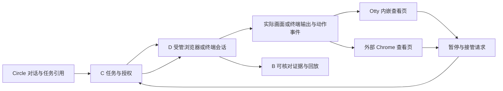

# 操作过程可见性与入口适配计划 V1

日期：2026-10-10。状态：用户已明确实时可见性和两种入口布局，见 [ADR 0014](decisions/0014-operator-visibility.md)；下面的显示/会话契约、组件与暂停接管是实现提案，未实施。

用户要求 Circle 发起 Web 操作时，人能看到整个实际操作过程；Otty 这类有浏览器面板的环境可并排显示，普通 Windows 终端可打开 Chrome。显示是平台交付能力的一部分。知识库沿用原设计；本轮扩展 A 的薄展示契约，不修改 Circle 核心或安装/启动展示服务。

设备管理范围采用 SSH 与 Web，见 [范围修订](decisions/0021-ssh-web-interaction-scope.md)。SSH 的 A–E 与 F/G 逐项归属、前端/流服务拆分和控制权边界见 [SSH 职责计划](ssh-responsibility-plan-v1.md)；用户入口与对象通信见 [交互讨论](user-interaction-and-object-communication-v1.md)。

## 1. 当前检查与缺口

- 平台检查基线 [`72a7e45`](https://github.com/qingshanfeihu/infosec-platform/commit/72a7e45)：[P2-6](p2-6-v03-record.md) 明确采用 HTTP 流程级，未运行浏览器，没有实时页面展示。HTTP 分类不能证明人已看到真实浏览器操作。
- Circle 本地与远端 main 核对为 [`f7ac6b03f326d717863dd55a74061923d9ec9910`](https://github.com/qingshanfeihu/circle/commit/f7ac6b03f326d717863dd55a74061923d9ec9910)。[扩展 renderer](https://github.com/qingshanfeihu/circle/blob/f7ac6b03f326d717863dd55a74061923d9ec9910/docs/extensions.md#renderers) 返回文本行；[Markdown 图片分支](https://github.com/qingshanfeihu/circle/blob/f7ac6b03f326d717863dd55a74061923d9ec9910/src/ink/components/markdown_renderer.ts#L88) 显示图片文本引用；[MCP 媒体](https://github.com/qingshanfeihu/circle/blob/f7ac6b03f326d717863dd55a74061923d9ec9910/docs/mcp.md)是模型附件。所检查路径未证明实时浏览器视图已存在，不能把模型能读图片当作用户能看完整操作。
- 本轮没有运行 Circle、Otty、Chrome、浏览器/设备或实际流式实验；Otty 的面板打开 API、Windows 启动/聚焦以及传输延迟仍未验证。

## 2. 同一执行会话，两种显示布局

| 用户环境 | 计划中的显示方式 | 与执行端的关系 |
|---|---|---|
| Otty 或具有浏览器面板的终端 | Circle 对话与平台实时查看页并排；入口适配器关联当前任务并打开面板 | 面板消费 D 的实际会话画面与事件，不能另开登录来代替正在执行的会话 |
| 普通 Windows/其他终端 | Circle 显示任务/会话引用，同时打开外部 Chrome 等浏览器中的实时查看页 | 使用同一查看契约与 D 会话；不依赖终端具备图形浏览器能力 |
| 本地执行机具备图形桌面（可选优化） | 可直接显示 D 启动并控制的专用真实浏览器窗口 | 仍登记同一会话、控制权和证据；不能任意连接用户正在使用的个人浏览器资料 |

建议共同提供受控 `viewUrl`：它打开平台会话查看页，显示受管浏览器实际渲染结果。查看页可以嵌入已有面板或由 Chrome 打开。它与设备管理地址分别表示，不能让用户在另一浏览器重新登录后宣称共享了 agent 会话。URL 本身不签发设备控制权，权限由平台可信登录和当前授权核验。

## 3. D 产生实际画面，A 关联并显示

A 负责发现显示能力、打开/重新关联查看页、显示任务与操作状态；D 持有浏览器/终端和真实输入出口；C 校验观察/接管主体及任务范围，协调控制权；B 保存证据修订；E 定义页面/CLI 方法和业务核验。查看页属于 A 的交互资产，不增加第六类运行权威。

### 浏览器显示候选

本地可评估 Playwright 有界面的浏览器（`headless: false`），见 [launch API](https://playwright.dev/docs/api/class-browsertype#browser-type-launch)。远程建议优先评估独立图形会话 + 受管浏览器 + 现成远程显示客户端，例如 [noVNC](https://github.com/novnc/noVNC)：它提供浏览器中的 VNC 显示，需对应 VNC/WebSocket 服务。noVNC 不是 Playwright、任务系统或权限服务，接入、控制权和授权仍由平台实现。

每个任务的图形显示需隔离，不能只隔离 BrowserContext 却让查看者看到同桌面的其他任务窗口。打开查看页前可以完成会话初始化，但从第一条实际 Web 操作（包括登录）开始，画面与动作时间线就应可见。持续呈现导航、输入、点击后页面变化、加载、弹窗、失败、下载与清理；必要时标注动作目标和当前步骤。截图/DOM 摘要可补充定位，录屏与 trace 支持事后复查，均不能替代实时显示。

显示连续性记录最近画面时间、连接状态及缺帧/断流区间。播放旧帧时明确标为陈旧，不能继续显示“实时”。实时显示的延迟、帧率和丢帧容忍在隔离实验中测量后冻结，不先承诺未经测试的数值。

### SSH 显示候选

SSH 会话提供实时终端视图：命令、输出、登录/模式/分页和连接状态与实际执行一致，可评估 [xterm.js](https://xtermjs.org/) 作为浏览器终端组件。显示端附着原会话，原始收发与可显示文本分别记录，敏感输入不进入普通历史。

当前仅讨论 SSH：终端组件/布局/打开方式归 A，真实连接/输出流/输入出口归 D，授权与接管决定归 C，产品命令/提示符/模式和判据归 E，证据归 B。具体输入控制在 D 服务端检查。

## 4. 查看、暂停与人工接管（提案）

默认允许获授权用户观察；自动操作与人工输入有唯一控制者。用户请求暂停后，D 停止派发下一动作并核对当前动作，不能把界面停止播放当成设备操作停止。已提交的配置/网络请求按实际状态对账。

接管流程建议：C 核验身份和范围 → D 将自动执行推进到可交接位置 → 对未决动作核对 → 服务端切换控制者/令牌 → 人工在原会话操作 → 交回后重新检查设备/页面/配置状态，失效的后续步骤重新规划。仍持有同一任务的设备写租约，控制主体变化不允许 SSH/Web 双写。

[noVNC 的 viewOnly](https://novnc.com/noVNC/docs/API.html) 只限制该客户端发送键鼠事件。只读和控制者检查必须在服务器输入出口强制执行，不能把前端按钮或属性当作权限边界。本地真实窗口的直接人工点击也需可检测、协调的接管路径；若候选技术无法阻止自动与人工同时输入，该模式只能先做有明确限制的演示，不能宣称完整接管通过。

显示关闭、Circle 退出、浏览器进程死亡和设备操作停止是四种不同事实。对于要求现场可见的任务，查看链路失效应暂停下一配置写动作、报告缺口并等待恢复/明确的后台执行决定；已发生作用保留并核对。查看就绪只证明显示链路成立，不证明人实际看了每一帧，也不是业务正确性签字。

## 5. 候选显示契约（未冻结字段）

| 内容 | 需要表达的约束 |
|---|---|
| viewId、taskId、runId、resourceId、sessionId | 指向同一实际会话和任务，跨窗口/入口重新关联，不凭页面标题识别 |
| kind、viewUrl、displayCapabilities | 浏览器/终端/日志等类型；嵌入/外部窗口、观察/控制能力按实测协商 |
| currentOperation/step、event sequence、observedAt | 动作与画面关联、重复事件去重、画面时效和断流披露 |
| controller、controlRevision、pending handover | 当前控制者、暂停/交接结果；陈旧输入在 D 拒绝 |
| liveState、historyRefs、gaps | 实时连接与历史证据分开；录屏、trace、输出索引和完整性缺口可核对 |

复用已冻身份/错误词表；本稿不增加新的 wire 状态枚举或绕开六调用。上述显示字段和操作面应在 F 契约冻结时确认。凭据、cookie 和 MFA 不放入查看链接、模型上下文或 Git；展示与留证范围分别核验，秘密输入区按通道处理。

## 6. 验收提案（全部待执行）

| ID | 必须观察的行为与证据 |
|---|---|
| VIS-01 同会话 | 从 Circle 发起，查看页与 D 的 sessionId/目标一致；看到的字段变化对应实际操作，另开登录不能代替 |
| VIS-02 两种布局 | 固定 Circle/Otty/Chrome/OS 版本；Otty 并排与 Windows 外部 Chrome 分别跑完整可见 Web 配置链 |
| VIS-03 全过程 | 登录前到结束清理均有实时画面与动作时间线；导航、表单、弹窗、加载和失败可见；断流如实标注 |
| VIS-04 控制交接 | 暂停后不派发新动作；原会话人工接管/交回无双输入；未完成副作用核对，不凭按钮状态判停止 |
| VIS-05 隔离与范围 | 两任务不串画面、终端、cookie 或控制权；越权查看/接管和旧控制令牌在服务端拒绝 |
| VIS-06 恢复 | 查看页/Circle 关闭后重新打开仍关联原会话；进程死亡和设备连接中断分别记录，不以 viewUrl 存在猜会话存活 |
| VIS-07 SSH | 在原 SSH 会话实时看到发送和输出；验证分页/模式、断连及人工交接，显示端不另开设备连接 |
| VIS-08 回放与真实效果 | 实时画面、动作、recording/trace/终端输出绑定同次运行；缺口披露；配置读回和业务判据另验收 |

VIS-01/02/03 为本轮新增可见性要求的验收方向，其余为实现与接管的配套提案。最低 MCP/CLI 能力仍能访问结构化状态，但 Web 任务没有可用实时显示时，不能称满足本用户的完整 Web 使用要求。P2-6 HTTP 结果不关闭本表，也不关闭已有 V03 浏览器/多模态验收。

## 7. 本轮产物与仍待讨论

本轮只做源码/记录阅读、官方资料查阅、文档与 GitHub 记录。未改 Circle 或平台业务代码，未安装依赖、启动显示服务或打开实际设备页面。浏览器/远程显示/xterm.js 具体版本、Otty 打开面板接口、Windows 启动适配、显示性能、同会话控制交接及录制完整性都未验证。

已确认：全过程可见；支持 Otty 并排和外部 Chrome 两种布局。待定：显示组件、打开方式、统一字段、暂停/接管机制和可见任务断流策略。相关：[C/D/E 讨论](cde-implementation-discussion-v1.md)、[适配计划](harness-adaptation-plan.md)、[五链验收](five-chain-acceptance-v1.md)。
