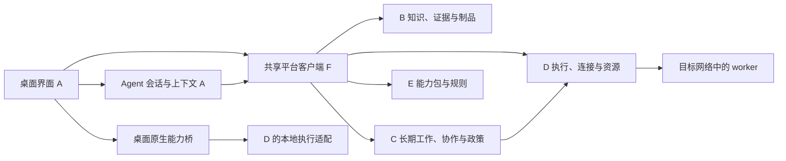

# 参考 ZCode 建设桌面框架

2026-10-10。用户提出桌面优先、参考 ZCode 的方向。本轮取得官方源码并做静态检查；Electron/React、具体复用范围与 Agent 运行时仍是方案建议，没有安装依赖、启动 ZCode 或验证桌面功能。

## 结论

ZCode 值得作为桌面框架的具体参考。它包含原生宿主、会话界面、Host、Agent 运行时、终端、嵌入式浏览器和远程连接，符合 A 是 harness 的方向。我们的桌面客户端应承载持续会话、上下文、模型和工具交互，同时提供 B/C/D/E 的观察与管理；客户端窗口不接管四个对象的业务状态。

建议先以固定源码基线做派生验证，确认能单独保留的桌面和 harness 部分，再确定正式复用清单。当前不把整套 ZCode 直接定为生产依赖，也不复制另一套产品任务系统。前一轮五个方案只是布局研究，桌面承载方式与具体布局选择分开。

## 已核对的源码

官方仓库：[zai-org/ZCode](https://github.com/zai-org/ZCode)。本轮固定提交 `aac4755666d09fdcd70272fcf063c077a639015f`，提交日期 2026-10-10，根 package.json 版本为 **3.15.1**。网络检索中的旧 README 摘要仍提到 3.14.3，因此本记录以本地固定提交为准。文件与内容摘要见[来源回执](zcode-evidence/source-receipt.json)。

| 源码部分 | 实际看到的结构 | 对我们的意义 |
|---|---|---|
| `packages/desktop` | Electron Main、Preload、Renderer、独立窗口 Host；包声明 Electron 41.0.3 | 可以借鉴窗口、IPC、进程与桌面资源的组织方式；这些是上游声明版本，尚未成为本项目依赖 |
| `packages/ui` | 共享 React UI、hooks 和 Zustand 状态；终端、文件、差异、聊天输入和侧面板 | 借鉴完整 harness 交互与设计规范，避免再次把工作类型堆成首页；UI 状态仍只是服务状态的投影 |
| `packages/shared/src/platform.ts` | `IPlatformService` 与跨端能力合同；浏览器操作绑定工作区、会话、页面和代际 | 桌面原生能力由明确接口提供，不能让普通 UI 直接任意访问本机或业务存储 |
| `packages/desktop/src/host` | 每窗口一个 Host，经 MessagePort 接界面，管理本地服务和远程连接注册 | 可参考连接与窗口生命周期；我们的长期工作不随窗口 Host 消亡 |
| `apps/zcode-cli` 与 Agent process manager | Agent CLI/运行时源码；桌面有 Agent 进程管理与 stdio 通信 | 桌面是 harness 的宿主，不只是网页包装；实际采用哪套运行时仍需要协议和行为验证 |
| `browserGuestManager.ts` 等 | 嵌入式浏览器 guest、控制命令、截图、录制、页面身份、恢复与释放 | 借鉴同一浏览器的观察和操作，映射到 A 显示与 D 实际会话；不把新开页面当作原现场 |

主要代码依据：[Host](https://github.com/zai-org/ZCode/blob/aac4755666d09fdcd70272fcf063c077a639015f/packages/desktop/src/host/index.ts)、[桌面宿主](https://github.com/zai-org/ZCode/blob/aac4755666d09fdcd70272fcf063c077a639015f/packages/desktop/src/main/desktopHostProcess.ts)、[平台接口](https://github.com/zai-org/ZCode/blob/aac4755666d09fdcd70272fcf063c077a639015f/packages/shared/src/platform.ts)、[浏览器](https://github.com/zai-org/ZCode/blob/aac4755666d09fdcd70272fcf063c077a639015f/packages/desktop/src/main/browserView/browserGuestManager.ts)、[设计规范](https://github.com/zai-org/ZCode/blob/aac4755666d09fdcd70272fcf063c077a639015f/DESIGN.md)。

## 桌面优先具体改变什么

用户打开独立应用，直接进入会话。文件、终端、浏览器和记录可以停靠、分屏或另开窗口；系统文件选择、快捷键、通知及窗口恢复由桌面宿主管理。B/C/D/E 的管理可以在同一应用中打开，也可以按人员职责使用专门窗口。

桌面 UI 可以继续使用 TypeScript/React。这里改变的是宿主能力、运行与交互方式，不要求把所有界面改写成系统原生控件。Web 可保留为补充查看或管理入口，但不再用浏览器页面作为桌面方案是否成立的依据。

## 映射到我们的五个对象



- **A**：会话、模型、上下文、工具/skill 加载、运行交互与用户干预。可以借鉴 ZCode 的前端、Host 与会话协议。A 的工作区和产品上下文允许补充和调整，不要求自然语言先填成任务表单。
- **B**：知识和产物由平台保存。桌面提供查询、引用、预览和维护入口；本地缓存不是另一份权威知识库。
- **C**：长期工作、授权、交接和完成仍在平台。ZCode 内部叫 task/session 的内容，需要按含义映射，不能直接替换成我们的 C。窗口关闭或 Agent 回合结束，不自动完成长期工作。
- **D**：文件/进程、SSH、浏览器与远端操作通过我们的执行合同管理。原生浏览器即使物理上运行在 Electron 中，其操作、身份与控制权仍属于 D；界面归 A。本地与远端 worker 都要核验当前授权和租约。
- **E**：专业能力从平台方法与版本记录加载。客户端可编辑、验证、启停或发布获准的方法；加载到会话不等于发布版本。

桌面 Main 负责窗口和原生桥接，不新增一套 C 的状态机。Renderer 不直接读写数据库或持有设备管理凭据；Agent 的工具出口也不能绕过 B/D/E 的权限检查。仍以现有 [A–E 基线](../object-boundaries-v1.md)和[权限设计](../design/identity-and-security-boundaries.md)为准。

## 第一版框架的建议结构

下面是拆分建议，不是已经生成或运行的包。现有 contracts、platform-pg、execution 等继续作为已存在的实现与验证材料，不因目录草案而搬迁。

```text
桌面客户端
├─ main       窗口、原生菜单、文件选择和进程监督
├─ preload    受限且有类型的桌面能力桥
├─ renderer   A 的会话界面，以及 B/C/D/E 的管理视图
└─ host       会话与运行时接入、服务连接、事件和恢复

共同接入层
├─ 平台客户端       调用已有 B/C/D/E 合同，绑定可信身份
├─ harness 适配     关联会话、运行、工具与平台记录
└─ 本地执行适配     接入 D，管理本地进程与同一浏览器
```

界面首先复用成熟的会话阅读、输入、工具输出和面板交互；业务管理只在需要时进入对应对象。第一版框架的检查重点是进程和状态有没有接对：Renderer 崩溃不会丢掉已经受理的工作，窗口重开可以找回会话和远端操作，停止后的真实状态能够查询。

## 复用边界

优先评估会话/工具输出组件、编辑与附件输入、文件和差异预览、终端面板、桌面窗口及平台接口、浏览器身份与恢复机制。这些部分仍有跨包依赖，尤其 `packages/ui` 直接依赖 services/shared/provider，不能当作完全独立的 UI 库复制。

官方账号、套餐/支付、官方插件渠道、更新下载、遥测与反馈服务需要形成明确替换清单。它们不属于我们的 B/C/D/E。内置 Agent 的模型、工具、权限和恢复语义也需单独评估；不能因为外观合适就认定运行时兼容。

上游 [LICENSE](https://github.com/zai-org/ZCode/blob/aac4755666d09fdcd70272fcf063c077a639015f/LICENSE) 为 Apache-2.0，官方 [NOTICE](https://github.com/zai-org/ZCode/blob/aac4755666d09fdcd70272fcf063c077a639015f/NOTICE.md)明确第一方代码与第三方资源的条款分别处理。若实际复用代码，需逐项记录来源、修改与许可并保留相应声明；仓库名义许可不能替代原生二进制、字体、图标或其他组件的独立许可。

本轮还看到两项直接影响框架预期的事实：仓库的 Computer Use 包是不可用占位；官方说明不把普通工作目录、worktree 或共享 Agent 执行当成默认的操作系统沙盒。嵌入式浏览器有实现，并不证明系统级桌面自动化或执行隔离已经可用。上述均为源码/文档观察，没有实机验证。

## 建议的框架验证顺序

1. **固定派生与拆分范围**：记录基线，列出桌面、UI、Host、运行时和原生资源的依赖及许可；确定哪些保留、隔离、替换。
2. **启动独立桌面外壳**：使用独立应用身份和数据目录，打开真正的桌面窗口、会话区及 B/C/D/E 入口。验证窗口关闭、崩溃和恢复；不沿用用户真实 ZCode 数据。
3. **接一条真实 Agent 会话链**：经过选定运行时，验证自由输入、上下文、工具输出、等待、停止与继续。先用脚本模型验证协议，真实模型质量另外记录。
4. **接本地和远端执行**：同一浏览器的查看与操作、本地文件/进程、SSH、远端操作核对分别验证；关闭窗口不冒充远端停止。
5. **接四个对象与人员权限**：真实来源与版本、C 的持久运行、D 的执行出口、E 的加载和发布；跨人员、窗口和项目验证。再讨论安装包、升级、签名与分发。

这轮没有启动 `pnpm bootstrap` 或 `dev:desktop`。官方默认桌面开发命令使用生产服务配置；后续验证需先隔离配置、数据和连接目标。当前交付是源码研究和桌面框架方案，不是已建成桌面客户端。
