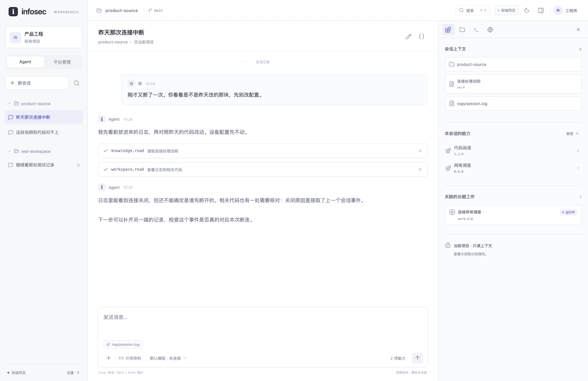

# 前端工作台首轮检查

2026-10-10。用户授权先搭建前端，用 Web 确定桌面工作台的外观与交互。本轮实现位于 [`packages/workbench-ui`](../../packages/workbench-ui/README.md)，界面仍待用户评审。

## 交付内容

前端已有可构建的 React / TypeScript 工程，包括应用布局、路由、公共组件、主题、响应式侧栏、数据接口、浏览器宿主接口，以及独立的合成数据适配器。Agent 保持持续会话形态；B/C/D/E 分别有管理页，也能由来源或工具记录直接进入。

主会话界面：

[深色会话](../design/assets/workbench-ui/agent-dark.png)、[知识管理页](../design/assets/workbench-ui/knowledge-dark.png)和[窄屏会话](../design/assets/workbench-ui/agent-mobile.png)使用同一套组件与样式。

## 实际检查

生产构建通过 TypeScript 类型检查和 Vite 打包。Playwright 启动隔离的 Chromium，读取构建产物，通过下列 10 个场景；没有浏览器控制台错误或未捕获异常。

| 场景 | 核对内容 |
|---|---|
| 页面与主题 | 会话和全部管理路由可以进入，浅色/深色截图可检查 |
| 自由会话 | 草稿、消息和改名经过切换与刷新后保留；任意输入不新增 C 的工作、不伪造 Agent 回复；输入按文字显示 |
| 资料修订 | 浏览旧修订不更改会话；主动加入后保留原有 rev.4 与新加的 rev.3 |
| 工具记录 | 输入和输出可展开，并打开 B 的关联来源 |
| 中断与执行 | 暂停 A 不变更 C/D；C 记录暂停请求后，D 仍保持原观察状态 |
| 会话能力 | 给选中会话加载 E 的能力，其他会话不变；刷新管理页仍保留目标会话；候选版本不能直接加载；无浏览器关联时不显示其他会话页面 |
| 本地附件 | 用户选择的文本保留内容；超过 256 KB 显示截断说明；刷新后可以查看 |
| 角色交互 | 观察员不能发送或请求暂停；平台运维看不到 B 的业务页面，仍可进入 D 的资源管理 |
| 搜索与终端 | 快捷键搜索进入对应资料；终端命令明确显示未执行 |
| 窄屏 | 390 × 844 下导航与上下文使用弹层，整页没有横向溢出 |

[机器回执](workbench-ui-20261010.json)保存实际浏览器版本、时间、场景名称和源码/构建文件 SHA-256。截图是合成数据。另在用户的 Otty 窗口打开了构建预览，确认真实窗口显示会话与输入区；开发服务器的热更新页面没有计作 Otty 验证通过。

检查期间修正了管理页返回错误会话、管理页刷新丢失选中会话，以及无浏览器关联时仍显示样例浏览器的问题。对照场景检查这些实际影响，不以按钮能点击代替通过。

## 仍需独立完成

真实 Agent 与模型流、B/C/D/E 服务接入、服务端鉴权、SSH/浏览器实时会话、Electron 主进程与宿主均未由本轮实现。当前角色由预览设置切换，本地记录也可由浏览器用户修改，不能当作安全强制边界或正式审计。

浏览器检查没有重跑其他包的既有验证，没有访问真机或业务资料，没有发布桌面安装包或部署站点。图形方案、人员权限模型和完整产品工作仍各自需要验收。
